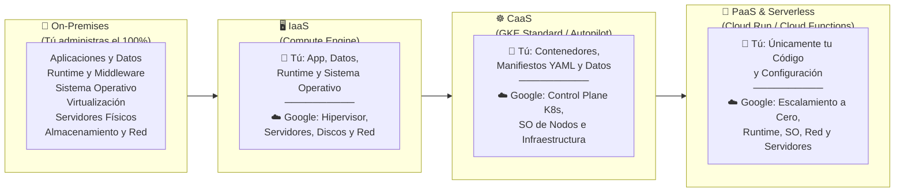
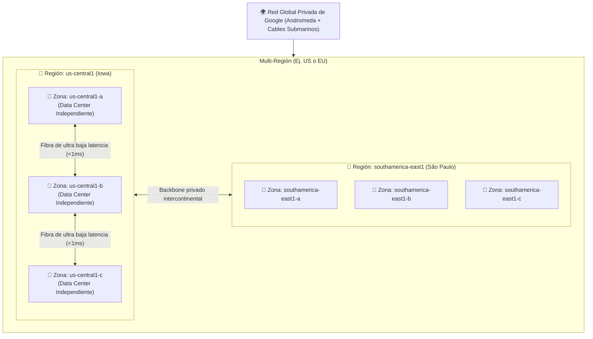
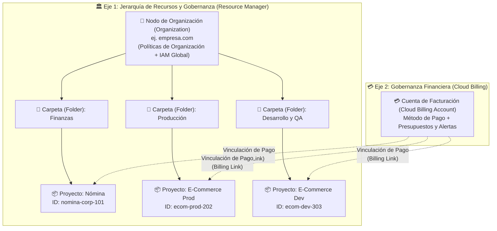
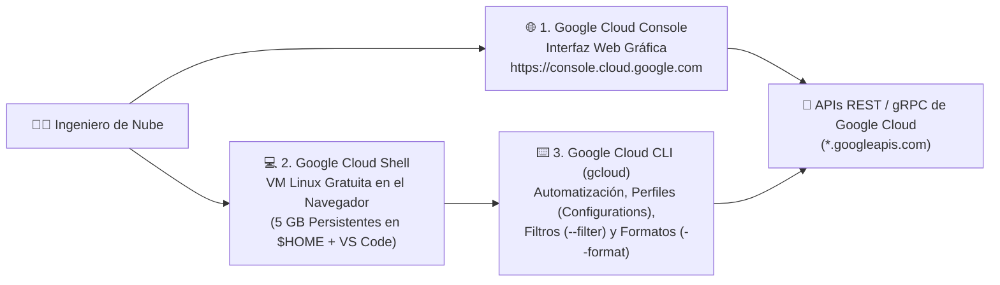

# Playbook 01: Introducción a Google Cloud Platform, Gobernanza, Jerarquía de Recursos y Herramientas de Gestión

## 1. Principios de Cloud Computing: Del Centro de Datos Físico a la Nube

Antes de sumergirnos en los comandos y servicios de **Google Cloud Platform (GCP)**, es fundamental comprender los principios económicos y arquitectónicos de la computación en la nube (*Cloud Computing*).

### 1.1. Las 5 Características Esenciales del Cloud Computing (Estándar NIST)
1. **Autoservicio bajo demanda (*On-demand self-service*)**: Un ingeniero aprovisiona servidores, redes o bases de datos mediante una API o consola en segundos, sin depender de tickets manuales ni esperar semanas a un proveedor de hardware.
2. **Acceso amplio por red (*Broad network access*)**: Los servicios están disponibles desde cualquier lugar a través de protocolos estándar seguros.
3. **Agrupación de recursos (*Resource pooling*)**: El proveedor de nube agrupa enormes cantidades de hardware físico para servir a múltiples clientes de forma aislada y segura (*multi-tenancy*).
4. **Elasticidad rápida (*Rapid elasticity*)**: Los recursos crecen horizontal o verticalmente en segundos cuando hay picos de demanda (*Scale Out*) y se contraen —incluso hasta cero— cuando la demanda desaparece (*Scale In*).
5. **Servicio medido (*Measured service*)**: Todo consumo (segundos de CPU, bytes de red, gigabytes almacenados) se mide con telemetría transparente. Solo pagas por lo que utilizas.

### 1.2. Cambio de Paradigma Financiero: CAPEX vs OPEX
- **CAPEX (*Capital Expenditure* — Gasto de Capital en On-Premises)**: Comprar servidores físicos por adelantado ($100,000 USD), alquilar un centro de datos, pagar aire acondicionado y asumir el riesgo de que los servidores queden subutilizados o se vuelvan obsoletos en 3 años.
- **OPEX (*Operational Expenditure* — Gasto Operativo en la Nube)**: Cero inversión inicial en hardware; pagas una factura mensual variable directamente proporcional al tráfico y uso real de tu negocio.

---

## 2. Modelos de Servicio en la Nube: IaaS, CaaS, PaaS, Serverless (FaaS) y SaaS

La computación en la nube se divide en capas de abstracción. A medida que avanzas de **IaaS** hacia **PaaS** y **Serverless**, **delegas más carga operativa a Google Cloud** para concentrarte exclusivamente en la lógica de negocio y los datos de tu aplicación.

### Comparativa Detallada de Modelos de Servicio en GCP

| Modelo de Servicio | Significado | ¿Qué administra el Ingeniero? | ¿Qué administra Google Cloud? | Servicios Representativos en GCP |
| :--- | :--- | :--- | :--- | :--- |
| **IaaS** (*Infrastructure as a Service*) | Infraestructura como Servicio | Sistema operativo invitado (Linux/Windows), parches, firewall, discos y aplicación. | Centros de datos físicos, red global, almacenamiento físico e hipervisor KVM. | **Compute Engine (VMs)**, **Persistent Disk**, **VPC Networking**. |
| **CaaS** (*Containers as a Service*) | Contenedores como Servicio | Imágenes de contenedor, arquitectura de Pods, servicios y políticas del clúster. | Plano de control de Kubernetes (y los nodos completos en modo **GKE Autopilot**). | **Google Kubernetes Engine (GKE)**. |
| **PaaS** (*Platform as a Service*) | Plataforma como Servicio | Código de la aplicación, dependencias y variables de entorno. | Servidores web subyacentes, balanceo de carga, certificados SSL y parches del SO. | **App Engine**, **Cloud SQL**, **AlloyDB**. |
| **Serverless / FaaS** (*Function as a Service*) | Cómputo Sin Servidor | Funciones o contenedores sin estado (*stateless*) y eventos disparadores. | Aprovisionamiento instantáneo, **escalado automático a cero ($0 sin uso)** y alta disponibilidad regional. | **Cloud Run**, **Cloud Run functions (Cloud Functions)**, **BigQuery**, **Firestore**. |
| **SaaS** (*Software as a Service*) | Software como Servicio | Únicamente usuarios, permisos y configuración funcional del producto final. | El 100% del software, base de datos e infraestructura. | **Google Workspace (Gmail, Drive, Meet)**, **Looker**. |

---

## 3. Infraestructura Global de Google: Regiones, Zonas y Red Global

Google Cloud opera una de las redes privadas de fibra óptica más grandes del planeta, compuesta por cables submarinos transoceánicos propios, cientos de puntos de presencia (*Edge PoPs*) y decenas de regiones.

### 3.1. Zona (*Zone*), Región (*Region*) y Multi-Región
- **Zona (*Zone*)**: Es un área de despliegue que funciona como **dominio de fallo aislado** dentro de una región (ej. `us-central1-a`). Su infraestructura (energía, refrigeración y red) está aislada de la de las demás zonas, de modo que un incidente físico en una zona no debería afectar a las otras. **Nunca despliegues un sistema crítico de producción en una sola zona**, ya que si esa zona sufre un incidente físico, tu aplicación caerá.
- **Región (*Region*)**: Es una ubicación geográfica independiente (ej. `us-central1` en Iowa o `europe-west1` en Bélgica) compuesta normalmente por **3 o más zonas** conectadas por fibra de ultra alta velocidad (< 1 ms de latencia). Diseñar aplicaciones distribuidas en múltiples zonas de una misma región garantiza **Alta Disponibilidad (*High Availability - HA*)**.
- **Multi-Región (*Multi-Region*)**: Servicios que replican tus datos automáticamente entre regiones separadas por cientos o miles de kilómetros (ej. `US`, `EU`, `ASIA` en Cloud Storage, BigQuery o Spanner) para garantizar **Recuperación ante Desastres (*Disaster Recovery - DR*)** frente a catástrofes regionales.

### 3.2. Niveles de Red de Google Cloud (*Network Service Tiers*)
Una característica única de GCP es que te permite elegir cómo viaja el tráfico entre tus recursos y tus usuarios en Internet:
1. **Nivel Premium (*Premium Tier* — Predeterminado)**: El tráfico del usuario entra a la red privada de fibra de Google en el Punto de Presencia (*Edge PoP*) más cercano a su ciudad y viaja **todo el trayecto por la fibra privada de Google** hasta el centro de datos. Ofrece la menor latencia, mayor seguridad y permite usar Balanceadores de Carga Globales con una única IP Anycast mundial.
2. **Nivel Estándar (*Standard Tier*)**: El tráfico viaja a través de la Internet pública general (ISP públicos) y solo entra a la red de Google en la región donde está alojado tu servidor. Es más económico para transferencia de datos salientes, pero tiene mayor latencia y solo soporta balanceadores regionales.

---

## 4. Gobernanza, Estructura Organizacional y Cuentas de Facturación

En una empresa u organización real, no se trabaja con un único proyecto donde todos hacen todo. Google Cloud proporciona una arquitectura robusta de **Gobernanza Corporativa** dividida en dos ejes que se conectan entre sí: la **Jerarquía de Recursos (*Resource Hierarchy*)** y la **Estructura de Facturación (*Cloud Billing*)**.

### 4.1. Los 4 Niveles de la Jerarquía de Recursos
1. **Nodo de Organización (*Organization Node*)**:
   - Es la raíz de toda la jerarquía corporativa y se crea automáticamente al vincular un dominio de **Google Workspace** o **Cloud Identity** (ej. `miempresa.com`).
   - Evita los "proyectos huérfanos": cualquier proyecto creado por un empleado con su correo corporativo pertenece legal y técnicamente a la Organización, no al empleado individual.
2. **Carpetas (*Folders*)**:
   - Agrupadores lógicos debajo de la Organización (pueden anidarse hasta 10 niveles de profundidad).
   - Representan departamentos (`Finanzas`, `Ingeniería`), regiones de negocio (`Latam`, `Europa`) o entornos (`Producción`, `Staging`, `Desarrollo`).
   - Permiten delegar la administración por área sin dar permisos sobre toda la empresa.
3. **Proyectos (*Projects*)**:
   - Es la **unidad base obligatoria de aislamiento técnico, cuotas, habilitación de APIs y facturación**. Todo recurso en GCP pertenece exactamente a un proyecto.
   - Todo proyecto posee **3 identificadores**:
     - **Project Name** (Ej. `Tienda Producción`): Nombre editable y descriptivo (no es único).
     - **Project ID** (Ej. `tienda-prod-84920`): Identificador único global elegido al crear el proyecto. **Es inmutable y es el que usamos en todos los comandos `gcloud`.**
     - **Project Number** (Ej. `492019482910`): Número único global asignado automáticamente por GCP para control interno y cuentas de servicio.
4. **Recursos (*Resources*)**:
   - Los activos concretos (VMs de Compute Engine, Buckets de Cloud Storage, Datasets de BigQuery, Clústeres de GKE) que viven dentro de un proyecto.

### 4.2. Gobernanza Activa: Herencia de IAM, Políticas de Organización y Etiquetas
¿Cómo gobierna un arquitecto de seguridad cientos de proyectos sin revisarlos uno por uno? Mediante tres herramientas:
1. **Herencia de IAM (¿Quién puede hacer qué?)**: Las políticas de permisos se heredan de padres a hijos (`Organización -> Carpeta -> Proyecto -> Recurso`).
2. **Políticas de Organización (*Organization Policies* — ¿Qué está permitido configurar?)**:
   - Mientras que **IAM controla a los usuarios**, las **Organization Policies ponen barreras de seguridad (*Guardrails*) sobre los recursos**, incluso para los propietarios (`Owners`) de los proyectos.
   - **Ejemplos reales de Restricciones (*Constraints*)**:
     - `compute.vmExternalIpAccess`: Prohibir que se creen máquinas virtuales con dirección IP pública en cualquier proyecto de la carpeta `Producción`.
     - `iam.disableServiceAccountKeyCreation`: Prohibir la descarga de llaves JSON de cuentas de servicio en toda la empresa.
     - `gcp.resourceLocations`: Permitir que solo se creen recursos en regiones aprobadas (ej. solo `us-central1` o solo la Unión Europea por GDPR).
3. **Etiquetas (*Labels*) y *Tags* para FinOps**:
   - Las **Labels** son pares clave-valor (`centro_costo=marketing`, `entorno=prod`, `proyecto=alfa`) que adjuntas a tus VMs, discos, buckets y bases de datos para desglosar la factura a fin de mes y saber exactamente cuánto gasta cada equipo.
   - Los **Tags** (*Resource Manager Tags*) son un mecanismo distinto: se definen de forma centralizada en la Organización, se heredan por la jerarquía y **pueden usarse como condición en políticas de IAM, Políticas de Organización y reglas de firewall**. Regla práctica: *Labels* para reportes y costos; *Tags* para gobernanza y seguridad.

> [!NOTE]
> **Organizaciones "seguras por defecto"**: Google aplica automáticamente un conjunto de Políticas de Organización a toda Organización creada **desde el 3 de mayo de 2024**. Entre ellas: prohibir la creación y subida de llaves de cuentas de servicio (`iam.managed.disableServiceAccountKeyCreation`, `iam.disableServiceAccountKeyUpload`), **impedir que las cuentas de servicio predeterminadas reciban el rol `Editor`** (`iam.automaticIamGrantsForDefaultServiceAccounts`), restringir identidades por dominio (`iam.allowedPolicyMemberDomains`) y exigir acceso uniforme en buckets (`storage.uniformBucketLevelAccess`). Si trabajas con una cuenta universitaria o corporativa reciente, es muy probable que tu proyecto herede estas restricciones; por eso los laboratorios del curso otorgan permisos explícitos en lugar de depender del rol `Editor`.

---

### 4.3. Cuentas de Facturación (*Cloud Billing Accounts*), Presupuestos y Alertas
- **Separación entre Jerarquía y Facturación**: Una **Cuenta de Facturación (*Billing Account*)** es un recurso independiente que contiene el instrumento de pago (tarjeta corporativa o facturación mensual invocada) y la moneda.
- **Relación Muchos-a-Uno**: Una sola Cuenta de Facturación puede pagar los gastos de **1, 10 o 500 proyectos distintos**. Por el contrario, un proyecto solo puede estar vinculado a **una única Cuenta de Facturación a la vez** (aunque puedes cambiarlo a otra cuenta de facturación en cualquier momento).
- **Roles de Facturación Separados de los Roles Técnicos**:
  - Un **Billing Account Administrator (`roles/billing.admin`)** administra medios de pago, facturas y presupuestos sin necesidad de tener acceso técnico para ver el código o las bases de datos de los proyectos.
  - Un **Project Billing Manager (`roles/billing.projectManager`)** puede vincular un proyecto a una cuenta de facturación.
- **Presupuestos y Alertas (*Budgets & Alerts*)**:
  - Se configuran sobre la Cuenta de Facturación (aplicando a todos los proyectos o a un proyecto específico).
  - Permiten definir umbrales de gasto **Real (*Actual spend*)** y **Proyectado (*Forecasted spend*)**. Al crear un presupuesto, la consola propone por defecto umbrales al **50%, 90% y 100%** del gasto real.
  - Pueden enviar correos electrónicos o publicar mensajes JSON automáticos en un tópico de **Cloud Pub/Sub** (lo que permite conectar una *Cloud Function* para tomar acciones programáticas o avisar por Slack).

> [!CAUTION]
> **Un presupuesto de alertas NO detiene el gasto.** Según la documentación oficial, un presupuesto de solo alertas no limita automáticamente el uso ni el gasto: solo te avisa. Si se olvida una VM o un clúster encendido, seguirá cobrando aunque se haya superado el 100% del presupuesto. Por eso cada laboratorio termina con una sección obligatoria de **limpieza de recursos**.

---

## 5. Herramientas de Gestión en Google Cloud

### 5.1. Google Cloud Console (Interfaz Web)
Es el centro de mando visual de GCP. Permite cambiar de proyecto u organización desde el selector superior, administrar la facturación, visualizar topologías de red, explorar gráficas de Cloud Monitoring y revisar recomendaciones inteligentes de ahorro y seguridad (**Active Assist / Recommender**).

### 5.2. Google Cloud Shell y Cloud Shell Editor
Es tu estación de trabajo de ingeniería en la nube accesible desde cualquier navegador sin instalar nada localmente:
- **Máquina Virtual Efímera Administrada**: Equipada con Linux, 5 GB de disco persistente gratuito en tu carpeta `$HOME`, y todas las herramientas preinstaladas (`gcloud`, `bq`, `kubectl`, `terraform`, `docker`, `git`, `python3`, `jq`).
- **Cloud Shell Editor**: IDE completo basado en VS Code integrado en la misma pestaña para editar código, manifiestos YAML o archivos de Terraform.
- **Web Preview (Vista Previa Web)**: Incluye un proxy seguro integrado que te permite probar en tu navegador aplicaciones web que levantes dentro de Cloud Shell en puertos como el `8080` sin abrir reglas de firewall públicas.

#### Límites de Cloud Shell que debes conocer (documentación oficial)
| Límite | Valor | Consecuencia práctica |
| :--- | :--- | :--- |
| Cuota semanal | **50 horas** por semana | Consulta tu consumo en *Session information → Usage quota*. |
| Inactividad | La sesión termina tras **40 minutos sin interacción** | Se pierden las **variables de entorno**; por eso los labs guardan sus variables en un archivo `env.sh` dentro de `$HOME`. |
| Duración máxima | **12 horas** por sesión | Puedes abrir una sesión nueva de inmediato. |
| Disco `$HOME` | **5 GB** persistentes | Si no usas Cloud Shell durante **120 días**, Google borra tu `$HOME` (avisa por correo antes). |
| Fuera de `$HOME` | Efímero | Todo lo instalado fuera de `$HOME` se pierde al terminar la VM. |
| Preferencias de `gcloud` | Guardadas en una carpeta temporal, **solo para la pestaña actual** | Los perfiles (`configurations`) no persisten entre sesiones salvo que configures `CLOUDSDK_CONFIG=$HOME/.config/gcloud` en `~/.bashrc`. |

### 5.3. Google Cloud CLI (`gcloud`) y Gestión de Perfiles (*Configurations*)
La herramienta `gcloud` organiza todos los servicios de GCP bajo una estructura uniforme:
`gcloud [alpha|beta] <GRUPO_SERVICIO> <RECURSO> <ACCION> [--banderas]`

Además de los modificadores `--filter` y `--format`, una característica esencial para trabajar con múltiples proyectos o entornos es el manejo de **Configuraciones con Nombre (`gcloud config configurations`)**:
- Puedes tener un perfil llamado `default`, otro llamado `entorno-dev` (apuntando al proyecto `dev` en `us-central1`) y otro llamado `entorno-prod` (apuntando al proyecto `prod` en `us-east1`), y alternar entre ellos instantáneamente con `gcloud config configurations activate <nombre>` o usar uno solo para un comando con `--configuration=<nombre>`.
- **Canales de lanzamiento**: los comandos sin prefijo son **GA** (estables); `gcloud beta ...` y `gcloud alpha ...` exponen funciones en prueba que pueden cambiar sin aviso. Por ejemplo, editar las etiquetas de un proyecto solo está disponible hoy como `gcloud alpha projects update --update-labels`.
- **Recuerda**: en Cloud Shell los perfiles se guardan solo para la pestaña y sesión actuales (ver la tabla de límites anterior).

---

## 6. Resumen del Catálogo de Servicios de Google Cloud

| Dominio Arquitectónico | Servicios Clave en GCP |
| :--- | :--- |
| **Cómputo** | **Compute Engine** (IaaS VMs), **Google Kubernetes Engine - GKE** (CaaS), **Cloud Run** (Contenedores Serverless), **Cloud Run functions** (FaaS por eventos), **App Engine** (PaaS). |
| **Almacenamiento y Bases de Datos** | **Cloud Storage** (Objetos), **Persistent Disk / Hyperdisk** (Bloques), **Filestore** (NFS), **Cloud SQL** y **AlloyDB** (Relacional SQL), **Cloud Spanner** (SQL Global), **Firestore** (NoSQL Documentos), **Bigtable** (NoSQL Wide-Column), **Memorystore** (Redis/Valkey). |
| **Redes (Networking)** | **VPC Global**, **Cloud Load Balancing**, **Cloud CDN**, **Cloud Armor** (WAF/DDoS), **Cloud NAT & Cloud Router**, **Cloud VPN & Interconnect**, **Cloud DNS**. |
| **Datos y Analítica** | **BigQuery** (Data Warehouse Serverless), **Cloud Pub/Sub** (Mensajería), **Dataflow** (Apache Beam), **Dataproc** (Spark/Hadoop), **Dataform**, **Looker**. |
| **Inteligencia Artificial** | **Vertex AI**, **Modelos Gemini**, **Agent Development Kit (ADK)**, **Document AI**, **Vision / Speech / Translation APIs**. |
| **Gobernanza, Seguridad y Ops** | **Resource Manager** (Org/Folders/Projects), **Cloud IAM**, **Secret Manager**, **Cloud KMS**, **Cloud Billing**, **Cloud Logging** y **Cloud Monitoring**. |

---

## 7. Referencias Oficiales

- **Jerarquía de Recursos y Gobernanza en Google Cloud**: [https://docs.cloud.google.com/resource-manager/docs/cloud-platform-resource-hierarchy](https://docs.cloud.google.com/resource-manager/docs/cloud-platform-resource-hierarchy)
- **Servicio de Políticas de Organización (Organization Policy Service)**: [https://docs.cloud.google.com/organization-policy/overview](https://docs.cloud.google.com/organization-policy/overview)
- **Conceptos de Administración de Facturación (Cloud Billing Concepts)**: [https://docs.cloud.google.com/billing/docs/concepts](https://docs.cloud.google.com/billing/docs/concepts)
- **Regiones, Zonas y Red Global de Google Cloud**: [https://cloud.google.com/about/locations](https://cloud.google.com/about/locations)
- **Niveles de Servicio de Red (Premium vs Standard Network Tiers)**: [https://docs.cloud.google.com/network-tiers/docs/overview](https://docs.cloud.google.com/network-tiers/docs/overview)
- **Documentación Oficial de Google Cloud Shell**: [https://docs.cloud.google.com/shell/docs](https://docs.cloud.google.com/shell/docs)
- **Límites de Uso de Cloud Shell**: [https://docs.cloud.google.com/shell/docs/limitations](https://docs.cloud.google.com/shell/docs/limitations)
- **Organizaciones Seguras por Defecto (Secure by Default)**: [https://docs.cloud.google.com/resource-manager/docs/secure-by-default-organizations](https://docs.cloud.google.com/resource-manager/docs/secure-by-default-organizations)
- **Presupuestos y Alertas de Cloud Billing**: [https://docs.cloud.google.com/billing/docs/how-to/budgets](https://docs.cloud.google.com/billing/docs/how-to/budgets)
- **Gestión de Configuraciones y Propiedades en `gcloud` CLI**: [https://docs.cloud.google.com/sdk/docs/configurations](https://docs.cloud.google.com/sdk/docs/configurations)
