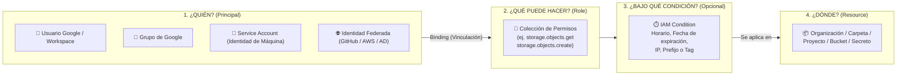
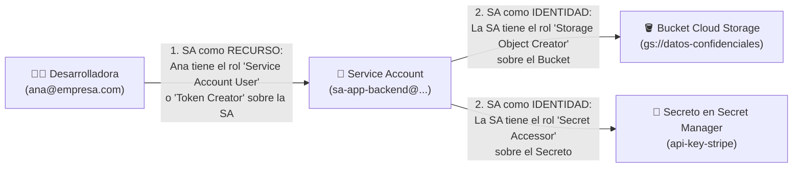
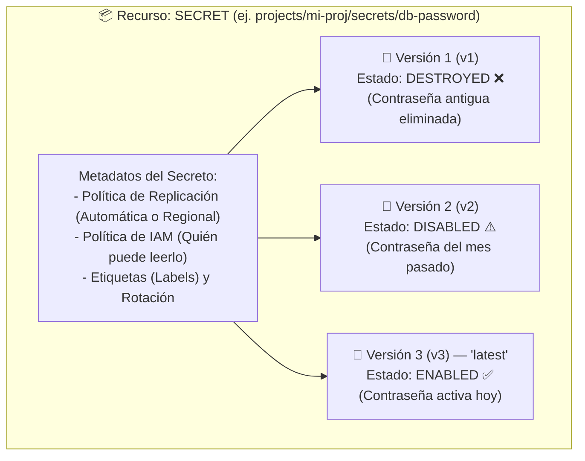

# Playbook 02: Identidad, Seguridad, Cloud IAM y Gestión de Secretos en Google Cloud

## 1. Introducción: La Identidad como el Nuevo Perímetro de Seguridad

En los centros de datos tradicionales, la seguridad se basaba casi exclusivamente en el **perímetro de red** (cortafuegos físicos y redes internas "confiables"). En la nube moderna, donde los servicios son distribuidos, serverless y globales, **la identidad es el verdadero perímetro de seguridad** (*Zero Trust Architecture*).

En Google Cloud Platform (GCP), **Cloud IAM (Identity and Access Management)** y **Secret Manager** conforman la columna vertebral para garantizar que cada persona, máquina virtual, contenedor o pipeline automatizado tenga **únicamente los permisos estrictamente necesarios** (*Principio de Menor Privilegio*) y acceda a credenciales sensibles sin exponerlas jamás en el código fuente.

---

## 2. Arquitectura Profunda de Cloud IAM

Como introdujimos en el Módulo 01, Cloud IAM responde a la pregunta: **¿Quién (*Principal*) puede hacer qué (*Role*) sobre qué recurso (*Resource*) y bajo qué condiciones (*Condition*)?**



### 2.1. Anatomía de un Permiso y de una Política (Allow Policy)
- **Permiso (*Permission*)**: Es la unidad atómica de autorización en GCP y tiene siempre el formato `<servicio>.<recurso>.<verbo>`.
  - Ejemplo: `compute.instances.start`, `storage.objects.create`, `secretmanager.versions.access`.
  - **Regla clave**: En GCP **nunca asignas un permiso suelto** directamente a un usuario; siempre asignas un **Rol** que agrupa uno o más permisos.
- **Vinculación (*Binding*)**: Une una lista de identidades (*members*) con un único rol (*role*) y, opcionalmente, una condición lógica (*condition*).
- **Política de IAM (*IAM Allow Policy*)**: Es un documento JSON adjunto a una Organización, Carpeta, Proyecto o Recurso específico (como un Bucket o un Secreto) que contiene todas sus vinculaciones (*bindings*).

Ejemplo real de una política IAM en formato JSON:

```json
{
  "bindings": [
    {
      "role": "roles/secretmanager.secretAccessor",
      "members": [
        "serviceAccount:sa-app-backend@mi-proyecto.iam.gserviceaccount.com"
      ],
      "condition": {
        "title": "AccesoTemporal2026",
        "description": "Expira al finalizar el proyecto",
        "expression": "request.time < timestamp('2026-12-31T23:59:59Z')"
      }
    }
  ]
}
```

### 2.2. ¿Cómo evalúa GCP si una petición es permitida o denegada?
1. **Denegación por defecto (*Default Deny*)**: En GCP todo está prohibido a menos que exista una política que lo permita explícitamente.
2. **Políticas de Denegación (*IAM Deny Policies*)**: Si la organización configuró una regla explícita de *Deny*, esta prevalece sobre cualquier permiso *Allow*.
3. **Unión Aditiva por Herencia**: Si no hay un *Deny*, GCP suma las políticas *Allow* desde la Organización -> Carpeta -> Proyecto -> Recurso individual (ej. un Bucket específico). Basta con que **uno** de esos niveles otorgue el permiso para que la acción sea autorizada.

> [!IMPORTANT]
> **¿Dónde debes asignar los permisos?**
> Si una aplicación solo necesita leer objetos de **un único Bucket** (`gs://mi-bucket-reportes`), **NO** le otorgues el rol `Storage Object Viewer` a nivel de todo el **Proyecto** (porque podría leer **todos** los buckets del proyecto). En su lugar, asigna el rol directamente sobre el **Recurso (el Bucket específico)**.

---

## 3. Tipos de Roles y Creación de Roles Personalizados (*Custom Roles*)

| Tipo de Rol | Quién lo mantiene | Cuándo usarlo | Cuándo EVITARLO |
| :--- | :--- | :--- | :--- |
| **Roles Básicos** (`Owner`, `Editor`, `Viewer`) | Google Cloud | Solo en cuentas personales de laboratorio inicial (`Owner` para el creador del proyecto). | **Siempre en producción**. El rol `Editor` incluye miles de permisos para crear, modificar y **borrar** datos en casi todo el proyecto. |
| **Roles Predefinidos** (`roles/storage.objectViewer`, `roles/run.admin`) | Google Cloud (se actualizan solos cuando GCP añade funciones) | **En el 90% de los casos profesionales**. Están diseñados por tarea o puesto de trabajo. | Cuando un rol predefinido sigue incluyendo algún permiso que tu auditoría de seguridad prohíbe (ej. `delete`). |
| **Roles Personalizados (*Custom Roles*)** (`projects/<id>/roles/<nombre>`) | **Tú / Tu equipo de seguridad** | Cuando necesitas combinar un conjunto exacto y mínimo de permisos que ningún rol predefinido ofrece. | Cuando un rol predefinido ya cumple el objetivo (ya que en los roles personalizados tú eres responsable de mantener la lista de permisos). |

### 3.1. Ciclo de Vida de un Rol Personalizado
- Al **eliminar** un rol personalizado, queda suspendido: no puede usarse en nuevas vinculaciones y las existentes dejan de tener efecto.
- Puedes **recuperarlo** con `gcloud iam roles undelete` durante **7 días**.
- Su **ID no puede reutilizarse hasta 44 días** después de la solicitud de borrado. *(Por eso, en el Laboratorio 02 el ID del rol lleva un sufijo con fecha y hora: así el laboratorio puede repetirse en el mismo proyecto).*

### 3.2. Propagación de los Cambios de IAM
Los cambios en una política de IAM **no son instantáneos**: según la documentación oficial, normalmente tardan **unos 2 minutos** en propagarse y pueden tardar **7 minutos o más**. Si acabas de otorgar un rol y recibes un `403 PERMISSION_DENIED`, espera y reintenta antes de buscar otro error.

---

## 4. Cuentas de Servicio (*Service Accounts*): Identidades para Máquinas

Una **Cuenta de Servicio (*Service Account*)** es un tipo especial de cuenta de Google que pertenece a una **aplicación, máquina virtual, contenedor o proceso automatizado**, en lugar de a un ser humano.

- **No tiene contraseña para iniciar sesión en un navegador**.
- Se identifica mediante una dirección de correo electrónico única con el formato:
  `<nombre-cuenta>@<project-id>.iam.gserviceaccount.com`

### 4.1. Los 3 Tipos de Cuentas de Servicio en un Proyecto GCP

1. **Cuentas de Servicio Administradas por el Usuario (*User-Managed Service Accounts*)**:
   - Son las que **tú creas explícitamente** para tus aplicaciones (por ejemplo, `sa-backend-pagos@...`, `sa-pipeline-datos@...`).
   - **Buena práctica**: Crear una cuenta de servicio dedicada por cada microservicio o carga de trabajo con permisos mínimos.
2. **Cuentas de Servicio Predeterminadas (*Default Service Accounts*)**:
   - Cuando habilitas ciertas APIs como Compute Engine, GCP crea automáticamente una cuenta llamada `<project-number>-compute@developer.gserviceaccount.com`.
   - **¡Peligro Histórico!**: Por compatibilidad histórica, a esta cuenta predeterminada se le solía asignar el rol básico **`Editor`** sobre todo el proyecto. Si cualquier VM usa esta cuenta por defecto y un atacante vulnera la aplicación web dentro de la VM, el atacante obtiene permisos de `Editor` sobre todo tu proyecto de GCP. **Siempre debes usar cuentas de servicio creadas por ti con permisos mínimos.**
   - **Situación actual (2024 en adelante)**: en las Organizaciones creadas desde mayo de 2024, la política *secure by default* `iam.automaticIamGrantsForDefaultServiceAccounts` **impide** que esta cuenta reciba `Editor`. Además, desde mayo–junio de 2024 **Cloud Build usa la cuenta predeterminada de Compute Engine para compilar**, de modo que en esos proyectos hay que otorgarle explícitamente los roles que necesite (por ejemplo `roles/run.builder` para desplegar desde código fuente).
3. **Agentes de Servicio de Google (*Google-Managed Service Agents*)**:
   - Cuentas internas administradas por Google (terminan en `@cloudservices.gserviceaccount.com` o `@gcp-sa-...iam.gserviceaccount.com`) que permiten a los servicios de GCP actuar en tu nombre (por ejemplo, para que un *Managed Instance Group* pueda crear VMs automáticamente en tu proyecto).

### 4.2. La Naturaleza Dual de una Cuenta de Servicio: Identidad y Recurso

Este es uno de los conceptos más importantes en arquitectura de seguridad en GCP. Una Cuenta de Servicio actúa simultáneamente como **Identidad** y como **Recurso**:



1. **La Cuenta de Servicio como IDENTIDAD (*Who*)**: Tú le das permisos a `sa-app-backend` para que pueda leer un secreto en Secret Manager o escribir en un Bucket de Cloud Storage.
2. **La Cuenta de Servicio como RECURSO (*What*)**: Si la desarrolladora `ana@empresa.com` quiere lanzar una máquina virtual que utilice la identidad de `sa-app-backend`, Ana necesita tener el rol **`Service Account User` (`roles/iam.serviceAccountUser`)** asignado **sobre esa Cuenta de Servicio específica**. De lo contrario, cualquier desarrollador podría adjuntar una cuenta de servicio privilegiada a una máquina suya y escalar privilegios.

---

## 5. El Peligro de las Llaves JSON y Cómo Autenticarse sin Llaves (*Keyless Authentication*)

Tradicionalmente, muchos desarrolladores descargaban un archivo `key.json` (una llave privada de larga duración de una cuenta de servicio) a su laptop o servidor para autenticarse.

> [!CAUTION]
> **¿Por qué NUNCA debes descargar archivos `key.json` de Cuentas de Servicio a menos que sea estrictamente inevitable?**
> - Un archivo `key.json` no expira por defecto y funciona desde cualquier lugar del mundo.
> - Si un desarrollador sube accidentalmente ese `key.json` a un repositorio de GitHub o le roban su laptop, los atacantes obtienen acceso inmediato y silencioso a tu nube en cuestión de segundos.
> - Por esta razón, en las Organizaciones creadas desde mayo de 2024 **la creación de llaves está bloqueada por defecto** mediante la política `iam.managed.disableServiceAccountKeyCreation`.

### ¿Cuáles son las 3 alternativas modernas sin llaves (*Keyless*) en GCP?

| Escenario | Método Seguro Recomendado (Sin descargar llaves JSON) | Cómo funciona por debajo |
| :--- | :--- | :--- |
| **1. Tu código corre dentro de GCP** (Compute Engine VM, Cloud Run, GKE, Cloud Functions) | **Attached Service Account (Cuenta de Servicio Adjunta)** | Le asignas la cuenta de servicio al recurso al crearlo. El código o CLI obtiene automáticamente tokens temporales (que rotan cada hora) desde el **Servidor de Metadatos interno** (`metadata.google.internal`). |
| **2. Desarrollo local o pruebas en Cloud Shell** | **Suplantación de Cuenta de Servicio (*Service Account Impersonation*)** (`--impersonate-service-account`) | Te autenticas con tu propio usuario humano y le pides a GCP un token temporal de corta duración para actuar como la cuenta de servicio (requiere el rol `roles/iam.serviceAccountTokenCreator`). |
| **3. Tu código corre fuera de GCP** (GitHub Actions, GitLab CI, AWS, Azure, On-Premises) | **Workload Identity Federation (Federación de Identidad de Cargas de Trabajo)** | GCP confía en el proveedor de identidad externo (OIDC/SAML, por ejemplo el token efímero de GitHub Actions) y lo intercambia por un token temporal de GCP sin almacenar ninguna llave estática en los secretos de GitHub. |

---

## 6. Gestión de Secretos con Google Cloud Secret Manager

Un error crítico de seguridad (violación de *The Twelve-Factor App* y OWASP) es guardar contraseñas de bases de datos, llaves de APIs de terceros (Stripe, SendGrid, OpenAI) o certificados privados dentro del código fuente, en archivos `.env` subidos a Git o en los metadatos planos de una máquina virtual (los cuales cualquier usuario con permiso `compute.instances.get` puede leer).

Para resolver esto existe **Google Cloud Secret Manager**.

### 6.1. Arquitectura de Secret Manager: Secret vs Secret Version



En Secret Manager debes distinguir dos conceptos:
1. **El Secreto (*Secret*)**: Es el **contenedor lógico** que tiene un nombre (ej. `db-password`), las reglas de replicación, las etiquetas y la política de permisos IAM. **El objeto *Secret* en sí mismo no contiene ningún dato secreto.**
2. **La Versión del Secreto (*Secret Version*)**: Es la que almacena la carga útil real (el texto o binario de la contraseña, hasta 64 KiB).
   - **Las versiones son inmutables**: No puedes "editar" la versión 1. Cuando cambias (rotas) una contraseña, creas la **Versión 2**.
   - **Alias `latest`**: Las aplicaciones pueden pedir la versión `latest` (la versión más reciente del secreto) o fijar un número de versión específico (`1`, `2`). En producción se recomienda **fijar un número de versión** y rotar de forma controlada: la documentación advierte que la garantía de consistencia fuerte para versiones nuevas no aplica cuando se accede mediante `latest` o alias.
   - **Estados de una versión**:
     - `ENABLED` (Habilitada): Se puede leer y consumir.
     - `DISABLED` (Deshabilitada): Nadie puede leerla temporalmente, pero se puede volver a habilitar si una rotación nueva falló y necesitas hacer *rollback*.
     - `DESTROYED` (Destruida): Eliminación criptográfica irreversible de la versión.

### 6.2. Roles clave de IAM para Secret Manager
- **`roles/secretmanager.secretAccessor` (Secret Manager Secret Accessor)**: Permite **únicamente leer el contenido** de las versiones habilitadas del secreto. **Este es el único rol que debe tener tu aplicación o máquina virtual.** No le permite borrar el secreto ni ver otros secretos si se asigna a nivel de secreto individual.
- **`roles/secretmanager.viewer`**: Permite ver que el secreto existe (sus metadatos y nombres), pero **NO permite ver el contenido secreto** de ninguna versión. Ideal para auditores.
- **`roles/secretmanager.admin`**: Control total para crear secretos, agregar versiones y administrar permisos.

---

## 7. Referencias Oficiales

- **Documentación General de Cloud IAM**: [https://docs.cloud.google.com/iam/docs/overview](https://docs.cloud.google.com/iam/docs/overview)
- **Mejores Prácticas para trabajar con Cuentas de Servicio**: [https://docs.cloud.google.com/iam/docs/best-practices-service-accounts](https://docs.cloud.google.com/iam/docs/best-practices-service-accounts)
- **Suplantación de Cuentas de Servicio (Service Account Impersonation)**: [https://docs.cloud.google.com/iam/docs/service-account-impersonation](https://docs.cloud.google.com/iam/docs/service-account-impersonation)
- **Creación y gestión de Roles Personalizados (Custom Roles)**: [https://docs.cloud.google.com/iam/docs/creating-custom-roles](https://docs.cloud.google.com/iam/docs/creating-custom-roles)
- **Condiciones de IAM (IAM Conditions)**: [https://docs.cloud.google.com/iam/docs/conditions-overview](https://docs.cloud.google.com/iam/docs/conditions-overview)
- **Propagación de Cambios de Acceso en IAM**: [https://docs.cloud.google.com/iam/docs/access-change-propagation](https://docs.cloud.google.com/iam/docs/access-change-propagation)
- **Cambio de la Cuenta de Servicio Predeterminada de Cloud Build**: [https://docs.cloud.google.com/build/docs/cloud-build-service-account-updates](https://docs.cloud.google.com/build/docs/cloud-build-service-account-updates)
- **Documentación Oficial de Secret Manager**: [https://docs.cloud.google.com/secret-manager/docs/overview](https://docs.cloud.google.com/secret-manager/docs/overview)
