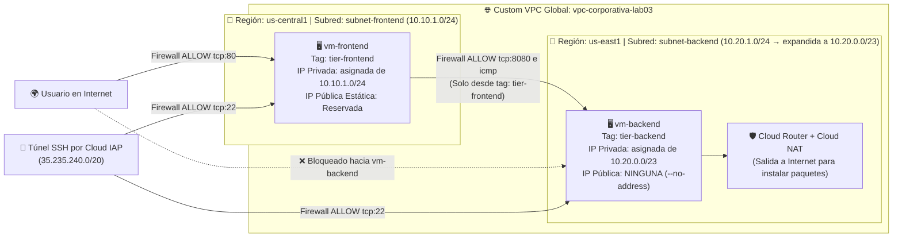

# Laboratorio 03: Diseño de Redes VPC Personalizadas, Subredes Multi-Región, Reglas de Firewall, IPs Públicas y Cloud NAT

- **Duración estimada**: 85–90 minutos
- **Nivel**: Intermedio / Redes y Seguridad Perimetral
- **Entorno de trabajo**: **Google Cloud Shell (`gcloud` CLI)** + Verificaciones visuales en **Google Cloud Console**

---

## 1. Objetivo del Laboratorio

Diseñar y construir desde cero una arquitectura de red empresarial de dos capas (*Frontend Público* y *Backend Privado*) sobre una **Red Virtual Privada en modo personalizado (`Custom VPC`)** que abarca dos regiones geográficas distintas (`us-central1` y `us-east1`). A lo largo del laboratorio configurarás subredes regionales, reservarás **direcciones IP públicas estáticas**, implementarás **reglas de firewall segmentadas por etiquetas de red (`Network Tags`)**, habilitarás **Cloud NAT** para dar salida segura a Internet a servidores sin IP pública y comprobarás experimentalmente la comunicación interregional privada y el aislamiento del firewall.



---

## 2. ¿Qué aprenderá el estudiante?

Al finalizar este laboratorio, serás capaz de:
1. Crear una **VPC en modo personalizado (`--subnet-mode=custom`)** sin subredes ni reglas de firewall inseguras preconfiguradas.
2. Crear **Subredes Regionales** en distintas regiones geográficas definiendo sus bloques CIDR (`10.10.1.0/24` y `10.20.1.0/24`) y expandiéndolas en caliente sin tiempo de inactividad.
3. Reservar, inspeccionar y liberar **Direcciones IP Públicas Estáticas Regionales** diferenciándolas de las IPs efímeras.
4. Diseñar **Reglas de Firewall de VPC** basadas en rangos IP de origen (como el rango oficial de Cloud IAP) y basadas en etiquetas de red (`--source-tags` y `--target-tags`) para aislar capas de aplicación.
5. Desplegar una máquina virtual **100% privada (sin IP externa)** y proporcionarle acceso saliente seguro a Internet mediante **Cloud Router y Cloud NAT**.
6. Diagnosticar conectividad y bloqueos de red entre regiones usando herramientas de terminal y la consola de VPC.

---

## 3. Estimación de Costos en la Nube

> [!TIP]
> **Costo total estimado por ejecutar este laboratorio durante 90 minutos: ~$0.02 a $0.04 USD**

| Recurso Aprovisionado | Especificación y Cantidad | Precio de Referencia | Costo por 1.5 Horas de Laboratorio |
| :--- | :--- | :--- | :--- |
| **Red VPC, Subredes y Reglas de Firewall** | 1 Custom VPC + 2 Subredes + 3 Reglas de Firewall | Gratuito | **$0.000 USD** |
| **2x Máquinas Virtuales (`vm-frontend` y `vm-backend`)** | 2x `e2-micro` encendidas durante ~45 minutos | ~$0.0084 / hora cada una | **~$0.013 USD** |
| **IP Pública Estática Regional (`ip-estatica-frontend`)** | 1 dirección IPv4 reservada | ~$0.005 / hora | **~$0.008 USD** |
| **Cloud Router + Cloud NAT Gateway** | 1 gateway regional usado por 1 VM durante ~30 minutos | Cloud Router gratuito; Cloud NAT se cobra **por VM que usa el gateway, por hora** (~$0.0014 por VM/hora, con tope por gateway) + ~$0.045 por GB procesado ([precios oficiales](https://cloud.google.com/nat/pricing)) | **< $0.01 USD** |
| **TOTAL ESTIMADO DE LA SESIÓN** | **Ejecutando la limpieza al finalizar el laboratorio** | — | **~$0.02 USD** |

---

## 4. Paso a Paso del Laboratorio

### Paso 1: Preparación del Entorno en Cloud Shell (5 min)

1. Abre la Consola de Google Cloud ([https://console.cloud.google.com](https://console.cloud.google.com)) e inicia **Google Cloud Shell** (`>_`).
2. Configura las variables de entorno para trabajar con dos regiones distintas (**Iowa `us-central1`** para el Frontend y **Carolina del Sur `us-east1`** para el Backend):

```bash
mkdir -p ~/workshop-gcp/lab03
cd ~/workshop-gcp/lab03

# Verificación previa: debe existir un proyecto activo en Cloud Shell
export PROJECT_ID=$(gcloud config get-value project 2>/dev/null)
if [ -z "$PROJECT_ID" ]; then
  echo "ERROR: No hay proyecto activo. Ejecuta: gcloud config set project TU_PROJECT_ID"
fi

# Guardar las variables del laboratorio en env.sh (Cloud Shell las pierde tras 40 min de inactividad)
cat > env.sh << EOF
export PROJECT_ID="$PROJECT_ID"
export REGION_FRONT="us-central1"
export ZONE_FRONT="us-central1-a"
export REGION_BACK="us-east1"
export ZONE_BACK="us-east1-b"
EOF
source env.sh

gcloud config set project $PROJECT_ID
gcloud services enable compute.googleapis.com

echo "Proyecto activo: $PROJECT_ID"
```

> [!IMPORTANT]
> Si Cloud Shell se desconecta (40 minutos de inactividad), recupera tus variables con: `cd ~/workshop-gcp/lab03 && source env.sh`. Las IPs que capturaremos más adelante también se agregan a `env.sh`.

---

### Paso 2: Creación de la Arquitectura VPC Global y Subredes Regionales (15 min)

#### 2.1. Crear la Red VPC en Modo Personalizado (`custom`)
A diferencia del modo `auto`, el modo `custom` nos entrega una red completamente limpia y bajo nuestro control:

```bash
gcloud compute networks create vpc-corporativa-lab03 \
  --subnet-mode=custom \
  --bgp-routing-mode=global \
  --description="Red VPC Global personalizada para el Laboratorio 03"
```

Verifica que la VPC se haya creado y que todavía no tenga ninguna subred:

```bash
gcloud compute networks list
gcloud compute networks subnets list --network=vpc-corporativa-lab03
```

#### 2.2. Crear las Subredes para Frontend (`us-central1`) y Backend (`us-east1`)
Crearemos dos subredes en regiones separadas por más de 1,500 kilómetros, ambas dentro de la misma VPC global:

```bash
# 1. Subred de Frontend en us-central1 con rango 10.10.1.0/24 (252 IPs útiles)
gcloud compute networks subnets create subnet-frontend \
  --network=vpc-corporativa-lab03 \
  --region=$REGION_FRONT \
  --range=10.10.1.0/24 \
  --enable-private-ip-google-access

# 2. Subred de Backend en us-east1 con rango 10.20.1.0/24 (252 IPs útiles)
gcloud compute networks subnets create subnet-backend \
  --network=vpc-corporativa-lab03 \
  --region=$REGION_BACK \
  --range=10.20.1.0/24 \
  --enable-private-ip-google-access
```

> [!NOTE]
> **¿Qué hace `--enable-private-ip-google-access`?**
> Permite que las máquinas virtuales de esa subred que **no tengan IP pública** puedan comunicarse de forma privada con las APIs y servicios de Google Cloud (como Cloud Storage, Secret Manager o Artifact Registry) sin salir a Internet.

#### 2.3. Demostración de Expansión de Rango CIDR en Caliente
Supongamos que el equipo de arquitectura decide que la subred `subnet-backend` (`10.20.1.0/24`) necesitará el doble de direcciones IP (`/23` = 508 IPs útiles). ¡Podemos expandirla sin interrumpir el tráfico! Ten en cuenta que la expansión **no se puede deshacer** y que `gcloud` calcula el nuevo rango aplicando la máscara al rango original: `10.20.1.0/24` pasa a ser **`10.20.0.0/23`** (que contiene al rango anterior):

```bash
gcloud compute networks subnets expand-ip-range subnet-backend \
  --region=$REGION_BACK \
  --prefix-length=23 \
  --quiet

# Verificar las dos subredes y sus rangos CIDR actuales
gcloud compute networks subnets list \
  --network=vpc-corporativa-lab03 \
  --format="table(name, region.basename(), ipCidrRange, gatewayAddress, privateIpGoogleAccess)"
```

Observa que `subnet-backend` ahora muestra el rango **`10.20.0.0/23`**, y que la columna `gatewayAddress` indica la dirección que Google reservó automáticamente como puerta de enlace de cada subred. Como el rango cambió, **no supondremos IPs fijas**: más adelante capturaremos la IP real de cada VM en una variable.

**Verificación en la Consola Web**:
- Ve a `☰` -> **Red de VPC (VPC network)** -> **Redes de VPC (VPC networks)** y haz clic en **`vpc-corporativa-lab03`**. Verás tus dos subredes listadas junto con la pestaña **Rutas (Routes)** que Google creó automáticamente para conectar ambas regiones.

---

### Paso 3: Creación de Reglas de Firewall de Cero Confianza (Zero-Trust) (15 min)

Como `vpc-corporativa-lab03` es una VPC personalizada nueva, **todo el tráfico entrante está bloqueado por defecto**. Crearemos tres reglas quirúrgicas:

#### 3.1. Regla 1: Permitir administración SSH únicamente a través del Túnel de Cloud IAP
En lugar de abrir el puerto `22` (SSH) a todo Internet (`0.0.0.0/0`, donde miles de bots intentan ataques de fuerza bruta cada minuto), solo permitiremos conexiones SSH que vengan desde el rango interno oficial de **Identity-Aware Proxy (IAP)** de Google (`35.235.240.0/20`):

```bash
gcloud compute firewall-rules create fw-allow-ssh-iap \
  --network=vpc-corporativa-lab03 \
  --direction=INGRESS \
  --priority=1000 \
  --action=ALLOW \
  --rules=tcp:22 \
  --source-ranges=35.235.240.0/20 \
  --description="Permite SSH seguro exclusivamente mediante tunel IAP"
```

#### 3.2. Regla 2: Permitir tráfico Web HTTP (Puerto 80) desde Internet solo hacia el Frontend
Solo los servidores que tengan la etiqueta `--target-tags=tier-frontend` podrán recibir tráfico desde Internet en el puerto `80`:

```bash
gcloud compute firewall-rules create fw-allow-http-frontend \
  --network=vpc-corporativa-lab03 \
  --direction=INGRESS \
  --priority=1000 \
  --action=ALLOW \
  --rules=tcp:80 \
  --source-ranges=0.0.0.0/0 \
  --target-tags=tier-frontend \
  --description="Permite trafico HTTP desde Internet unicamente hacia tier-frontend"
```

#### 3.3. Regla 3: Permitir comunicación Interna únicamente desde el Frontend hacia el Backend
Nuestros servidores `tier-backend` solo aceptarán pings (`icmp`) y peticiones en el puerto `8080` (`tcp:8080`) si provienen de una máquina que tenga la etiqueta `--source-tags=tier-frontend`:

```bash
gcloud compute firewall-rules create fw-allow-frontend-to-backend \
  --network=vpc-corporativa-lab03 \
  --direction=INGRESS \
  --priority=1000 \
  --action=ALLOW \
  --rules=tcp:8080,icmp \
  --source-tags=tier-frontend \
  --target-tags=tier-backend \
  --description="Permite que solo el Frontend hable con el Backend en puerto 8080 e ICMP"
```

Lista las reglas de firewall de tu nueva VPC para verificar la configuración:

```bash
gcloud compute firewall-rules list \
  --filter="network:vpc-corporativa-lab03" \
  --format="table(name, direction, priority, allowed[].map().firewall_rule().list():label=PERMITIDO, sourceRanges.list():label=ORIGEN_IP, sourceTags.list():label=ORIGEN_TAG, targetTags.list():label=DESTINO_TAG)"
```

---

### Paso 4: Direcciones IP Públicas Estáticas vs Instancias Privadas (15 min)

#### 4.1. Reservar una Dirección IP Pública Estática para el Frontend
Para que la IP pública de nuestro servidor Frontend no cambie nunca aunque lo apaguemos, reservaremos una IP estática en `us-central1`:

```bash
gcloud compute addresses create ip-estatica-frontend \
  --region=$REGION_FRONT \
  --description="IP publica fija para vm-frontend"

# Guardar la dirección IP reservada en una variable y mostrarla
export FRONTEND_STATIC_IP=$(gcloud compute addresses describe ip-estatica-frontend --region=$REGION_FRONT --format="get(address)")
echo "export FRONTEND_STATIC_IP=\"$FRONTEND_STATIC_IP\"" >> env.sh
echo "IP Pública Estática reservada: $FRONTEND_STATIC_IP"
```

Observa con `gcloud compute addresses list` que su estado actual es **`RESERVED`** (reservada, pero aún no en uso).

#### 4.2. Crear la Máquina Virtual `vm-frontend` (Con IP Pública Estática en `us-central1`)
```bash
# Guardar el Startup Script en un archivo (forma recomendada: --metadata separa por comas y rompería scripts que las contengan)
cat << 'SCRIPT' > startup-frontend.sh
#! /bin/bash
apt-get update && apt-get install -y nginx
echo "<h1>Servidor Frontend Publico (us-central1)</h1>" > /var/www/html/index.html
systemctl restart nginx
SCRIPT

gcloud compute instances create vm-frontend \
  --zone=$ZONE_FRONT \
  --machine-type=e2-micro \
  --image-family=debian-12 \
  --image-project=debian-cloud \
  --network=vpc-corporativa-lab03 \
  --subnet=subnet-frontend \
  --address=$FRONTEND_STATIC_IP \
  --tags=tier-frontend \
  --metadata-from-file=startup-script=startup-frontend.sh
```

#### 4.3. Crear la Máquina Virtual `vm-backend` (100% Privada SIN IP Pública en `us-east1`)
Observa el parámetro crucial **`--no-address`**, el cual garantiza que esta máquina virtual nazca sin ninguna dirección IP pública expuesta a Internet:

```bash
gcloud compute instances create vm-backend \
  --zone=$ZONE_BACK \
  --machine-type=e2-micro \
  --image-family=debian-12 \
  --image-project=debian-cloud \
  --network=vpc-corporativa-lab03 \
  --subnet=subnet-backend \
  --no-address \
  --tags=tier-backend
```

Compara ambas máquinas virtuales ejecutando:

```bash
gcloud compute instances list \
  --format="table(name, zone.basename(), networkInterfaces[0].network.basename():label=VPC, networkInterfaces[0].subnetwork.basename():label=SUBRED, networkInterfaces[0].networkIP:label=IP_PRIVADA, networkInterfaces[0].accessConfigs[0].natIP:label=IP_PUBLICA)"
```

¡Fíjate en la columna **`IP_PUBLICA`**!
- `vm-frontend` tiene asignada tu IP estática `$FRONTEND_STATIC_IP` y una IP privada de `10.10.1.0/24`.
- `vm-backend` tiene una IP privada de `10.20.0.0/23` y su columna `IP_PUBLICA` está **totalmente vacía**.

Guardemos las IPs privadas reales de ambas VMs (Google las asigna automáticamente; nunca conviene escribirlas a mano en los scripts):

```bash
export FRONTEND_IP=$(gcloud compute instances describe vm-frontend --zone=$ZONE_FRONT --format="get(networkInterfaces[0].networkIP)")
export BACKEND_IP=$(gcloud compute instances describe vm-backend --zone=$ZONE_BACK --format="get(networkInterfaces[0].networkIP)")
echo "export FRONTEND_IP=\"$FRONTEND_IP\"" >> env.sh
echo "export BACKEND_IP=\"$BACKEND_IP\"" >> env.sh
echo "Frontend: $FRONTEND_IP | Backend: $BACKEND_IP"
```

---

### Paso 5: Configuración de Cloud Router y Cloud NAT para la Subred Privada (15 min)

#### 5.1. Comprobar que `vm-backend` aún NO puede salir a Internet
Conectémonos a `vm-backend` a través del túnel seguro de **Cloud IAP** (`--tunnel-through-iap`, ya que no tiene IP pública) e intentemos hacer una petición hacia un sitio de Internet **que no pertenece a Google**:

```bash
gcloud compute ssh vm-backend \
  --zone=$ZONE_BACK \
  --tunnel-through-iap \
  --command="curl -sI --max-time 5 https://example.com || echo '-> SIN SALIDA A INTERNET: La VM es 100% privada y aun no tiene Cloud NAT.'"
```
Verás que el comando expira tras 5 segundos porque `vm-backend` no tiene IP pública para salir a Internet.

> [!NOTE]
> **¿Por qué no probamos con `www.google.com`?** Como la subred tiene **Private Google Access** activado, la VM puede alcanzar los dominios predeterminados de Google (las APIs y, según la documentación, también aplicaciones web de Google) **sin necesidad de NAT**. Una prueba contra `google.com` podría responder y confundirnos; por eso usamos un dominio ajeno a Google.

#### 5.2. Crear Cloud Router y Cloud NAT en la región del Backend (`us-east1`)
Para que `vm-backend` pueda descargar actualizaciones o paquetes desde Internet sin exponer puertos entrantes, configuremos **Cloud NAT**:

```bash
# 1. Crear el Cloud Router en la región us-east1 dentro de nuestra VPC
gcloud compute routers create router-nat-east \
  --network=vpc-corporativa-lab03 \
  --region=$REGION_BACK

# 2. Crear el Gateway de Cloud NAT asociado al Cloud Router
gcloud compute routers nats create nat-gateway-east \
  --router=router-nat-east \
  --region=$REGION_BACK \
  --nat-all-subnet-ip-ranges \
  --auto-allocate-nat-external-ips
```

#### 5.3. Comprobar que `vm-backend` ahora SÍ sale a Internet y levantar su API en el puerto `8080`
Volvamos a probar desde `vm-backend` (el comando reintenta durante ~1 minuto mientras Cloud NAT termina de programarse), iniciando además un pequeño servicio HTTP de Python en el puerto interno `8080`:

```bash
gcloud compute ssh vm-backend \
  --zone=$ZONE_BACK \
  --tunnel-through-iap \
  --command="
    echo '=== 1. PROBANDO SALIDA A INTERNET A TRAVES DE CLOUD NAT ==='
    for i in \$(seq 1 6); do
      curl -sI --max-time 5 https://example.com | head -n 1 | grep . && break
      echo 'Esperando a Cloud NAT (10 s)...'; sleep 10
    done

    echo '=== 2. INICIANDO MICROSERVICIO INTERNO EN PUERTO 8080 ==='
    mkdir -p /tmp/api-interna
    echo '{\"servicio\": \"Backend Privado en us-east1\", \"ip_privada\": \"$BACKEND_IP\", \"acceso\": \"Solo permitido desde Frontend\"}' > /tmp/api-interna/status.json
    nohup python3 -m http.server 8080 --directory /tmp/api-interna > /dev/null 2>&1 &
    sleep 2
    ss -tulpn | grep 8080
  "
```
¡Excelente! `curl -sI https://example.com` devolvió una línea `HTTP/... 200` gracias a **Cloud NAT**, y el servicio interno ya escucha en el puerto `8080`.

---

### Paso 6: Pruebas de Conectividad Interregional y Firewall en Vivo (15 min)

Realicemos ahora las tres pruebas definitivas de nuestra arquitectura de red:

#### 6.1. Prueba 1: Acceso desde Internet hacia la IP Pública Estática del Frontend (`Puerto 80`)
Ejecuta desde Cloud Shell:

```bash
curl http://$FRONTEND_STATIC_IP
```
> **Resultado**: Recibes `<h1>Servidor Frontend Publico (us-central1)</h1>` porque la regla `fw-allow-http-frontend` permite tráfico en el puerto 80 hacia `tier-frontend`.

#### 6.2. Prueba 2: Comunicación Privada Interregional (`us-central1` -> `us-east1`) en el Puerto `8080`
Entremos a `vm-frontend` (en Iowa) y pidámosle que haga `ping` y consulte el puerto `8080` de `vm-backend` (en Carolina del Sur, `$BACKEND_IP`) a través de la VPC Global. Las variables `$FRONTEND_IP` y `$BACKEND_IP` se expanden en Cloud Shell antes de enviar el comando a la VM:

```bash
gcloud compute ssh vm-frontend \
  --zone=$ZONE_FRONT \
  --tunnel-through-iap \
  --command="
    echo '=== 1. PING PRIVADO DE IOWA ($FRONTEND_IP) A CAROLINA DEL SUR ($BACKEND_IP) ==='
    ping -c 3 $BACKEND_IP

    echo -e '\n=== 2. CONSUMIENDO API PRIVADA DEL BACKEND EN PUERTO 8080 ==='
    curl -s http://$BACKEND_IP:8080/status.json ; echo ''
  "
```
> **Resultado**: Verás el tiempo de latencia interregional por la fibra de Google (~25–30 ms) y la respuesta JSON del Backend privado (`{"servicio": "Backend Privado en us-east1"...}`).

#### 6.3. Prueba 3: Comprobar que el Firewall bloquea intentos en sentido inverso (`Backend` -> `Frontend:8080`)
¿Qué pasa si `vm-backend` intenta hacerle `ping` a `vm-frontend` (`$FRONTEND_IP`)? Recuerda que nuestra regla `fw-allow-frontend-to-backend` solo autorizó tráfico **desde `tier-frontend` hacia `tier-backend`**, no al revés:

```bash
gcloud compute ssh vm-backend \
  --zone=$ZONE_BACK \
  --tunnel-through-iap \
  --command="ping -c 2 -W 3 $FRONTEND_IP || echo '-> BLOQUEADO POR FIREWALL: El Backend no tiene permiso para iniciar conexiones hacia el Frontend.'"
```
> **Resultado**: **100% packet loss**. El Firewall distribuido de VPC bloqueó el intento porque la comunicación solo está permitida en el sentido `Frontend -> Backend`.

---

## 5. Limpieza de Recursos en Google Cloud (Cleanup)

> [!CAUTION]
> **¡IMPORTANTE!** En Google Cloud no puedes eliminar una red VPC ni sus subredes si todavía existen máquinas virtuales, routers o reglas de firewall dentro de ella. Además, recuerda que **las direcciones IP públicas estáticas reservadas generan costo por hora si no se eliminan**. Ejecuta el siguiente bloque en **Cloud Shell** en este orden exacto:

```bash
# 0. Recuperar las variables del laboratorio (por si la sesión de Cloud Shell se reinició)
cd ~/workshop-gcp/lab03 && source env.sh

# 1. Eliminar las dos Máquinas Virtuales (Frontend y Backend)
gcloud compute instances delete vm-frontend --zone=$ZONE_FRONT --quiet
gcloud compute instances delete vm-backend --zone=$ZONE_BACK --quiet

# 2. Liberar (Eliminar) la Dirección IP Pública Estática Reservada
gcloud compute addresses delete ip-estatica-frontend --region=$REGION_FRONT --quiet

# 3. Eliminar el Gateway de Cloud NAT y el Cloud Router
gcloud compute routers nats delete nat-gateway-east --router=router-nat-east --region=$REGION_BACK --quiet
gcloud compute routers delete router-nat-east --region=$REGION_BACK --quiet

# 4. Eliminar las 3 Reglas de Firewall de nuestra VPC
gcloud compute firewall-rules delete \
  fw-allow-ssh-iap \
  fw-allow-http-frontend \
  fw-allow-frontend-to-backend \
  --quiet

# 5. Eliminar las 2 Subredes Regionales
gcloud compute networks subnets delete subnet-frontend --region=$REGION_FRONT --quiet
gcloud compute networks subnets delete subnet-backend --region=$REGION_BACK --quiet

# 6. Eliminar la Red VPC Personalizada
gcloud compute networks delete vpc-corporativa-lab03 --quiet
```

### Auditoría Final de Limpieza
Verifica que no queden instancias, direcciones IP estáticas ni routers activos:

```bash
echo "=== Instancias VM ==="
gcloud compute instances list

echo "=== Direcciones IP Estáticas Reservadas ==="
gcloud compute addresses list

echo "=== Redes VPC (Solo debe aparecer 'default') ==="
gcloud compute networks list
```

---

## 6. Conclusiones

En este laboratorio has diseñado y operado una red de nivel de producción en Google Cloud Platform:
- Comprobaste que una **VPC en GCP es un recurso global**, permitiendo que subredes en regiones distantes (`us-central1` y `us-east1`) se comuniquen directamente por IP privada sin pasar por Internet.
- Aplicaste las mejores prácticas de seguridad de red: creaste una VPC en **modo personalizado (`custom`)**, restringiste el acceso SSH exclusivamente al túnel de **Cloud IAP** y aislaste la comunicación entre capas usando **Network Tags (`tier-frontend` -> `tier-backend`)**.
- Aprendiste la diferencia operativa entre una **IP Pública Estática Reservada**, una **IP Efímera** y una instancia **100% privada (`--no-address`)**.
- Implementaste **Cloud NAT y Cloud Router**, permitiendo que servidores privados accedan a Internet para descargar actualizaciones sin exponer jamás una IP pública entrante.

---

## 7. Retos Prácticos (Challenges)

1. **Reto 1 — Reglas de Firewall basadas en Service Accounts (Zero-Trust Avanzado)**:
   En lugar de usar `--source-tags` y `--target-tags`, investiga en `gcloud compute firewall-rules create --help` cómo utilizar las banderas **`--source-service-accounts`** y **`--target-service-accounts`**. Explica por qué en una empresa grande con cientos de desarrolladores es más seguro basar el firewall en Cuentas de Servicio que en etiquetas de red (*Network Tags*).

2. **Reto 2 — Regla de Salida (`EGRESS`) para Bloquear Tráfico Saliente**:
   Crea una regla de firewall de dirección **`EGRESS`** con acción **`DENY`** y prioridad **`500`** que impida que cualquier máquina con la etiqueta `tier-backend` pueda conectarse hacia la IP pública `8.8.8.8` (DNS de Google), mientras sigue pudiendo conectarse al resto de Internet a través de Cloud NAT.

3. **Reto 3 — Interconexión con VPC Network Peering**:
   Crea dos redes VPC en modo personalizado (`vpc-a` con subred `10.1.0.0/24` y `vpc-b` con subred `10.2.0.0/24`). Investiga cómo usar el comando `gcloud compute networks peerings create` en ambos sentidos (`vpc-a -> vpc-b` y `vpc-b -> vpc-a`) para que ambas redes pasen al estado `ACTIVE` e intercambien rutas privadas automáticamente.

---

## 8. Referencias Oficiales

- **Referencia CLI: `gcloud compute networks` y `subnets`**: [https://docs.cloud.google.com/sdk/gcloud/reference/compute/networks](https://docs.cloud.google.com/sdk/gcloud/reference/compute/networks)
- **Referencia CLI: `gcloud compute firewall-rules`**: [https://docs.cloud.google.com/sdk/gcloud/reference/compute/firewall-rules](https://docs.cloud.google.com/sdk/gcloud/reference/compute/firewall-rules)
- **Referencia CLI: `gcloud compute addresses` (IPs Estáticas)**: [https://docs.cloud.google.com/sdk/gcloud/reference/compute/addresses](https://docs.cloud.google.com/sdk/gcloud/reference/compute/addresses)
- **Configuración de Cloud NAT con `gcloud`**: [https://docs.cloud.google.com/nat/docs/set-up-manage-network-address-translation](https://docs.cloud.google.com/nat/docs/set-up-manage-network-address-translation)
