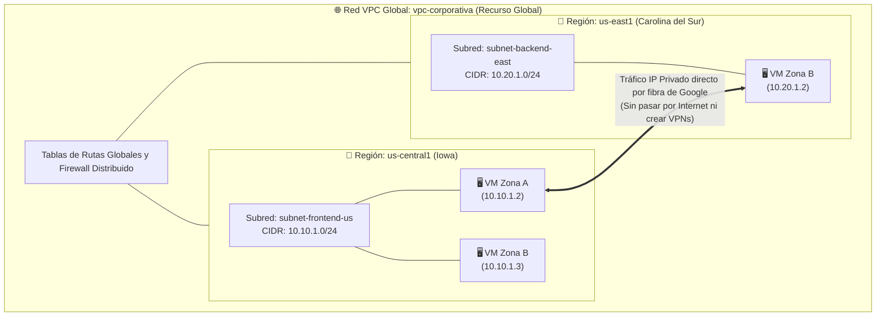
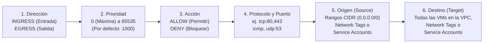
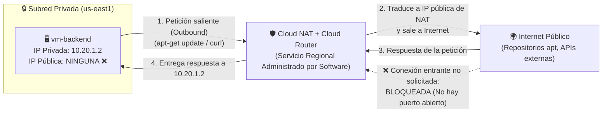

# Playbook 03: Redes Virtuales en la Nube — Arquitectura VPC, Subredes, Firewall, Direccionamiento IP y Cloud NAT

## 1. Introducción: ¿Qué es una Virtual Private Cloud (VPC) en Google Cloud?

Una **Virtual Private Cloud (VPC)** es una red virtual privada, aislada y definida por software (SDN) dentro de Google Cloud Platform, impulsada por la pila de virtualización de red **Andromeda** de Google.

Mientras que en otros proveedores de nube (como AWS o Azure) una red virtual está atada a una única región geográfica, **en Google Cloud las redes VPC son recursos GLOBALES y las subredes (*Subnets*) son recursos REGIONALES**.

### ¿Qué implicaciones arquitectónicas tiene una VPC Global?
1. **Comunicación Interregional Nativa**: Una máquina virtual en `us-central1` (`10.10.1.2`) puede comunicarse directamente con otra máquina virtual en `europe-west1` o `us-east1` (`10.20.1.2`) usando únicamente sus **direcciones IP privadas internas**, viajando por la fibra óptica privada de Google sin salir jamás a la Internet pública y sin configurar túneles VPN ni *VPC Peering*.
2. **Subredes que abarcan todas las Zonas de una Región**: Una sola subred (ej. `10.10.1.0/24` en `us-central1`) puede ser utilizada simultáneamente por máquinas virtuales ubicadas en `us-central1-a`, `us-central1-b` y `us-central1-c`. Esto simplifica enormemente la alta disponibilidad.

---

## 2. Tipos de Redes VPC: `Default`, `Auto Mode` y `Custom Mode`

Cuando creas un proyecto nuevo en GCP o diseñas una red desde cero, existen tres modalidades de VPC:

| Modalidad | ¿Cómo crea las subredes? | Rango IP CIDR | ¿Recomendada en Producción? |
| :--- | :--- | :--- | :--- |
| **Red `default`** | Precreada automáticamente en todo proyecto nuevo (salvo que la Política de Organización `compute.skipDefaultNetworkCreation` lo impida) con 1 subred por cada región del mundo y reglas de firewall abiertas (`default-allow-ssh`, `default-allow-rdp`, `default-allow-icmp` y `default-allow-internal`). | `10.128.0.0/9` (prefijos `/20` predefinidos) | **No**. Útil solo para laboratorios rápidos iniciales. En producción se recomienda eliminarla o no usarla. |
| **VPC en Modo Automático (`--subnet-mode=auto`)** | Crea automáticamente 1 subred `/20` en cada región actual y futura de GCP. | `10.128.0.0/9` fijo | **No**. Como usa siempre el mismo bloque IP (`10.128.0.0/9`), si luego intentas conectarla por VPN o Peering con otra red en modo automático, habrá **colisión de direcciones IP (Overlapping CIDRs)**. |
| **VPC en Modo Personalizado (`--subnet-mode=custom`)** | Empieza **con 0 subredes**. Tú decides exactamente en qué regiones crear subredes y qué rangos CIDR privados asignar. | Cualquier rango privado RFC 1918 (`10.0.0.0/8`, `172.16.0.0/12`, `192.168.0.0/16`) | **Sí (Estándar obligatorio en producción)**. Te da control total de direccionamiento, evita colisiones IP y reduce la superficie de ataque. |

---

## 3. Subredes (*Subnets*) y Direccionamiento IP en GCP

### 3.1. Las 4 Direcciones IP Reservadas en cada Subred
En una red tradicional suelen reservarse 2 direcciones IP (red y broadcast). En Google Cloud, **toda subred reserva siempre 4 direcciones IP** que no pueden ser asignadas a tus máquinas virtuales:

Tomando como ejemplo la subred **`10.10.1.0/24`** (256 direcciones totales -> **252 utilizables**):

| Dirección IP en el Rango | Rol en la Subred de GCP |
| :--- | :--- |
| **`10.10.1.0`** (Primera dirección) | Identificador de la Red (*Network Address*). |
| **`10.10.1.1`** (Segunda dirección) | **Puerta de enlace predeterminada (*Default Gateway*)** virtual de la subred. |
| *`10.10.1.2` a `10.10.1.253`* | **Rango utilizable para tus VMs y recursos internos (252 IPs)**. Google asigna automáticamente una IP libre de este rango; **no supongas una IP concreta** en tus scripts: consúltala con `gcloud compute instances describe`. |
| **`10.10.1.254`** (Penúltima dirección) | Reservada por Google para uso futuro. |
| **`10.10.1.255`** (Última dirección) | Dirección de difusión (*Broadcast Address*). *(Nota: GCP no soporta tráfico broadcast L2, pero reserva la IP).* |

### 3.2. Expansión de Subredes sin Tiempo de Inactividad
Si creaste una subred con máscara `/24` (252 hosts) y tu empresa crece, en GCP puedes **expandir el rango CIDR en caliente** (por ejemplo, de `/24` a `/20`, pasando a 4,092 hosts) con el comando `gcloud compute networks subnets expand-ip-range` sin apagar ninguna máquina ni recrear la subred. Detalles importantes:
- La expansión **no se puede deshacer**: los rangos se pueden agrandar, pero nunca achicar.
- `gcloud` calcula el nuevo rango **aplicando la máscara al rango original**. Por ejemplo, `10.20.1.0/24` expandido a `/23` se convierte en **`10.20.0.0/23`**. El nuevo rango no debe solaparse con otras subredes de la VPC.
- Si tienes reglas de firewall que referencian el rango antiguo, revísalas después de expandir.

### 3.3. Direcciones IP Internas vs Externas (Públicas): Efímeras vs Estáticas

Cada máquina virtual en GCP recibe una dirección **IP Interna (Privada)** obligatoria de su subred y, opcionalmente, una dirección **IP Externa (Pública)** enrutada por Internet mediante NAT 1:1 en el borde de la red de Google (la VM por dentro solo ve su IP privada al ejecutar `ip addr`).

| Tipo de Dirección IP | IP Efímera (*Ephemeral*) | IP Estática Reservada (*Static*) |
| :--- | :--- | :--- |
| **¿Cómo se asigna?** | Automáticamente de un pool de Google al crear o encender la VM. | La reservas explícitamente como un recurso con nombre propio (`gcloud compute addresses create`). |
| **¿Qué pasa si detienes (`STOP`) la VM?** | **La IP Pública Efímera SE PIERDE** y al volver a encender la VM recibirá otra IP pública distinta. (La IP privada sí se conserva al detenerla). | **Se conserva fija** aunque detengas, reinicies o incluso destruyas la VM y la pases a otro servidor. |
| ** Alcance** | Regional | **Regional** (para VMs y Balanceadores Regionales) o **Global** (para Balanceadores de Carga HTTP/S Anycast). |
| **Consideración de Costos** | Desde 2024 **toda IPv4 externa tiene costo por hora** mientras está asignada a un recurso; desaparece al detener la VM. | También se cobra por hora mientras está en uso, y **si la reservas y la dejas suelta** (sin asociar a un recurso en ejecución) se cobra una tarifa por "desperdiciar" una IPv4 pública escasa. Libérala siempre al terminar. |

---

## 4. Arquitectura de Reglas de Firewall de VPC

En Google Cloud no necesitas instalar un *appliance* o servidor central de firewall para proteger tus subredes. El **Firewall de VPC es distribuido y con estado (*Stateful*)**: se ejecuta directamente en el hipervisor de cada servidor físico justo en la tarjeta de red virtual de cada VM.

### 4.1. ¿Qué significa que el Firewall sea *Stateful* (Con Estado)?
Si creas una regla de entrada (`INGRESS`) que permite que un cliente visite tu servidor web en el puerto `80`, **no necesitas crear una regla de salida (`EGRESS`)** para los paquetes de respuesta: el firewall recuerda la conexión activa y permite automáticamente el tráfico de retorno de esa sesión establecida.

### 4.2. Los 6 Parámetros de toda Regla de Firewall en GCP

1. **Dirección (`Direction`)**:
   - **`INGRESS` (Entrada)**: Tráfico que intenta entrar hacia tus VMs (desde Internet o desde otra VM de la misma VPC).
   - **`EGRESS` (Salida)**: Tráfico que sale desde tus VMs hacia afuera.
2. **Prioridad (`Priority`)**: Un número entero entre `0` y `65535`. **El número más bajo gana** (una regla con prioridad `100` se evalúa antes y le gana a una regla con prioridad `1000`).
3. **Acción (`Action`)**: `ALLOW` (permitir el paso) o `DENY` (rechazar el paquete). Si dos reglas tienen exactamente la misma prioridad (ej. `1000`), **`DENY` siempre le gana a `ALLOW`**.
4. **Destino (`Target`) — ¿A qué VMs aplica la regla?**:
   - A todas las instancias de la VPC.
   - A instancias que tengan una **Etiqueta de Red (*Network Tag*)** específica (ej. `--target-tags=tier-frontend`).
   - A instancias que corran con una **Cuenta de Servicio (*Service Account*)** específica (el método más seguro en entornos empresariales, porque los tags de red los puede cambiar un administrador de VMs, mientras que las cuentas de servicio están protegidas por IAM).

> [!NOTE]
> **Más allá de las reglas de firewall de VPC**: Google Cloud agrupa hoy sus capacidades de firewall bajo **Cloud Next Generation Firewall (Cloud NGFW)**. Además de las reglas de VPC que usamos en el laboratorio, existen las **políticas de firewall jerárquicas** (aplicadas a nivel de Organización o Carpeta) y las **políticas de firewall de red** (globales o regionales), que pueden usar **Tags seguros gobernados por IAM** en lugar de *Network Tags*. En arquitecturas empresariales nuevas se recomiendan las políticas de firewall sobre las reglas sueltas.

### 4.3. Las 2 Reglas Implícitas de toda VPC
Aunque acabes de crear una VPC en modo personalizado vacía sin ninguna regla visible, toda VPC tiene dos reglas invisibles con la prioridad más baja posible (`65535`):
1. **Regla Implícita de Salida (*Implicit Allow Egress*, prioridad `65535`)**: Permite que cualquier VM salga hacia cualquier destino (`0.0.0.0/0`) si tiene ruta y dirección IP o NAT para hacerlo.
2. **Regla Implícita de Entrada (*Implicit Deny Ingress*, prioridad `65535`)**: **Bloquea absolutamente todo el tráfico entrante** hacia tus VMs (incluso entre dos VMs de la misma subred) a menos que tú crees explícitamente una regla `ALLOW` con prioridad menor a `65535`.

---

## 5. Salida Segura a Internet sin IP Pública: Cloud Router y Cloud NAT

### El Dilema de Seguridad en los Servidores Backend y Bases de Datos
Por seguridad, tus servidores de backend (`vm-backend`) y bases de datos **nunca deben tener una dirección IP pública**. Así es imposible que un atacante desde Internet les envíe paquetes directamente.

Sin embargo, si `vm-backend` no tiene IP pública, ¿cómo hace para conectarse a los repositorios oficiales de Debian/Ubuntu (`apt-get update`), descargar contenedores de Docker Hub o llamar a una API externa de pagos?

La respuesta es **Cloud NAT (Network Address Translation)** trabajando en conjunto con **Cloud Router**:

- **No es una VM cuello de botella**: A diferencia de las antiguas "instancias NAT" que podían saturarse o caerse, **Cloud NAT** es un servicio 100% definido por software en el plano de datos de Andromeda, altamente disponible y sin servidores proxy que mantener.
- **Unidireccional por diseño**: Permite a tus VMs privadas **iniciar conexiones hacia Internet** y recibir la respuesta de esas conexiones, pero **impide que cualquier actor en Internet inicie una conexión hacia tus VMs privadas**.
- **Modelo de precios**: Cloud Router es gratuito; Cloud NAT se cobra **por cada VM que usa el gateway, por hora** (con un tope por gateway) más el **volumen de datos procesados por GB**.

### 5.1. Private Google Access: Llegar a las APIs de Google sin IP Pública ni NAT
Muchas VMs privadas solo necesitan hablar con servicios de Google (Cloud Storage, Secret Manager, Artifact Registry, BigQuery). Para eso no hace falta Cloud NAT: basta con activar **Private Google Access** en la subred (`--enable-private-ip-google-access`).
- Con Private Google Access activado, las VMs **sin IP externa** pueden alcanzar las APIs y servicios de Google usando la ruta predeterminada de la VPC, sin salir a Internet. Sin él, una VM sin IP externa solo puede enviar paquetes a destinos internos.
- Según la documentación, los **dominios predeterminados** incluyen la mayoría de las APIs de Google y también **aplicaciones web de Google** (como Gmail o Google Docs). Por eso, para comprobar si una VM privada tiene salida a Internet "general", conviene probar contra un dominio que **no** sea de Google (por ejemplo `example.com`), como hacemos en el laboratorio.
- Private Google Access y Cloud NAT son complementarios: el primero para APIs de Google, el segundo para el resto de Internet.

---

## 6. Interconexión de Redes: VPC Peering vs Shared VPC

Cuando una empresa tiene múltiples proyectos o redes VPC y necesita comunicarlos de forma privada, GCP ofrece dos patrones arquitectónicos principales:

| Característica | **VPC Network Peering** | **Shared VPC (VPC Compartida)** |
| :--- | :--- | :--- |
| **Concepto** | Conecta dos redes VPC independientes (de un mismo proyecto, de distintos proyectos o incluso de distintas organizaciones) para que se hablen por IP privada. | Un **Proyecto Host (*Host Project*)** centraliza una única red VPC administrada por el equipo de Redes, y los **Proyectos de Servicio (*Service Projects*)** crean sus VMs dentro de las subredes de ese proyecto Host. |
| **¿Quién lo administra?** | Descentralizado (ambos administradores de red deben aceptar el *peering*). | **Centralizado** (el equipo de Seguridad/Networking gobierna toda la red en el Proyecto Host). |
| **Regla de Transitividad** | **NO es transitivo**: Si `VPC-A` tiene peering con `VPC-B`, y `VPC-B` tiene peering con `VPC-C`, **`VPC-A` NO puede ver a `VPC-C`** a menos que crees un peering directo entre `A` y `C`. | Todas las subredes viven dentro de la misma VPC compartida, por lo que no sufren el límite de transitividad. |
| **Caso de Uso Ideal** | Conectar con la VPC de un proveedor SaaS externo o unir dos proyectos independientes sin nodo de Organización común. | **Arquitectura empresarial estándar en GCP** cuando se cuenta con un Nodo de Organización y equipos separados de Redes y Desarrollo. |

---

## 7. Referencias Oficiales

- **Descripción General de Redes VPC en Google Cloud**: [https://docs.cloud.google.com/vpc/docs/vpc](https://docs.cloud.google.com/vpc/docs/vpc)
- **Subredes y Rangos IP en VPC**: [https://docs.cloud.google.com/vpc/docs/subnets](https://docs.cloud.google.com/vpc/docs/subnets)
- **Reglas de Firewall de VPC**: [https://docs.cloud.google.com/firewall/docs/firewalls](https://docs.cloud.google.com/firewall/docs/firewalls)
- **Direcciones IP Internas y Externas (Efímeras y Estáticas)**: [https://docs.cloud.google.com/compute/docs/ip-addresses](https://docs.cloud.google.com/compute/docs/ip-addresses)
- **Documentación Oficial de Cloud NAT**: [https://docs.cloud.google.com/nat/docs/overview](https://docs.cloud.google.com/nat/docs/overview)
- **Private Google Access**: [https://docs.cloud.google.com/vpc/docs/private-google-access](https://docs.cloud.google.com/vpc/docs/private-google-access)
- **Expansión del Rango de una Subred**: [https://docs.cloud.google.com/vpc/docs/create-modify-vpc-networks](https://docs.cloud.google.com/vpc/docs/create-modify-vpc-networks)
- **VPC Network Peering vs Shared VPC**: [https://docs.cloud.google.com/vpc/docs/vpc-peering](https://docs.cloud.google.com/vpc/docs/vpc-peering)
