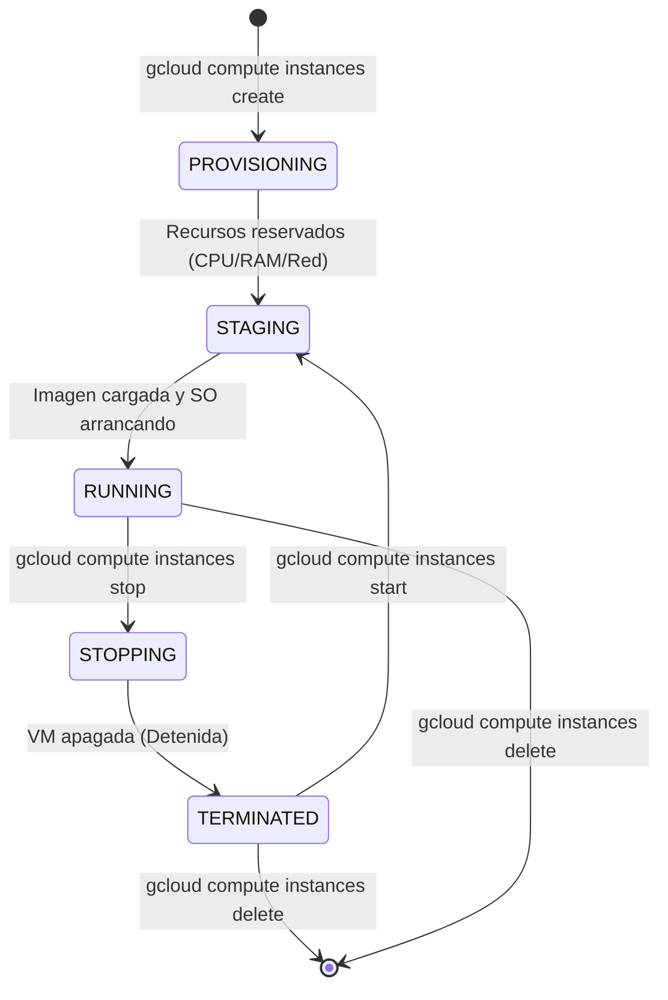
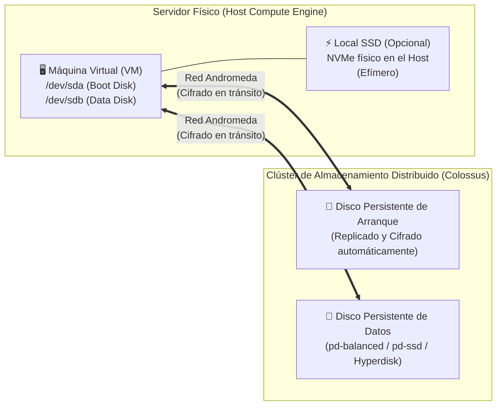
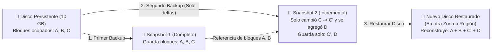
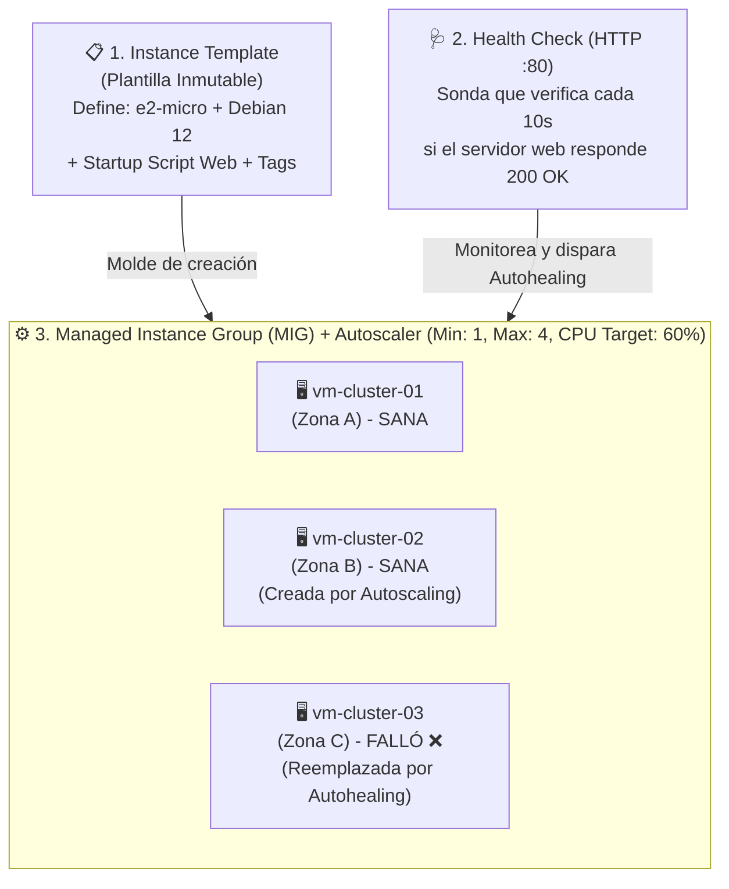

# Playbook 04: Infraestructura como Servicio con Google Compute Engine — VMs, Discos, Snapshots y Clústeres Autoescalables

## 1. Introducción: ¿Qué es Google Compute Engine (GCE)?

**Google Compute Engine (GCE)** es el servicio de **Infraestructura como Servicio (IaaS)** de Google Cloud que permite crear y ejecutar **Máquinas Virtuales (VMs)** sobre la infraestructura global de Google. Con Compute Engine tienes control absoluto sobre el sistema operativo (Linux o Windows Server), el almacenamiento en bloques adjunto, las interfaces de red, las reglas de firewall y cualquier software o configuración de kernel que tu carga de trabajo necesite.

### 1.1. Arquitectura Interna: Hipervisor y *Live Migration*
Debajo de cada máquina virtual de Compute Engine opera un hipervisor basado en **KVM (Kernel-based Virtual Machine)** altamente personalizado y endurecido por Google, apoyado por chips dedicados de seguridad e infraestructura (**Google Titanium**) que descargan el procesamiento de red (Andromeda) y de almacenamiento en bloque fuera de las CPUs principales de tu máquina virtual.

Una de las capacidades más importantes de Compute Engine es la **Migración en Vivo (*Live Migration*)**:
- Cuando Google necesita realizar mantenimiento de hardware o actualizar el software del servidor físico (*host*) donde corre tu VM, **no apaga ni reinicia tu máquina virtual**.
- En su lugar, Google mueve tu VM en ejecución (incluyendo su memoria RAM activa y sus conexiones de red abiertas) hacia otro servidor físico sano dentro de la misma zona de forma totalmente transparente, sin que tus usuarios ni tu aplicación noten interrupción alguna.

---

## 2. Familias y Tipos de Máquinas Virtuales

Google Cloud clasifica sus máquinas virtuales en **Familias de Máquinas** según el tipo de carga de trabajo. Comprender su nomenclatura es clave para no pagar de más ni quedarse corto de recursos.

### 2.1. Cómo leer el nombre de un Tipo de Máquina
La mayoría de las máquinas siguen el estándar **`<serie>-<perfil>-<número_de_vCPUs>`**:
- Ejemplo: **`n2-standard-4`**
  - **`n2`**: Serie y generación del procesador (Serie N, 2.ª generación Intel Xeon). *(Si termina en `d` como `n2d` o `c2d`, utiliza procesadores **AMD EPYC**; si termina en `a` como `t2a` o `c4a`, utiliza arquitectura **ARM**).*
  - **`standard`**: Perfil de balance entre CPU y memoria RAM (`standard` = 4 GB de RAM por cada vCPU; `highmem` = 8 GB de RAM por vCPU; `highcpu` = 1 o 2 GB de RAM por vCPU).
  - **`4`**: Cantidad de CPUs virtuales (**vCPUs**, donde 1 vCPU equivale a 1 hilo de hardware o *hyperthread*). Por lo tanto, una `n2-standard-4` tiene **4 vCPUs y 16 GB de RAM**.

### 2.2. Comparativa de Familias de Máquinas en Compute Engine

| Familia | Series Principales | Características Técnicas | Casos de Uso Ideales |
| :--- | :--- | :--- | :--- |
| **Propósito General (Costo-Optimizado)** | **`E2`** (`e2-micro`, `e2-small`, `e2-medium`, `e2-standard-*`) | Asignación dinámica de procesador (Intel o AMD según disponibilidad en la zona). Excelente relación costo-beneficio. | Entornos de desarrollo, laboratorios, microservicios ligeros, servidores web de tráfico bajo/medio y entornos de prueba. |
| **Propósito General (Equilibrado / Rendimiento)** | **`N2`, `N2D`, `N4`, `C3`, `C4`** | Procesadores dedicados de última generación con velocidad de reloj sostenida y soporte para discos avanzados (*Hyperdisk*). | Aplicaciones empresariales de producción, servidores de aplicaciones, bases de datos medianas y backends de tráfico constante. |
| **Optimizadas para Cómputo (Compute-Optimized)** | **`C2`, `C2D`, `H3`** | La frecuencia por núcleo más alta disponible (Ghz elevados) y rendimiento determinista sin sobreasignación. | Computación de alto rendimiento (HPC), servidores de videojuegos multijugador, codificación de video, modelado financiero e inferencia en CPU. |
| **Optimizadas para Memoria (Memory-Optimized)** | **`M1`, `M2`, `M3`, `M4`, `X4`** | Desde cientos de GB hasta **32 TB de memoria RAM** en una sola máquina virtual. | Bases de datos gigantes en memoria como **SAP HANA**, análisis en memoria a gran escala y motores OLTP masivos. |
| **Optimizadas para Aceleradores (GPU / AI)** | **`A2`, `A3`, `A4`, `G2`**, entre otras | Equipadas con GPUs **NVIDIA** (por ejemplo A100, H100, B200 o L4) conectadas mediante NVLink de alta velocidad. Para IA a gran escala Google también ofrece sus propios aceleradores **Cloud TPU**. | Entrenamiento e inferencia de Modelos de Lenguaje Grande (LLMs), Deep Learning, renderizado 3D y procesamiento gráfico pesado. |

---

## 3. Modelos de Aprovisionamiento, Ciclo de Vida y Optimización de Costos (FinOps)

### 3.1. Ciclo de Vida de una VM y ¿Qué se cobra en cada estado?

> [!WARNING]
> **¡Atención con las Máquinas Detenidas (`TERMINATED`)!**
> Cuando detienes una VM (`gcloud compute instances stop`), **dejas de pagar por las vCPUs y la memoria RAM**. Sin embargo, **SIGUES PAGANDO** por:
> 1. Todos los **Discos Persistentes (Boot Disk y Data Disks)** asociados a la máquina (se cobran por los GB aprovisionados al mes, esté encendida o apagada la VM).
> 2. Las **Direcciones IP Externas Estáticas (Reservadas)** si no están asignadas a una instancia en ejecución (`RUNNING`).
> Para dejar de pagar el 100%, debes **eliminar la instancia y sus discos**, o bien tomar un **Snapshot** (mucho más económico por GB) y borrar el disco.

### 3.2. Opciones de Ahorro en Compute Engine
1. **Facturación por Segundo**: Compute Engine factura por segundo de uso (con un mínimo de 1 minuto).
2. **Máquinas Spot (*Spot VMs*, antes *Preemptible VMs*)**:
   - Ofrecen **descuentos de entre el 60% y el 91%** frente al precio estándar porque utilizan capacidad excedente de los centros de datos de Google.
   - **La condición**: Si Google necesita recuperar esa capacidad para un cliente de pago estándar en esa zona, **detendrá o eliminará tu Spot VM con un aviso previo de 30 segundos** (señal ACPI).
   - **Cuándo usarlas**: Procesamiento por lotes (*batch*), renderizado, pipelines de CI/CD, nodos trabajadores en GKE o clústeres autoescalables (*stateless*) que toleran que una máquina desaparezca y sea reemplazada por otra.
3. **Descuentos por Uso Continuado (*Sustained Use Discounts - SUDs*)**: En familias como N1/N2, Google aplica descuentos automáticos de hasta el 20%–30% si una VM corre durante una gran parte del mes, sin que tengas que firmar ningún compromiso. *(No aplican a todas las series; por ejemplo, las `E2` no reciben SUDs porque ya tienen un precio base reducido).*
4. **Descuentos por Compromiso de Uso (*Committed Use Discounts - CUDs*)**: Si sabes que tu empresa usará una cantidad base de vCPUs y RAM durante **1 año o 3 años**, puedes firmar un CUD para obtener entre **37% y 55% (o hasta 70% en memoria)** de descuento garantizado.

---

## 4. Arquitectura de Almacenamiento en Bloque (Block Storage)

Un concepto arquitectónico vital en Google Cloud es que **los Discos Persistentes (`Persistent Disks`) NO están físicamente dentro del servidor donde corre tu VM**. Son volúmenes de almacenamiento en bloque distribuidos y conectados a través de la red interna de altísima velocidad de Google.

### Ventajas de que los Discos Persistentes sean de Red:
- **Supervivencia independiente**: Si el servidor físico de tu VM falla o si tú decides destruir la VM conservando el disco, tus datos siguen intactos en el disco persistente.
- **Redimensionamiento en caliente (*Online Resizing*)**: Puedes aumentar el tamaño de un disco persistente (por ejemplo, pasar de 10 GB a 500 GB) mientras la máquina virtual está encendida y trabajando, sin tiempo de inactividad.
- **Lectura simultánea (*Multi-Attach Read-Only*)**: Ciertos discos persistentes pueden montarse en modo de **solo lectura** en múltiples máquinas virtuales al mismo tiempo.

### 4.1. Comparativa de Tipos de Discos en Compute Engine

| Tipo de Disco | Identificador en CLI | Tecnología | Alcance | Características y Caso de Uso |
| :--- | :--- | :--- | :--- | :--- |
| **Balanced Persistent Disk** | `pd-balanced` | SSD | Zonal o Regional | **El predeterminado para la mayoría de series** (como `E2` y `N2`). Equilibrio óptimo entre rendimiento (IOPS) y precio para la mayoría de discos de arranque y aplicaciones generales. *(Las series más nuevas, como `C3`, `C4` o `N4`, usan Hyperdisk).* |
| **Performance (SSD) Persistent Disk** | `pd-ssd` | SSD de baja latencia | Zonal o Regional | Mayor cantidad de IOPS por GB y latencia de un solo dígito de milisegundo. Ideal para bases de datos relacionales o NoSQL. |
| **Standard Persistent Disk** | `pd-standard` | Magnético (HDD) | Zonal o Regional | Económico pero con bajos IOPS. Útil para lecturas/escrituras secuenciales grandes (logs históricos, backups calientes, procesamiento batch tipo Kafka/Hadoop). |
| **Google Cloud Hyperdisk** | `hyperdisk-balanced` / `hyperdisk-extreme` | SSD de última generación | Zonal (existe también *Hyperdisk Balanced High Availability*, replicado entre dos zonas) | Desacopla el tamaño del disco de su velocidad: puedes pedir un disco pequeño con miles de IOPS y MB/s configurables en caliente. Usado en familias modernas (`C3`, `N4`, `C4`). |
| **Local SSD** | `local-ssd` | NVMe físico directo en el Host | Servidor físico local | **Efímero** (por defecto los datos se pierden si detienes o eliminas la VM). Ofrece millones de IOPS y latencia sub-milisegundo para cachés temporales, *scratch disks* o *shuffling* de datos. |

> [!NOTE]
> **Discos Persistentes Regionales (`--replica-zones`)**: Cuando creas un disco persistente regional, Google escribe cada bloque de forma **síncrona en dos zonas distintas** dentro de la misma región (ej. `us-central1-a` y `us-central1-b`). Si toda la zona `a` cae, puedes conectar inmediatamente ese disco a una VM de respaldo en la zona `b` sin perder un solo byte de datos.

---

## 5. Snapshots, Imágenes Personalizadas y Machine Images

Cuando trabajas con máquinas virtuales, existen tres mecanismos distintos para respaldar o clonar servidores. Confundirlos es un error común en exámenes de certificación y en producción:

### 5.1. ¿Cómo funcionan los Snapshots (Instantáneas)?
Un **Snapshot** es una copia de seguridad puntual (*point-in-time backup*) de un disco persistente.
- **Son Incrementales**: El **Snapshot #1** copia únicamente los bloques que contienen datos reales (si tu disco es de 100 GB pero solo usas 5 GB, el snapshot solo almacena y te cobra esos 5 GB comprimidos). El **Snapshot #2** lee solo los bloques que cambiaron (`Δ`) desde el Snapshot #1.
- **Son Seguros al Borrar**: Si eliminas el Snapshot #1, Google mueve automáticamente los bloques necesarios hacia el Snapshot #2 para que este siga siendo 100% restaurable por sí mismo.
- **Están en Cloud Storage (Oculto/Administrado)**: Los snapshots se guardan redundantemente fuera de tu zona (en ubicaciones regionales o multi-regionales), por lo que sirven para **migrar un disco de una zona a otra, o incluso de un continente a otro**.

### 5.2. Tabla Comparativa: ¿Cuál usar en cada escenario?

| Recurso | ¿Qué respalda? | ¿Es Incremental? | Caso de Uso Principal |
| :--- | :--- | :--- | :--- |
| **Snapshot (Instantánea)** | **Un único Disco Persistente** (sea de arranque o de datos) | **Sí** (muy económico para backups periódicos) | **Copias de seguridad periódicas (Backups)** automatizadas por horario (*Snapshot Schedules*), recuperación ante desastres y migración de discos entre zonas. |
| **Custom Image (Imagen Personalizada)** | Un disco de arranque preparado como plantilla de Sistema Operativo (*Golden Image*) | No (se paga por la imagen completa) | Crear una **imagen maestra endurecida (Hardened OS)** con tus paquetes, agentes de seguridad y dependencias preinstaladas para arrancar cientos de VMs rápido sin descargar paquetes desde cero. |
| **Machine Image (Imagen de Máquina)** | **La VM completa**: configuración de hardware, metadatos, interfaces de red, etiquetas y **todos** sus discos adjuntos | Sí (para los datos de los discos) | Clonar o respaldar un servidor complejo completo (con múltiples discos y configuración exacta de red) en un solo paso. |

---

## 6. Acceso Seguro a las VMs y Automatización con Startup Scripts

### 6.1. ¿Cómo funciona SSH en Compute Engine sin contraseñas?
En Google Cloud, las imágenes Linux oficiales vienen con la autenticación por contraseña SSH **deshabilitada por seguridad**. En su lugar, cuando ejecutas `gcloud compute ssh nombre-vm` o haces clic en el botón **SSH** en la consola web:
1. `gcloud` genera un par de llaves criptográficas SSH (pública y privada) efímeras o locales en tu Cloud Shell (`~/.ssh/google_compute_engine`).
2. `gcloud` sube tu **llave pública** a los **Metadatos** de la instancia o del proyecto (o utiliza tu perfil de **OS Login** en IAM).
3. Dentro de la VM, el demonio preinstalado **`google-guest-agent`** detecta la llave pública autorizada, crea tu usuario Linux automáticamente si no existía y te permite entrar de forma cifrada.

### 6.2. Identity-Aware Proxy (IAP) TCP Forwarding
En arquitecturas empresariales seguras, **las máquinas virtuales de backend o bases de datos NO deben tener dirección IP pública (externa)**. Pero si una VM no tiene IP pública, ¿cómo nos conectamos a ella por SSH para administrarla?
- Mediante **Cloud IAP (Identity-Aware Proxy) para TCP**.
- Al pasar el parámetro **`--tunnel-through-iap`** al comando `gcloud compute ssh`, Google verifica tu identidad de IAM y abre un túnel HTTPS cifrado desde tu Cloud Shell hasta la IP privada interna de tu VM (permitiendo el paso desde el rango interno oficial de IAP de Google: `35.235.240.0/20` al puerto `22`).

### 6.3. Scripts de Inicio (*Startup Scripts*) y Servidor de Metadatos
Un **Startup Script** es un script (en Bash para Linux o PowerShell/Batch para Windows) que se almacena en los metadatos de la instancia y se ejecuta automáticamente como `root` cada vez que la máquina virtual arranca.
- **Forma recomendada de pasarlo**: guardarlo en un archivo y usar `--metadata-from-file=startup-script=mi-script.sh`. La alternativa `--metadata=startup-script='...'` interpreta las **comas** como separadores entre claves, así que un script que contenga comas (por ejemplo en CSS o en comandos) rompe el comando con el error `Bad syntax for dict arg`.
- Es el mecanismo fundamental para que una VM recién creada en un clúster autoescalable se configure sola (instalar Nginx/Docker, descargar la última versión de la aplicación e iniciar el servicio) sin intervención humana.
- Además, desde dentro de cualquier VM en GCP puedes consultar información interna sobre sí misma (su nombre, zona, ID de proyecto, IP o token de su Service Account) haciendo una petición HTTP interna a **`http://metadata.google.internal/computeMetadata/v1/`** pasando el encabezado `Metadata-Flavor: Google`.

---

## 7. Alta Disponibilidad y Escalabilidad Horizontal: Plantillas y Grupos de Instancias Administrados (MIGs)

Una sola máquina virtual —por grande que sea— representa un **Punto Único de Fallo (*Single Point of Failure - SPOF*)**. En la nube moderna, las aplicaciones se diseñan para escalar **horizontalmente**: en lugar de tener 1 servidor gigante (*Scale Up*), tenemos un clúster elástico de servidores pequeños (*Scale Out*) que crece cuando hay muchos usuarios y se reduce cuando el tráfico baja.

En Compute Engine, esto se logra combinando tres componentes:

### 7.1. Instance Template (Plantilla de Instancia)
Es el plano o molde de diseño que define cómo deben ser las máquinas virtuales del clúster: qué tipo de máquina (`e2-micro`), qué imagen de sistema operativo o *Custom Image*, qué tamaño de disco, qué etiquetas de red (*Network Tags*) y qué *Startup Script* ejecutarán al nacer.
- **Dato clave**: Las plantillas de instancia son **inmutables** (no se pueden editar una vez creadas). Si quieres actualizar la versión de tu aplicación o cambiar el tamaño de máquina, creas una `plantilla-v2` y le pides al MIG que realice una actualización progresiva (*Rolling Update*) reemplazando las máquinas viejas por nuevas sin tirar el servicio.

### 7.2. Managed Instance Group (MIG — Grupo de Instancias Administrado)
Es el controlador que mantiene vivo y elástico a tu clúster de máquinas idénticas creadas a partir del *Instance Template*. Sus cuatro superpoderes son:
1. **Autoescalamiento (*Autoscaling*)**: Agrega nuevas VMs automáticamente cuando sube la carga y elimina VMs cuando la carga disminuye (ahorrando costos). Puede escalar basándose en:
   - **Utilización promedio de CPU** (ej. mantener el clúster al 60% de CPU).
   - **Capacidad de un Balanceador de Carga HTTP(S)** (peticiones por segundo o utilización).
   - **Métricas personalizadas de Cloud Monitoring** (ej. cantidad de mensajes pendientes en una cola de Cloud Pub/Sub).
   - **Cronogramas (*Scaling Schedules*)** (ej. tener mínimo 10 servidores todos los lunes a las 8:00 AM).
   - **Reducción prudente**: para evitar oscilaciones, el autoscaler espera unos **10 minutos** de carga baja (periodo de estabilización) antes de eliminar VMs.
2. **Autoreparación (*Autohealing*)**: A diferencia de la recuperación básica que solo mira si la VM está encendida, el *Autohealing* utiliza un **Health Check** a nivel de aplicación (por ejemplo, hacer un `GET /health` al puerto `80` cada 10 segundos). Si Nginx se cuelga y deja de responder `HTTP 200`, aunque el sistema operativo Linux siga encendido, el MIG destruye esa VM defectuosa y crea una nueva automáticamente.
   - **Requisito de red**: las sondas de los Health Checks provienen de los rangos de Google **`35.191.0.0/16`** y **`130.211.0.0/22`**. Debe existir una regla de firewall que permita ese tráfico hacia el puerto revisado; si no, todas las VMs aparecerán como `UNHEALTHY` y el MIG las recreará en bucle.
3. **Cobertura Regional (Multi-Zona)**: Un **MIG Regional** reparte tus máquinas entre varias zonas de una región (por defecto 3, ej. `us-central1-a`, `b` y `c`). Si una zona completa falla, las demás absorben la carga.
4. **Actualizaciones Progresivas (*Rolling Updates & Canary*)**: Permite desplegar cambios gradualmente (por ejemplo, actualizar de una en una las VMs, o enviar una nueva versión solo al 10% de las instancias para probarla en producción).

---

## 8. Referencias Oficiales

- **Documentación General de Compute Engine**: [https://docs.cloud.google.com/compute/docs](https://docs.cloud.google.com/compute/docs)
- **Guía de Comparación de Familias de Máquinas Virtuales**: [https://docs.cloud.google.com/compute/docs/machine-resource](https://docs.cloud.google.com/compute/docs/machine-resource)
- **Opciones de Almacenamiento en Compute Engine (Persistent Disk, Hyperdisk, Local SSD)**: [https://docs.cloud.google.com/compute/docs/disks](https://docs.cloud.google.com/compute/docs/disks)
- **Funcionamiento de Snapshots de Persistent Disk y Buenas Prácticas**: [https://docs.cloud.google.com/compute/docs/disks/snapshots](https://docs.cloud.google.com/compute/docs/disks/snapshots)
- **Conexión Segura a VMs mediante Identity-Aware Proxy (IAP)**: [https://docs.cloud.google.com/iap/docs/using-tcp-forwarding](https://docs.cloud.google.com/iap/docs/using-tcp-forwarding)
- **Grupos de Instancias Administrados (MIGs) y Autoescalamiento**: [https://docs.cloud.google.com/compute/docs/instance-groups](https://docs.cloud.google.com/compute/docs/instance-groups)
- **Políticas de Autoescalamiento de Grupos de Instancias**: [https://docs.cloud.google.com/compute/docs/autoscaler](https://docs.cloud.google.com/compute/docs/autoscaler)
