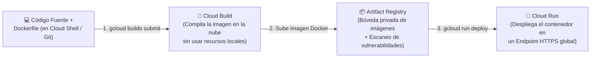
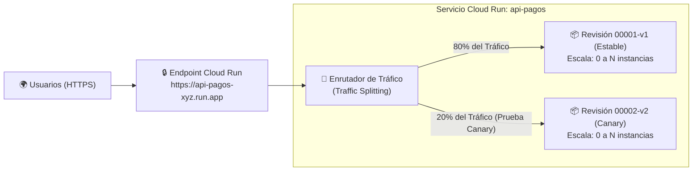
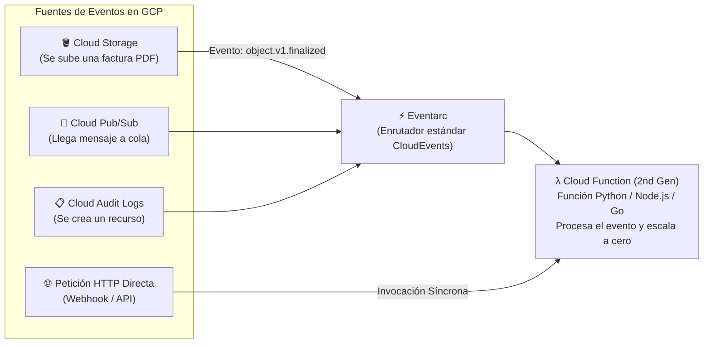

# Playbook 05: Contenedores y Cómputo Serverless — Artifact Registry, Cloud Build, Cloud Run y Cloud Functions

## 1. Introducción: De las Máquinas Virtuales a los Contenedores y al Mundo Serverless

En el Módulo 04 aprendimos a administrar **Máquinas Virtuales (Compute Engine)**. Aunque las VMs ofrecen control total sobre el sistema operativo, presentan tres retos importantes para el desarrollo moderno de software:
1. **Peso y Velocidad de Arranque**: Una VM incluye un sistema operativo invitado completo (varios gigabytes) y tarda entre 30 y 90 segundos en arrancar y ejecutar su *Startup Script*.
2. **El problema de *"En mi máquina sí funciona"***: Diferencias sutiles en librerías del sistema o versiones de Python/Node.js entre la laptop del desarrollador y la VM de producción causan fallos inesperados.
3. **Pago por Capacidad Ociosa**: Si tu servidor web recibe cero visitas a las 3:00 AM, una VM encendida te sigue cobrando el 100% de su CPU, RAM y disco.

### 1.1. ¿Qué resuelve un Contenedor?
Un **Contenedor** empaqueta únicamente el código de tu aplicación, su intérprete (ej. Python, Node.js, Go, JVM) y sus dependencias exactas dentro de una **imagen inmutable y ligera**, compartiendo el kernel de Linux del sistema anfitrión de forma aislada (*Namespaces* y *cgroups*).

### 1.2. ¿Qué significa "Serverless" (Sin Servidor)?
*Serverless* no significa que no existan servidores físicos; significa que **Google Cloud administra el 100% de la infraestructura subyacente, los parches de seguridad y el escalado**. Sus cuatro características definitorias son:
- **Cero administración de servidores o clústeres**.
- **Escalado automático en segundos** desde 1 hasta miles de instancias según las peticiones entrantes.
- **Escalado a Cero (*Scale to Zero*)**: Si nadie está usando tu aplicación o API, el número de instancias baja a `0` y **pagas $0.00 USD por cómputo**.
- **Facturación granular por uso real**: Solo pagas por los milisegundos exactos de CPU y memoria consumidos mientras tu código procesa una solicitud o evento.

---

## 2. El Pipeline de Contenedores en GCP: Cloud Build y Artifact Registry

Antes de ejecutar un contenedor en la nube, necesitamos **construir la imagen (*Build*)** y **almacenarla en un registro privado seguro (*Registry*)**.

### 2.1. Cloud Build
Es el servicio serverless de Integración y Entrega Continua (**CI/CD**) de Google Cloud. Cuando ejecutas `gcloud builds submit`, Cloud Build comprime tu código, levanta un entorno de compilación efímero en la nube, ejecuta tu `Dockerfile` (o utiliza **Google Cloud Buildpacks** para crear la imagen automáticamente aunque no tengas un `Dockerfile`) y guarda la imagen resultante.

### 2.2. Artifact Registry
Es el gestor universal y privado de artefactos de Google Cloud y el **reemplazo oficial del antiguo *Container Registry* (`gcr.io`)**, que fue retirado: hoy los dominios `gcr.io` son atendidos por Artifact Registry.
- Almacena no solo **imágenes de contenedores Docker/OCI**, sino también paquetes privados de **Python (`pip`), Node.js (`npm`), Java (`Maven/Gradle`), Go y Apt/Yum**.
- Es un recurso **Regional o Multi-Regional** con control estricto de permisos por IAM (`roles/artifactregistry.reader` / `writer`) y análisis automático de vulnerabilidades (*Artifact Analysis*).

---

## 3. Google Cloud Run: Contenedores Serverless a Escala Planetaria

**Cloud Run** es la plataforma insignia de Google Cloud para ejecutar contenedores sin servidor. Su API es compatible con el estándar abierto **Knative** y ofrece dos **entornos de ejecución** con aislamiento fuerte:
- **Primera generación (gen1)**: basada en **gVisor**, un kernel de seguridad en espacio de usuario que emula la mayoría de las llamadas al sistema. Ofrece arranques en frío muy rápidos.
- **Segunda generación (gen2)**: una **microVM con compatibilidad Linux completa** (todas las llamadas al sistema, cgroups, sistemas de archivos de red), mejor rendimiento de CPU y red; requiere al menos 512 MiB de memoria.
- Para los **servicios**, Cloud Run elige el entorno según las funciones que uses (o puedes fijarlo con `--execution-environment`); los **jobs** siempre usan gen2. Ambos entornos cuestan lo mismo.

### 3.1. Dos Formas de Ejecutar Cargas en Cloud Run
1. **Cloud Run Services (Servicios)**:
   - Diseñados para **APIs REST, GraphQL, aplicaciones web, microservicios gRPC, WebSockets o backends de agentes de IA**.
   - Tu contenedor debe escuchar peticiones HTTP en el puerto inyectado en la variable de entorno **`$PORT`** (por defecto `8080`).
   - Al desplegarlo, Cloud Run te entrega automáticamente una **URL pública con certificado TLS/HTTPS válido (`https://mi-servicio-xxxx.run.app`)** y un balanceador de carga integrado.
2. **Cloud Run Jobs (Trabajos por Lotes)**:
   - Diseñados para **scripts de migración de bases de datos, procesamiento de datos nocturno, generación de reportes o tareas por lotes**.
   - No escuchan en un puerto HTTP: el contenedor arranca, ejecuta su tarea (incluso dividiéndola en múltiples tareas paralelas), devuelve código de salida `0` y se apaga inmediatamente. Cada tarea puede durar **hasta 168 horas (7 días)**.

### 3.2. Arquitectura de Revisiones Inmutables y División de Tráfico (*Traffic Splitting*)

Cada vez que despliegas un cambio de código o de variables de entorno en un Servicio de Cloud Run, **no sobrescribes la versión anterior**. En su lugar, Cloud Run crea una nueva **Revisión Inmutable (*Revision*)**:

Esto te permite implementar estrategias de despliegue avanzadas sin instalar mallas de servicios complejas:
- **Despliegue Canary (Progresivo)**: Enviar solo el **10% o 20%** del tráfico real a la nueva revisión `v2` para monitorear si hay errores antes de enviarlo al 100% de los usuarios.
- **Pruebas con Revision Tags (`--no-traffic --tag=qa`)**: Desplegar una nueva revisión con **0% del tráfico de producción**, pero accesible mediante una URL exclusiva (`https://qa---api-pagos-xyz.run.app`) para que el equipo de pruebas la valide en vivo.
- **Rollback Instantáneo**: Si la revisión `v2` presenta un fallo en producción, puedes regresar el **100% del tráfico a la revisión `v1` en un par de segundos** con un solo comando `gcloud run services update-traffic`.

### 3.3. El Superpoder Económico de Cloud Run: La Concurrencia
En las funciones serverless tradicionales de primera generación, si llegan **50 peticiones al mismo segundo**, la nube debe levantar **50 instancias separadas** (y cobrarte 50 veces la memoria y CPU).

En **Cloud Run**, tú defines la **Concurrencia (`--concurrency`, por defecto `80`, máximo `1000`)**:
- Una **única instancia** de tu contenedor en Cloud Run puede atender hasta **80 peticiones HTTP simultáneas** (ideal para aplicaciones en Node.js, Go, Python FastAPI/Async o Java que esperan respuestas de bases de datos o APIs externas).
- Si tu carga usa mucha CPU por petición (como comprimir un PDF o ejecutar un modelo ML en CPU), puedes configurar `--concurrency=1` para que cada petición tenga su propia instancia exclusiva.

### 3.4. Control de *Cold Starts* (Arranques en Frío) y Límites Máximos
- **`--min-instances` (Por defecto `0`)**: Si está en `0`, ahorras el máximo dinero porque escala a cero sin tráfico, pero la primera petición después de un periodo de inactividad sufrirá un pequeño *Cold Start* (1 a 3 segundos mientras levanta el contenedor). Si configuras `--min-instances=1`, Cloud Run mantiene 1 contenedor precalentado listo para responder en milisegundos.
- **`--max-instances`**: Límite de seguridad para evitar que un pico de tráfico masivo o un ataque DDoS levante 1,000 contenedores, agote las conexiones de tu base de datos Cloud SQL o dispare tu factura.

---

## 4. Cloud Run functions (Cloud Functions 2nd Gen): Código Orientado a Eventos

¿Qué ocurre cuando ni siquiera quieres crear un `Dockerfile` ni configurar un servidor web, sino simplemente escribir una función en Python o Node.js de 20 líneas que se ejecute cuando ocurra un evento en la nube?

Ahí entra **Cloud Run functions** (conocido históricamente como **Cloud Functions 2nd Gen**). Hoy en día, las funciones de 2.ª generación se construyen automáticamente sobre **Cloud Build**, corren sobre el motor de **Cloud Run** y reciben eventos a través de **Eventarc**.

Existen dos formas válidas de desplegarlas:
| Comando | Qué hace | Cuándo usarlo |
| :--- | :--- | :--- |
| `gcloud functions deploy NOMBRE --gen2 ...` | Crea la función y su *trigger* (HTTP o de eventos) en un solo comando | El flujo clásico, muy usado en tutoriales y en el Laboratorio 05 |
| `gcloud run deploy NOMBRE --source . --function=PUNTO_DE_ENTRADA --base-image=python313` | Despliega la función como un servicio de Cloud Run; los eventos se conectan aparte con `gcloud eventarc triggers create` | El flujo que usa la documentación más reciente; da acceso directo a todas las opciones de Cloud Run |

> [!IMPORTANT]
> **Permisos de compilación**: desde 2024 Cloud Build compila con la **cuenta de servicio predeterminada de Compute Engine**. La documentación de Cloud Run indica otorgarle el rol **`roles/run.builder`** para desplegar desde código fuente. Para *triggers* de Eventarc, la identidad del *trigger* necesita además **`roles/eventarc.eventReceiver`** y **`roles/run.invoker`**, y el agente de servicio de Cloud Storage necesita **`roles/pubsub.publisher`**.

### Los 2 Tipos Principales de Funciones
1. **Funciones HTTP (`--trigger-http`)**:
   - Se invocan de forma **síncrona** mediante una petición `GET` o `POST` a su URL HTTPS. Ideales para Webhooks (ej. recibir notificaciones de pago de Stripe o un bot de Telegram/Slack) y micro-APIs ligeras.
2. **Funciones Basadas en Eventos (*Event-Driven* / CloudEvents)**:
   - Se invocan de forma **asíncrona** cuando ocurre un cambio de estado en otro servicio de GCP:
     - `--trigger-bucket`: Se dispara automáticamente cuando se sube, sobrescribe o borra un archivo en un Bucket de Cloud Storage.
     - `--trigger-topic`: Se dispara cuando un sistema publica un mensaje en un tópico de **Cloud Pub/Sub**.
     - `--trigger-event-filters`: Se dispara ante eventos de decenas de servicios de GCP (Firestore, BigQuery, IAM, Compute Engine, y cualquier servicio que emita *Cloud Audit Logs*) a través de **Eventarc**.
   - El bucket de Cloud Storage debe estar en la **misma región** (o multirregión) que el *trigger*, y un *trigger* recién creado puede tardar **hasta 2 minutos** en quedar operativo.

---

## 5. Matriz de Decisión: ¿Cuándo usar Cloud Run vs Cloud Functions vs Compute Engine vs GKE?

| Criterio | **Cloud Functions (2nd Gen)** | **Cloud Run** | **Google Kubernetes Engine (GKE)** | **Compute Engine (VMs)** |
| :--- | :--- | :--- | :--- | :--- |
| **Unidad de Despliegue** | Una **Función** en un lenguaje soportado (Python, Node, Go, Java, PHP, Ruby, .NET) | **Cualquier Contenedor** (cualquier lenguaje, binario o librería del sistema) | **Pods y Manifiestos YAML** de Kubernetes | **Imagen de Sistema Operativo** (Linux / Windows) |
| **¿Escala a Cero ($0)?** | **Sí** | **Sí** | No | No |
| **Tiempo máximo por petición** | Hasta **60 minutos** (HTTP) / 9 min (Eventos) | Hasta **60 minutos** por petición (Services) / **168 horas** por tarea (Jobs) | **Ilimitado** (procesos permanentes 24/7) | **Ilimitado** |
| **Caso de Uso Ideal** | Automatizaciones impulsadas por eventos (*Event-Driven*), transformación de archivos al subirlos a GCS, Webhooks rápidos. | **El estándar por defecto para APIs modernas, backends web, microservicios y aplicaciones en contenedores**. | Plataformas complejas con decenas de microservicios interconectados que requieren ecosistema Kubernetes avanzado. | Sistemas *legacy*, bases de datos instaladas manualmente o software que exige drivers de kernel específicos. |

---

## 6. Referencias Oficiales

- **Documentación Oficial de Cloud Run**: [https://docs.cloud.google.com/run/docs](https://docs.cloud.google.com/run/docs)
- **División de Tráfico (Traffic Splitting) y Revisiones en Cloud Run**: [https://docs.cloud.google.com/run/docs/rollouts-rollbacks-traffic-migration](https://docs.cloud.google.com/run/docs/rollouts-rollbacks-traffic-migration)
- **Documentación de Cloud Run functions (Cloud Functions 2nd Gen)**: [https://docs.cloud.google.com/functions/docs](https://docs.cloud.google.com/functions/docs)
- **Documentación de Artifact Registry**: [https://docs.cloud.google.com/artifact-registry/docs](https://docs.cloud.google.com/artifact-registry/docs)
- **Documentación de Cloud Build**: [https://docs.cloud.google.com/build/docs](https://docs.cloud.google.com/build/docs)
- **Arquitectura de Eventos con Eventarc**: [https://docs.cloud.google.com/eventarc/docs](https://docs.cloud.google.com/eventarc/docs)
- **Entornos de Ejecución de Cloud Run (gen1 vs gen2)**: [https://docs.cloud.google.com/run/docs/about-execution-environments](https://docs.cloud.google.com/run/docs/about-execution-environments)
- **Desplegar desde Código Fuente en Cloud Run (permisos de compilación)**: [https://docs.cloud.google.com/run/docs/deploying-source-code](https://docs.cloud.google.com/run/docs/deploying-source-code)
