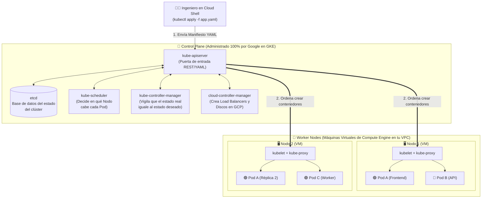
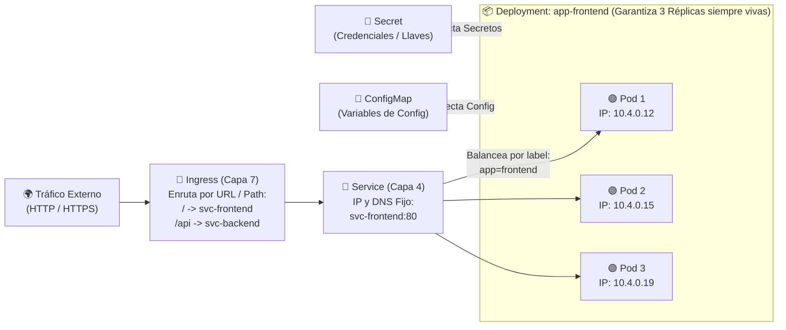
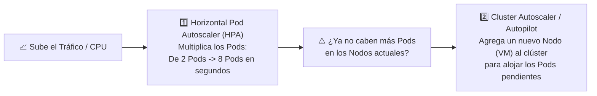

# Playbook 06: Orquestación de Contenedores con Google Kubernetes Engine (GKE) — Arquitectura, Autopilot, Pods, Deployments, Services, Secrets e Ingress

## 1. Introducción: ¿Qué es Kubernetes y por qué nació en Google?

En el Módulo 05 vimos cómo ejecutar un contenedor individual en Cloud Run. Sin embargo, cuando una organización opera decenas o cientos de microservicios interconectados que requieren redes internas avanzadas, almacenamiento persistente adjunto, comunicación de baja latencia entre contenedores, demonios por nodo o portabilidad multi-nube, necesita un **Orquestador de Contenedores**.

**Kubernetes (K8s)** fue creado originalmente por Google a partir de más de una década de experiencia operando **Borg** (el sistema interno que ejecuta miles de millones de contenedores por semana para Gmail, YouTube y Google Search). Google lo publicó como código abierto en **2014** y en **2015**, con el lanzamiento de la versión 1.0, lo donó a la recién creada *Cloud Native Computing Foundation (CNCF)*.

**Google Kubernetes Engine (GKE)** es el servicio de Kubernetes administrado más maduro del mercado: Google actualiza, parchea y mantiene el plano de control de Kubernetes por ti, integrándolo nativamente con las redes VPC, los balanceadores de carga, los discos persistentes, IAM y la observabilidad de GCP.

---

## 2. Arquitectura Interna de un Clúster de Kubernetes en GKE

Un clúster de Kubernetes se divide siempre en dos planos: el **Plano de Control (*Control Plane*)**, que toma las decisiones, y el **Plano de Datos (*Worker Nodes*)**, donde realmente se ejecutan tus contenedores.

### 2.1. Componentes del Control Plane (Administrados por Google)
1. **`kube-apiserver`**: Es el único componente con el que hablas cuando ejecutas comandos `kubectl`. Valida tu identidad IAM, procesa tus archivos YAML y coordina todo el clúster.
2. **`etcd`**: Almacén distribuido clave-valor que guarda la "verdad absoluta" del clúster (qué Pods existen, qué Secrets hay creados y en qué estado están).
3. **`kube-scheduler`**: Cuando pides crear un Pod nuevo que requiere `500m` de CPU y `1Gi` de RAM, el *Scheduler* evalúa todos los nodos disponibles y elige el nodo óptimo donde ubicarlo.
4. **`kube-controller-manager`**: Ejecuta bucles de control infinitos (*Reconciliation Loops*). Si tú declaraste que quieres **3 réplicas** de tu aplicación y un nodo se apaga dejando solo 2, el controlador detecta la diferencia y ordena crear inmediatamente la 3.ª réplica en otro nodo sano.

### 2.2. Componentes de cada Worker Node (Nodo de Trabajo)
1. **`kubelet`**: El agente que corre en cada nodo VM. Recibe las órdenes del `kube-apiserver`, descarga las imágenes desde Artifact Registry y se asegura de que los contenedores dentro de los Pods estén vivos.
2. **Container Runtime (`containerd`)**: El motor de bajo nivel encargado de arrancar y aislar los contenedores en Linux.
3. **`kube-proxy` / Dataplane V2 (Cilium eBPF)**: Administra las reglas de red virtuales para que los Pods puedan comunicarse entre sí y con los *Services*.

---

## 3. Modos de Operación en GKE: Autopilot vs Standard

Al crear un clúster en GKE, debes tomar una decisión arquitectónica fundamental entre dos modos de operación:

| Característica | **GKE Autopilot (Recomendado por Google)** | **GKE Standard** |
| :--- | :--- | :--- |
| **¿Quién administra los Nodos (VMs)?** | **Google Cloud al 100%**. Tú ni siquiera ves ni configuras grupos de nodos (*Node Pools*). | **Tú configuras los Node Pools** (eliges familia de máquina `e2`/`n2`, tamaño y cantidad de nodos). |
| **Modelo de Facturación** | **Pagas únicamente por los recursos (vCPU, RAM y almacenamiento efímero) que solicitan tus Pods en ejecución**. No pagas por espacio vacío en los nodos. | **Pagas por cada Máquina Virtual (Nodo) encendida** en Compute Engine, esté llena de Pods o esté al 10% de uso. |
| **Seguridad y Buenas Prácticas** | Preconfigurado con endurecimiento (*Hardening*) automático, *Workload Identity* y bloqueo de contenedores privilegiados riesgosos. | Flexibilidad total (permite modificar parámetros de kernel de los nodos o ejecutar contenedores privilegiados especiales). |
| **SLA (Acuerdo de Nivel de Servicio)** | **99.95% a nivel de clúster Regional y hasta 99.9% a nivel de Pods**. | 99.95% en el Control Plane (Regional) / 99.5% (Zonal). |
| **¿Cuándo elegirlo?** | **Para el 95% de las cargas de producción modernas** donde quieres toda la potencia de Kubernetes sin perder tiempo administrando VMs ni pagando capacidad ociosa. | Cuando necesitas control de bajo nivel sobre el sistema operativo del nodo o tiempos de aprovisionamiento inmediato en laboratorios zonales rápidos. |

---

## 4. Objetos Fundamentales de Kubernetes (El Lenguaje Declarativo)

En Kubernetes no le dices al sistema *cómo* hacer las cosas paso a paso (imperativo), sino que escribes un archivo **Manifiesto YAML** declarando **qué estado final deseas** (declarativo) y lo aplicas con `kubectl apply -f archivo.yaml`.

### 4.1. Pod (La Unidad Mínima)
En Kubernetes **nunca despliegas un contenedor suelto**; despliegas un **Pod**.
- Un **Pod** es una cápsula que envuelve a **uno** (lo más común) o varios contenedores estrechamente acoplados (patrón *Sidecar*, por ejemplo tu contenedor web + un recolector de logs).
- Todos los contenedores dentro de un mismo Pod comparten **la misma dirección IP privada** y pueden hablarse por `localhost`.
- **Los Pods son mortales y efímeros**: Si un Pod muere, no "revive"; Kubernetes lo destruye y crea un Pod totalmente nuevo con **otra dirección IP distinta**. Por eso en producción nunca creamos Pods sueltos, sino **Deployments**.

### 4.2. Deployment y ReplicaSet (Alta Disponibilidad y Actualizaciones)
El **Deployment** es el controlador que administra el ciclo de vida de tus Pods sin estado (*Stateless*):
- Mantiene un **ReplicaSet** que garantiza que siempre haya exactamente $N$ copias idénticas de tu Pod corriendo (`replicas: 3`).
- Permite hacer **Actualizaciones Progresivas (*Rolling Updates*)**: si cambias la imagen de `v1` a `v2`, el Deployment levanta primero un Pod `v2`, verifica que esté sano (*Readiness Probe*) y solo entonces apaga un Pod `v1`, repitiendo el ciclo con cero tiempo de inactividad.

### 4.3. Service (Red Estable y Balanceo de Carga hacia los Pods)
Como los Pods nacen y mueren cambiando de dirección IP constantemente, ¿cómo hace un microservicio o un usuario para conectarse a ellos? A través de un **Service**.
Un **Service** agrupa dinámicamente a todos los Pods que tengan una etiqueta específica (por ejemplo, `selector: app: frontend`) y les da **una única dirección IP fija y un nombre DNS interno inmutable**.

| Tipo de Service | Alcance | ¿Qué crea en Google Cloud? | Caso de Uso |
| :--- | :--- | :--- | :--- |
| **`ClusterIP`** *(Predeterminado)* | **100% Interno al Clúster** | Una IP virtual interna accesible solo desde otros Pods dentro del clúster. | Microservicios internos de backend, cachés o bases de datos que no deben exponerse directamente a Internet. |
| **`NodePort`** | Nivel de Nodos VM | Abre un puerto alto (`30000–32767`) en cada nodo del clúster. | Históricamente, el escalón intermedio para que un **Ingress** de GKE llegara a los Pods. En los clústeres *VPC-native* actuales, GKE usa **balanceo nativo de contenedores (NEGs)** y el Ingress puede apuntar directamente a Services `ClusterIP`. |
| **`LoadBalancer`** | **Externo (Internet o VPC)** | Aprovisiona automáticamente un **Network Load Balancer (Capa 4 TCP/UDP)** real en GCP con una IP pública dedicada. | Exponer un único servicio directamente a Internet (ideal para protocolos TCP/UDP o un frontend único rápido). |

### 4.4. ConfigMaps y Secrets (Configuración Desacoplada)
Una regla de oro del diseño con contenedores es **no meter configuraciones ni contraseñas dentro de la imagen Docker**, para que la misma imagen exacta sirva en `Desarrollo`, `QA` y `Producción`:
- **`ConfigMap`**: Objeto que almacena configuración **no confidencial** en pares clave-valor o archivos de configuración (ej. `ENTORNO=produccion`, `COLOR_TEMA=azul`, `nginx.conf`).
- **`Secret`**: Objeto que almacena datos **sensibles** (contraseñas, tokens, certificados TLS) para inyectarlos en los Pods como variables de entorno o archivos montados en memoria (`tmpfs`).
  - **Cuidado: Base64 no es cifrado.** Cualquiera con permiso para leer Secrets en el namespace puede decodificarlos. GKE cifra los datos de `etcd` en reposo, y puedes reforzarlo con cifrado de Secrets mediante Cloud KMS.
  - Para credenciales críticas, la práctica recomendada en GKE es guardarlas en **Google Cloud Secret Manager** y montarlas en los Pods con su complemento de integración, usando **Workload Identity Federation for GKE** para que el Pod se autentique sin llaves.

### 4.5. Ingress (Enrutador HTTP/HTTPS Inteligente de Capa 7)
Si tienes 10 microservicios web y expones cada uno con un `Service` tipo `LoadBalancer`, tendrías que pagar **10 Balanceadores de Carga y 10 IPs públicas distintas**.
- El objeto **`Ingress`** resuelve esto: crea **un único Application Load Balancer (HTTP/HTTPS Global o Regional de Capa 7)** en Google Cloud con **una sola IP pública**, y enruta las peticiones hacia múltiples `Services` internos según la ruta URL (`/tienda` -> `svc-tienda`, `/pagos` -> `svc-pagos`) o el subdominio (`api.empresa.com`, `web.empresa.com`).
- El balanceador de un Ingress tarda **varios minutos** en aprovisionarse y también en eliminarse. Antes de borrar un clúster conviene eliminar los Ingress y los Services `LoadBalancer` y **esperar** a que desaparezcan sus reglas de reenvío; si no, pueden quedar recursos huérfanos (como NEGs) en el proyecto.
- **Gateway API**: es la evolución de Ingress en Kubernetes. Separa la infraestructura (`Gateway`, administrada por el equipo de plataforma) de las rutas (`HTTPRoute`, administradas por cada equipo de aplicación) y está disponible de forma nativa en GKE. Para diseños nuevos, Google recomienda evaluar Gateway API.

---

## 5. Escalabilidad Elástica en Dos Dimensiones en GKE

En GKE el autoescalamiento ocurre en dos niveles complementarios:

1. **Horizontal Pod Autoscaler (HPA)**: Vigila el promedio de CPU o memoria de los Pods de un Deployment. Si supera tu umbral (ej. 50% de CPU), incrementa automáticamente el número de réplicas de Pods (ej. de 2 a 10 Pods).
   - El porcentaje se calcula **sobre lo solicitado en `resources.requests`**: sin `requests` de CPU definidos, el HPA no puede calcular la utilización.
   - Se define con la API estable **`autoscaling/v2`** (manifiesto YAML) o con `kubectl autoscale deployment NOMBRE --cpu=50% --min=2 --max=10` en las versiones actuales de `kubectl` (la bandera antigua `--cpu-percent` ya no aparece en la referencia oficial).
2. **Cluster Autoscaler (o GKE Autopilot)**: Si el HPA crea nuevos Pods pero los nodos actuales ya tienen su CPU/RAM llena (los Pods quedan en estado `Pending`), el clúster aprovisiona automáticamente nuevos nodos en Compute Engine y los elimina cuando vuelven a quedar vacíos.

---

## 6. Referencias Oficiales

- **Documentación General de Google Kubernetes Engine (GKE)**: [https://docs.cloud.google.com/kubernetes-engine/docs](https://docs.cloud.google.com/kubernetes-engine/docs)
- **Comparativa Oficial: GKE Autopilot vs GKE Standard**: [https://docs.cloud.google.com/kubernetes-engine/docs/concepts/choose-cluster-mode](https://docs.cloud.google.com/kubernetes-engine/docs/concepts/choose-cluster-mode)
- **Conceptos de Kubernetes (Pods, Deployments, StatefulSets)**: [https://kubernetes.io/docs/concepts/workloads/](https://kubernetes.io/docs/concepts/workloads/)
- **Servicios, Balanceo de Carga e Ingress en GKE**: [https://docs.cloud.google.com/kubernetes-engine/docs/concepts/service](https://docs.cloud.google.com/kubernetes-engine/docs/concepts/service)
- **Hoja de Referencia Oficial de `kubectl` (Cheat Sheet)**: [https://kubernetes.io/docs/reference/kubectl/cheatsheet/](https://kubernetes.io/docs/reference/kubectl/cheatsheet/)
- **Referencia de `kubectl autoscale`**: [https://kubernetes.io/docs/reference/kubectl/generated/kubectl_autoscale/](https://kubernetes.io/docs/reference/kubectl/generated/kubectl_autoscale/)
- **Autoescalamiento Horizontal de Pods en GKE**: [https://docs.cloud.google.com/kubernetes-engine/docs/how-to/horizontal-pod-autoscaling](https://docs.cloud.google.com/kubernetes-engine/docs/how-to/horizontal-pod-autoscaling)
