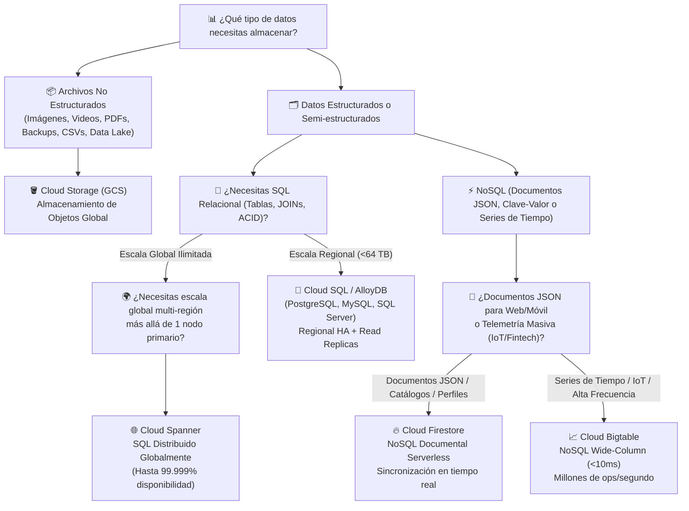
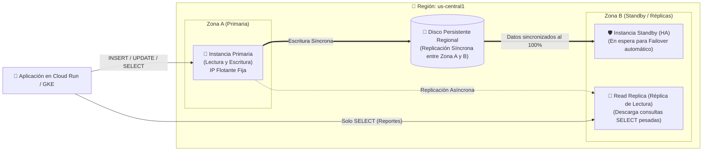

# Playbook 07: Almacenamiento de Objetos y Bases de Datos Administradas — Cloud Storage, Cloud SQL, Firestore, AlloyDB y Spanner

## 1. Introducción: Eligiendo el Almacenamiento Correcto para Cada Dato

En una arquitectura moderna en la nube, **ninguna aplicación seria guarda todos sus datos en un solo lugar**. Intentar guardar videos o PDFs dentro de una base de datos SQL encarece enormemente el sistema y degrada su rendimiento; por otro lado, intentar guardar transacciones bancarias en archivos sueltos impide garantizar consistencia transaccional (ACID).

Google Cloud ofrece servicios especializados según la naturaleza del dato. El siguiente árbol de decisión resume cómo selecciona un arquitecto de nube el motor de almacenamiento en GCP:

---

## 2. Google Cloud Storage (GCS): Almacenamiento de Objetos

**Cloud Storage** es el servicio de almacenamiento de objetos de Google Cloud diseñado para una durabilidad anual del **99.999999999% (11 nueves)**. Permite almacenar desde un archivo de configuración de 1 KB hasta cientos de petabytes de video o datos analíticos.

### 2.1. Conceptos Arquitectónicos de Cloud Storage
1. **Buckets (Cubos)**: Son los contenedores de nivel superior donde viven los objetos. Todo Bucket tiene un **nombre único a nivel mundial**, una **ubicación geográfica** (Regional, Dual-Region o Multi-Region) y una **clase de almacenamiento predeterminada**.
2. **Objetos Inmutables**: Un objeto consta de los datos del archivo más sus metadatos. En Cloud Storage **los objetos son inmutables**: no puedes "modificar la línea 5" de un archivo directamente en el bucket; cuando actualizas un archivo, subes un objeto nuevo que reemplaza (o crea una nueva versión de) el objeto completo.
3. **Espacio de Nombres Plano (*Flat Namespace*)**: Físicamente no existen subcarpetas dentro de un bucket; todos los objetos viven en un mismo nivel plano. Cuando subes `reportes/2026/enero.pdf`, ese texto completo es simplemente el **nombre (clave)** del objeto, aunque la Consola Web y `gcloud storage` interpretan el carácter `/` para mostrártelo visualmente como carpetas.

### 2.2. Las 4 Clases de Almacenamiento (*Storage Classes*) y Autoclass

Todas las clases de almacenamiento en Cloud Storage tienen **exactamente la misma durabilidad (11 nueves) y la misma velocidad de respuesta en milisegundos**. Lo único que cambia es el **modelo de precios**: cuanto menos frecuente sea el acceso, **más barato es guardar el GB al mes, pero más caro es leerlo (*Retrieval Fee*) y tiene un periodo mínimo de permanencia**:

| Clase de Almacenamiento | Frecuencia de Acceso Ideal | Duración Mínima de Almacenamiento | Costo de Almacenamiento (Ref. US) | Costo de Lectura / Recuperación (*Retrieval*) | Caso de Uso |
| :--- | :--- | :--- | :--- | :--- | :--- |
| **`Standard`** | Datos "Calientes" (acceso diario o constante) | **Ninguna** (0 días) | ~$0.020 / GB / mes | **$0.00 (Gratis)** | Imágenes de sitios web activos, streaming de video, datos usados en pipelines diarios de BigQuery/IA. |
| **`Nearline`** | Máximo **1 vez al mes** | **30 días** | ~$0.010 / GB / mes (50% más barato) | $0.01 / GB leído | Copias de seguridad mensuales, reportes contables de cierre de mes. |
| **`Coldline`** | Máximo **1 vez por trimestre** | **90 días** | ~$0.004 / GB / mes (80% más barato) | $0.02 / GB leído | Datos de recuperación ante desastres (DR) que rara vez se leen. |
| **`Archive`** | Máximo **1 vez al año** | **365 días** | ~$0.0012 / GB / mes (94% más barato) | $0.05 / GB leído | Archivo legal, médico o financiero exigido por regulaciones durante 5 a 10 años. |

> [!TIP]
> **¿No sabes con qué frecuencia se leerán tus archivos? Usa `Autoclass`**: Al habilitar *Autoclass* en un bucket, Google Cloud monitorea automáticamente cada objeto (de 128 KiB o más): si nadie lo lee durante **30 días**, lo baja a `Nearline`. **Por defecto Nearline es la clase final**; si configuras `Archive` como clase terminal, a los **90 días** sin acceso pasa a `Coldline` y a los **365 días** a `Archive`. Si alguien vuelve a leerlo, regresa a `Standard` **sin tarifas de recuperación ni de eliminación anticipada**. A cambio, Autoclass cobra una **tarifa de administración** por objeto.

### 2.3. Protección y Gobernanza de Objetos en GCS
- **Object Versioning (Versionado de Objetos)**: Cuando está activo, si alguien sobrescribe o borra un objeto, Cloud Storage no lo destruye: conserva la versión anterior con un número único de generación (`#17123456...`) para que puedas restaurarla en segundos.
- **Soft Delete (Borrado Suave)**: Independientemente del versionado, los buckets nuevos tienen por defecto una **retención de borrado suave de 7 días**: los objetos (e incluso buckets) eliminados pueden restaurarse durante ese periodo. Ten en cuenta que los objetos en borrado suave **siguen generando costo de almacenamiento** hasta que vence la retención; puedes ajustarla con `--soft-delete-duration`.
- **Borrar un bucket versionado**: `gcloud storage rm --recursive gs://BUCKET` elimina **todas las versiones** (vigentes y no vigentes) de todos los objetos y luego el bucket.
- **Object Lifecycle Management (Gestión del Ciclo de Vida)**: Reglas JSON declarativas que automatizan el ahorro de costos (por ejemplo: *"Pasar a `NEARLINE` todo objeto con más de 30 días de antigüedad, y eliminar definitivamente las versiones no actuales después de 90 días"*).
- **Signed URLs (URLs Firmadas)**: Permiten otorgar acceso temporal (por ejemplo, válido solo durante **10 minutos**) para que un usuario externo descargue un PDF privado o suba una foto directamente a un bucket privado sin hacer público el bucket.

---

## 3. Bases de Datos Relacionales Administradas: Cloud SQL, AlloyDB y Cloud Spanner

### 3.1. Cloud SQL (PostgreSQL, MySQL y SQL Server)
**Cloud SQL** es el servicio de bases de datos relacionales totalmente administrado para motores estándar (**PostgreSQL, MySQL y SQL Server**). Google se encarga de los parches del motor, las copias de seguridad automatizadas, la recuperación a un punto en el tiempo (*Point-in-Time Recovery - PITR*) y la replicación.

#### Ediciones de Cloud SQL: Enterprise vs Enterprise Plus
| Edición | Características | Máquinas de núcleo compartido (`db-f1-micro`, `db-g1-small`) |
| :--- | :--- | :--- |
| **Enterprise** | Funciones administradas esenciales, buena relación costo/rendimiento | **Sí** (ideal para desarrollo y laboratorios; sin SLA) |
| **Enterprise Plus** | Mayor rendimiento, mantenimiento con tiempo de inactividad casi nulo, mayor retención de PITR y SLA más alto | No |

> [!WARNING]
> Para **PostgreSQL 16 o superior**, la edición **predeterminada es Enterprise Plus**. Si creas una instancia con `gcloud sql instances create` sin `--edition=ENTERPRISE`, obtendrás la edición más cara y no podrás usar máquinas de núcleo compartido. El almacenamiento máximo es de **64 TB** en núcleos dedicados y **3 TB** en núcleo compartido.

#### Arquitectura de Alta Disponibilidad (HA) y Réplicas de Lectura en Cloud SQL

> [!IMPORTANT]
> **Diferencia Crítica entre Instancia Standby (HA) y Read Replica**:
> - **Instancia Standby (Alta Disponibilidad)**: Comparte un **Disco Persistente Regional síncrono** con la primaria. **No puedes hacerle consultas mientras todo está normal**; su único propósito es tomar el control automáticamente en ~60 segundos (*Failover*) manteniendo la misma dirección IP si la Zona A sufre una caída.
> - **Read Replica (Réplica de Lectura)**: Usa replicación **asíncrona** y tiene su propia dirección IP. **Sí recibe tráfico de consultas `SELECT`** para aliviar la carga del servidor primario, pero no hace *failover* automático por sí sola.

### 3.2. ¿Cuándo pasar de Cloud SQL a AlloyDB o Cloud Spanner?
- **AlloyDB for PostgreSQL**: Si tu base de datos PostgreSQL en Cloud SQL empieza a sufrir por consultas analíticas pesadas mezcladas con miles de transacciones por segundo, **AlloyDB** ofrece un motor creado por Google 100% compatible con PostgreSQL que separa el cómputo del almacenamiento, incluye un motor columnar en memoria asistido por ML y es hasta **4x más rápido en transacciones (OLTP)** y **100x más rápido en consultas analíticas**.
- **Cloud Spanner**: Si necesitas una base de datos SQL donde usuarios en Tokio, Londres y Nueva York escriban simultáneamente con **consistencia fuerte global**, escalabilidad horizontal prácticamente ilimitada y un SLA de hasta **99.999%** en configuraciones multirregionales (menos de 5 minutos de inactividad al año), **Cloud Spanner** lo logra apoyándose en **TrueTime**, la API de tiempo de Google respaldada por relojes atómicos y GPS.

---

## 4. Bases de Datos NoSQL Administradas: Cloud Firestore y Cloud Bigtable

### 4.1. Cloud Firestore (Base de Datos Documental Serverless)
**Firestore** es la base de datos NoSQL orientada a documentos de última generación de Google Cloud y Firebase.
- **100% Serverless (Escala a Cero)**: No aprovisionas servidores ni eliges cantidad de CPU/RAM; pagas únicamente por la cantidad de documentos leídos, escritos, eliminados y por los GB almacenados (con una generosa capa gratuita diaria de 50,000 lecturas y 20,000 escrituras, aplicable a una base de datos por proyecto).
- **Modos y ediciones**: una base de datos se crea en **modo Nativo** (el que usamos, con SDKs móviles/web y tiempo real) o en **modo Datastore** (compatibilidad con la API heredada de Datastore). Un proyecto solo puede tener una base de datos llamada `(default)`, aunque admite bases de datos adicionales con nombre. Además de la edición Standard existe una **edición Enterprise**, que añade, entre otras cosas, compatibilidad con MongoDB.
- **Modelo Jerárquico de Datos**:
  - **Colecciones (*Collections*)**: Contenedores de documentos (ej. `usuarios`, `pedidos`).
  - **Documentos (*Documents*)**: Registros individuales similares a objetos JSON con campos tipados (`string`, `number`, `boolean`, `array`, `map`, `timestamp`, `geopoint`).
  - **Subcolecciones (*Subcollections*)**: Colecciones anidadas dentro de un documento específico (ej. `usuarios/cliente_101/direcciones/dir_casa`).
- **Esquema Flexible (*Schemaless*)**: Dos documentos dentro de la misma colección `productos` pueden tener atributos completamente distintos sin necesidad de ejecutar migraciones bloqueantes (`ALTER TABLE`).
- **Sincronización en Tiempo Real y Transacciones ACID**: Permite que aplicaciones web, Android e iOS escuchen cambios en vivo (*Realtime Listeners*) y soporta transacciones ACID multi-documento.

### 4.2. Comparativa Resumen de Bases de Datos en GCP

| Servicio | Modelo de Datos | ¿Serverless (Escala a Cero)? | Capacidad Máxima | Caso de Uso Ideal |
| :--- | :--- | :--- | :--- | :--- |
| **Cloud SQL** | Relacional SQL (`PostgreSQL`, `MySQL`, `SQL Server`) | No (Pagas por la instancia encendida) | Hasta 64 TB (3 TB en núcleo compartido) | Sistemas transaccionales tradicionales (ERP, CRM, e-commerce, backends empresariales). |
| **AlloyDB** | Relacional SQL (`PostgreSQL` de ultra alto desempeño) | No | Almacenamiento distribuido que escala automáticamente (decenas de TB) | Cargas PostgreSQL empresariales exigentes e híbridas (HTAP: transaccional + analítico). |
| **Cloud Spanner** | Relacional SQL Distribuido Globalmente | No (Por nodos o Processing Units) | Petabytes (Ilimitada) | Sistemas financieros globales, pagos mundiales, inventarios multi-región con 99.999% SLA. |
| **Cloud Firestore** | NoSQL Documental (JSON Jerárquico) | **Sí** (Capa gratuita diaria incluida) | Terabytes / Escalado automático | Catálogos de productos, perfiles de usuario, apps móviles/web en tiempo real, estado de agentes IA. |
| **Cloud Bigtable** | NoSQL de Columnas Anchas (*Wide-Column* Clave-Valor) | No (Por nodos) | Petabytes | Series de tiempo (*Time-Series*), telemetría IoT masiva, ad-tech y datos bursátiles (<10ms). |

---

## 5. Referencias Oficiales

- **Documentación General de Cloud Storage**: [https://docs.cloud.google.com/storage/docs](https://docs.cloud.google.com/storage/docs)
- **Clases de Almacenamiento en Cloud Storage (`Standard`, `Nearline`, `Coldline`, `Archive`)**: [https://docs.cloud.google.com/storage/docs/storage-classes](https://docs.cloud.google.com/storage/docs/storage-classes)
- **Documentación Oficial de Cloud SQL para PostgreSQL**: [https://docs.cloud.google.com/sql/docs/postgres](https://docs.cloud.google.com/sql/docs/postgres)
- **Alta Disponibilidad (HA) en Cloud SQL**: [https://docs.cloud.google.com/sql/docs/postgres/high-availability](https://docs.cloud.google.com/sql/docs/postgres/high-availability)
- **Ediciones de Cloud SQL (Enterprise vs Enterprise Plus)**: [https://docs.cloud.google.com/sql/docs/postgres/editions-intro](https://docs.cloud.google.com/sql/docs/postgres/editions-intro)
- **Autoclass en Cloud Storage**: [https://docs.cloud.google.com/storage/docs/autoclass](https://docs.cloud.google.com/storage/docs/autoclass)
- **Documentación Oficial de Cloud Firestore**: [https://docs.cloud.google.com/firestore/native/docs](https://docs.cloud.google.com/firestore/native/docs)
- **Guía de Selección de Bases de Datos en Google Cloud**: [https://cloud.google.com/products/databases](https://cloud.google.com/products/databases)
