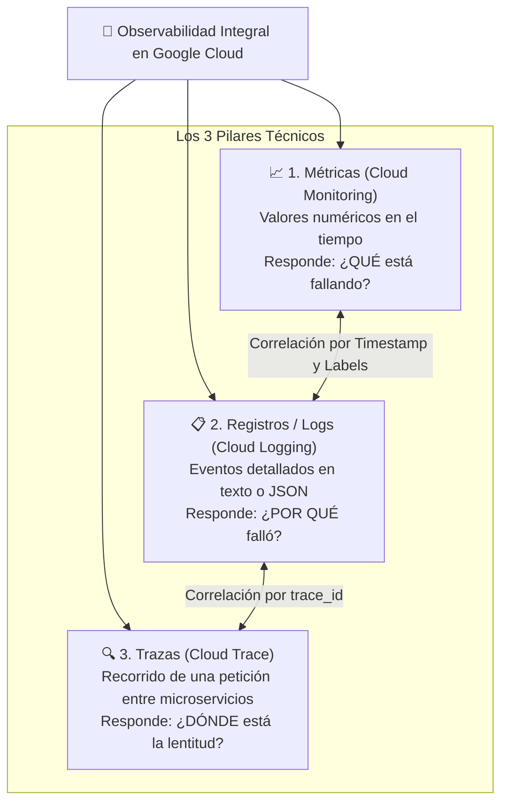
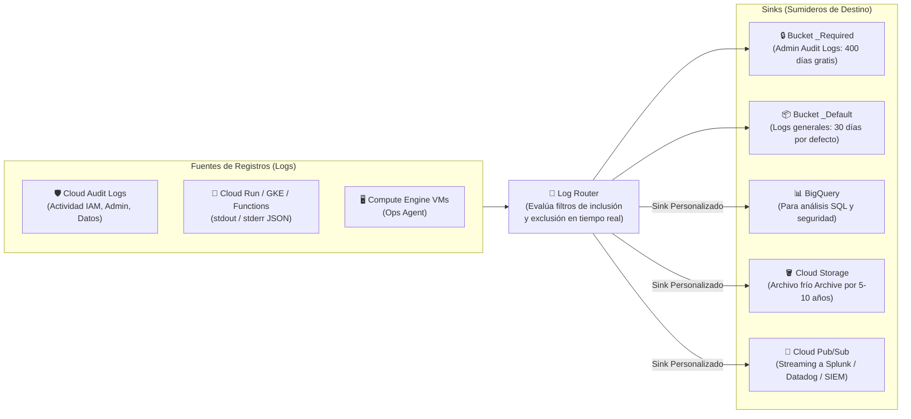
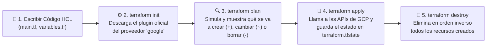

# Playbook 08: Monitoreo, Observabilidad e Infraestructura como Código — Cloud Logging, Cloud Monitoring y Terraform en GCP

## 1. Introducción: Monitoreo vs Observabilidad y Principios de SRE

Desplegar una aplicación en la nube es apenas el comienzo; mantenerla rápida, disponible y confiable en producción es el verdadero reto de la **Ingeniería de Confiabilidad de Sitios (*Site Reliability Engineering - SRE*)**, disciplina creada en Google.

### 1.1. ¿Cuál es la diferencia entre Monitoreo y Observabilidad?
- **Monitoreo (*Monitoring*)**: Es la acción de recolectar métricas predefinidas y configurar tableros o alertas para **fallos conocidos (*Known Unknowns*)**. Por ejemplo: *"Avísame si el disco de la base de datos supera el 85% de uso"*.
- **Observabilidad (*Observability*)**: Es una propiedad arquitectónica del sistema que te permite entender qué está ocurriendo por dentro haciendo preguntas interactivas desde afuera, especialmente ante **fallos nuevos e impredecibles (*Unknown Unknowns*)** en arquitecturas distribuidas. Por ejemplo: *"¿Por qué solo los usuarios de dispositivos Android en Brasil que pagan con tarjeta de crédito están experimentando 4 segundos de latencia desde hace 12 minutos?"*.

---

## 2. Los 3 Pilares de la Observabilidad y las 4 Señales Doradas de SRE

### 2.1. Las 4 Señales Doradas (*The Four Golden Signals*)
Según el manual oficial de **Google SRE**, si solo pudieras medir cuatro cosas en cualquier sistema orientado al usuario, debes medir las **Cuatro Señales Doradas**:
1. **Latencia (*Latency*)**: El tiempo que tarda en atenderse una solicitud (importante medir el percentil **p95 y p99**, no solo el promedio, y separar la latencia de peticiones exitosas de la de peticiones fallidas).
2. **Tráfico (*Traffic*)**: Cuánta demanda está recibiendo tu sistema (ej. peticiones HTTP por segundo, mensajes de Pub/Sub por minuto).
3. **Errores (*Errors*)**: La tasa de solicitudes que fallan, ya sea explícitamente (ej. `HTTP 500`) o implícitamente (respondió `HTTP 200` pero con datos vacíos o tardó más del límite acordado).
4. **Saturación (*Saturation*)**: Qué tan "lleno" está tu servicio respecto a su capacidad máxima (ej. % de memoria RAM utilizada, conexiones activas a Cloud SQL o hilos ocupados).

### 2.2. SLI, SLO y SLA: El Vocabulario de la Confiabilidad
- **SLI (*Service Level Indicator*)**: La **métrica real medida** (ej. *"El 99.92% de las peticiones en los últimos 30 días respondieron en menos de 200ms"*).
- **SLO (*Service Level Objective*)**: La **meta técnica interna** que se compromete a cumplir el equipo de ingeniería (ej. *"Nuestro objetivo es que el SLI de disponibilidad sea $\ge 99.9\%$"*).
- **SLA (*Service Level Agreement*)**: El **contrato legal y financiero** con el cliente que define qué penalización o reembolso ocurre si no se cumple un umbral (suele ser ligeramente más holgado que el SLO interno, ej. `99.5%`).

---

## 3. Google Cloud Observability: Cloud Logging y Cloud Monitoring

### 3.1. Arquitectura de Cloud Logging y el Enrutador de Registros (*Log Router*)
Cada vez que un servicio de GCP, un contenedor en Cloud Run/GKE, una VM o un registro de auditoría genera un log, este pasa instantáneamente por el **Log Router (Enrutador de Registros)** de tu proyecto:

#### Los 4 Tipos de Registros de Auditoría (*Cloud Audit Logs*)
| Tipo de Registro de Auditoría | ¿Qué registra? | ¿Viene activado por defecto? | ¿Tiene costo y cuánto se retiene? |
| :--- | :--- | :--- | :--- |
| **1. Actividad del Administrador (*Admin Activity*)** | Creaciones, borrados o modificaciones de recursos, cambios en IAM. | **Sí (Siempre activo, no se puede apagar)** | **100% Gratuito** (Se guarda 400 días en `_Required`). |
| **2. Eventos del Sistema (*System Event*)** | Acciones automáticas de Google (ej. *Live Migration* o *Autohealing*). | **Sí (Siempre activo)** | **100% Gratuito** (400 días en `_Required`). |
| **3. Acceso a los Datos (*Data Access*)** | Quién leyó el contenido de una tabla, bucket o secreto (`DATA_READ` / `DATA_WRITE`). | **No** (Se activa por servicio porque genera gran volumen, excepto en BigQuery). | Consume cuota de Cloud Logging (30 días en `_Default`). |
| **4. Política Rechazada (*Policy Denied*)** | Cuando GCP bloquea a un usuario o servicio por violar una política de seguridad. | **Sí** | Consume cuota de Cloud Logging (30 días). |

#### Métricas Basadas en Registros (*Log-based Metrics*)
Es una de las funciones más útiles de Cloud Logging: te permite definir un filtro de búsqueda en los logs (por ejemplo, `severity="ERROR" AND jsonPayload.modulo="pagos"`) y **convertir cada coincidencia en un contador numérico en Cloud Monitoring** para graficarlo en un Dashboard o disparar una alerta por correo/Slack si ocurren más de 5 errores en 1 minuto.

> [!NOTE]
> **Métricas y sinks no son retroactivos**: una métrica basada en registros o un sink solo procesan las entradas que llegan **después** de haberse creado. Además, los sinks hacia **Cloud Storage** escriben en **lotes por hora**, y los primeros archivos pueden tardar **de 2 a 3 horas** en aparecer en el bucket. Para análisis inmediato conviene un sink hacia **BigQuery** o consultar directamente en el Explorador de registros.

---

### 3.2. Cloud Monitoring: Métricas, Ops Agent, Uptime Checks y Alertas
- **Métricas de Plataforma vs Métricas Internas (Ops Agent)**:
  - Por defecto, el hipervisor de Compute Engine ve el `% de CPU`, los `bytes de red` y las `IOPS de disco` de una VM desde afuera.
  - Sin embargo, por privacidad y aislamiento, el hipervisor **NO sabe cuánta memoria RAM libre o cuánto espacio libre en el sistema de archivos (`/`) queda dentro de tu sistema operativo Linux**. Para recolectar memoria RAM, espacio en disco y logs de aplicaciones (Nginx, PostgreSQL) dentro de una VM, se instala el agente oficial unificado de Google: el **Cloud Ops Agent**. *(En servicios serverless como Cloud Run, Cloud Functions o GKE, la memoria RAM y CPU ya se reportan automáticamente sin instalar nada).*
- **Uptime Checks (Comprobaciones de Disponibilidad Global)**: Sondas externas administradas por Google ubicadas en múltiples continentes que hacen peticiones periódicas (`HTTP`, `HTTPS` o `TCP`) a la URL o IP pública de tu aplicación para verificar que responde a nivel mundial. Se ejecutan cada **1, 5, 10 o 15 minutos**, y el *timeout* se expresa en **segundos** (con `gcloud`: `--period=1 --timeout=10`). Si tu servidor está detrás de un firewall, debes permitir el tráfico desde las IPs de las sondas.
- **Instrumentación con OpenTelemetry**: para métricas y trazas de tus propias aplicaciones, Google Cloud recomienda instrumentar con el estándar abierto **OpenTelemetry**, que exporta a Cloud Monitoring y Cloud Trace sin atar tu código a un proveedor.
- **Políticas de Alerta (*Alerting Policies*)**: Constan de tres partes:
  1. **Condición (*Condition*)**: Qué métrica o Uptime Check se vigila, durante cuánto tiempo y cuál es el umbral.
  2. **Canales de Notificación (*Notification Channels*)**: A dónde avisar (Correo electrónico, SMS, Slack, PagerDuty, Webhook o tópico de Pub/Sub para remediación automática).
  3. **Documentación**: Instrucciones en Markdown adjuntas a la alerta que le indican al ingeniero de guardia exactamente qué pasos seguir para resolver el incidente.

---

## 4. Infraestructura como Código (IaC) con Terraform en Google Cloud

A lo largo de los primeros laboratorios hemos creado recursos ejecutando comandos imperativos de `gcloud` o explorando la consola web. En la industria moderna, crear infraestructura de producción manualmente en la consola (*ClickOps*) está prohibido por cuatro razones:
1. **No es reproducible**: Si necesitas crear mañana un entorno `staging` idéntico a `produccion`, recordar los 80 clics y parámetros exactos que pusiste hace 6 meses es imposible.
2. **Error humano y *Configuration Drift***: Alguien modifica una regla de firewall a mano un viernes por la noche y nadie sabe qué cambió ni quién lo aprobó.
3. **Sin historial de cambios ni revisión por pares (*Code Review*)**.
4. **Lento ante desastres**: Reconstruir toda una plataforma manualmente puede tomar días; con **Infraestructura como Código (IaC)** toma minutos.

### 4.1. Imperativo (`gcloud` bash) vs Declarativo (**Terraform**)
- **Enfoque Imperativo (`gcloud`)**: Le das órdenes paso a paso (*"Crea esta VPC; ahora crea esta subred; ahora crea esta VM"*). Si ejecutas tu script dos veces seguidas, la segunda vez fallará diciendo **`ERROR: Resource already exists`**.
- **Enfoque Declarativo (Terraform)**: Escribes archivos `.tf` en lenguaje **HCL (*HashiCorp Configuration Language*)** describiendo **la fotografía final de lo que quieres tener**. Si ejecutas `terraform apply` 10 veces seguidas sin cambiar el código, Terraform compara tu código con la realidad y te dice **`No changes. Your infrastructure matches the configuration`** (*Idempotencia*). Si cambias el tamaño de máquina en el código de `e2-micro` a `e2-small`, Terraform calcula el diferencial y modifica únicamente ese atributo.

### 4.2. El Flujo de Trabajo de Terraform en 4 Comandos

> [!WARNING]
> **La Importancia Crítica del Archivo de Estado (`terraform.tfstate`)**:
> Cuando Terraform crea tus recursos en GCP, guarda un mapa JSON llamado `terraform.tfstate` que relaciona cada bloque de tu código con el ID real del recurso en Google Cloud.
> - En este laboratorio trabajaremos con el estado local en Cloud Shell.
> - **En equipos de producción reales**, el archivo `terraform.tfstate` **NUNCA se sube a Git** (porque puede contener datos sensibles y causaría conflictos si dos ingenieros ejecutan Terraform al mismo tiempo); en su lugar, se configura un **`backend "gcs"`** para guardar el estado en un **Bucket de Cloud Storage con versionado habilitado**.

### 4.3. Fijar Versiones del Proveedor y Alternativas Administradas
- **Fija siempre la versión mayor del proveedor** en el bloque `required_providers` (por ejemplo `version = "~> 8.0"` para `hashicorp/google`). Así un `terraform init` futuro no instalará una versión mayor con cambios incompatibles sin que lo decidas. Al subir de versión mayor, revisa la guía de actualización del proveedor y ejecuta `terraform plan` antes de aplicar.
- **Infrastructure Manager**: Google Cloud ofrece un servicio administrado que ejecuta Terraform por ti (guarda el estado, aplica los cambios con una cuenta de servicio y deja registro de cada despliegue), útil cuando no quieres operar tu propio pipeline de Terraform.

---

## 5. Referencias Oficiales

- **Documentación General de Google Cloud Observability**: [https://docs.cloud.google.com/stackdriver/docs](https://docs.cloud.google.com/stackdriver/docs)
- **Guía de Cloud Logging y Enrutamiento (Log Router & Sinks)**: [https://docs.cloud.google.com/logging/docs/routing/overview](https://docs.cloud.google.com/logging/docs/routing/overview)
- **Métricas Basadas en Registros (Log-based Metrics)**: [https://docs.cloud.google.com/logging/docs/logs-based-metrics](https://docs.cloud.google.com/logging/docs/logs-based-metrics)
- **Cloud Monitoring, Uptime Checks y Alertas**: [https://docs.cloud.google.com/monitoring/docs](https://docs.cloud.google.com/monitoring/docs)
- **Libro Gratuito de Google Site Reliability Engineering (SRE Book)**: [https://sre.google/books/](https://sre.google/books/)
- **Infraestructura como Código con Terraform en Google Cloud**: [https://docs.cloud.google.com/docs/terraform](https://docs.cloud.google.com/docs/terraform)
- **Documentación Oficial del Google Cloud Provider en Terraform Registry**: [https://registry.terraform.io/providers/hashicorp/google/latest/docs](https://registry.terraform.io/providers/hashicorp/google/latest/docs)
- **Exportación de Registros a Cloud Storage (lotes por hora)**: [https://docs.cloud.google.com/logging/docs/export/storage](https://docs.cloud.google.com/logging/docs/export/storage)
- **Infrastructure Manager**: [https://docs.cloud.google.com/infrastructure-manager/docs](https://docs.cloud.google.com/infrastructure-manager/docs)
