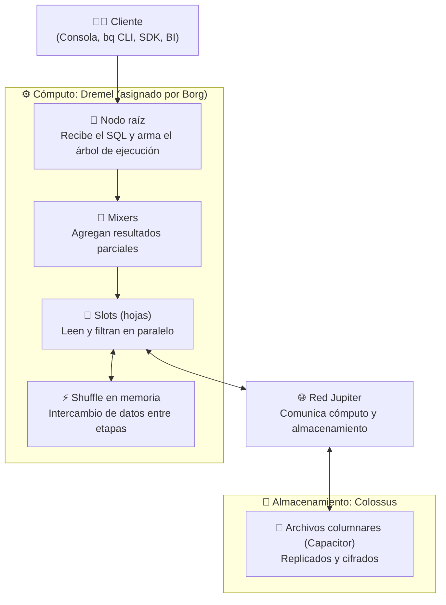
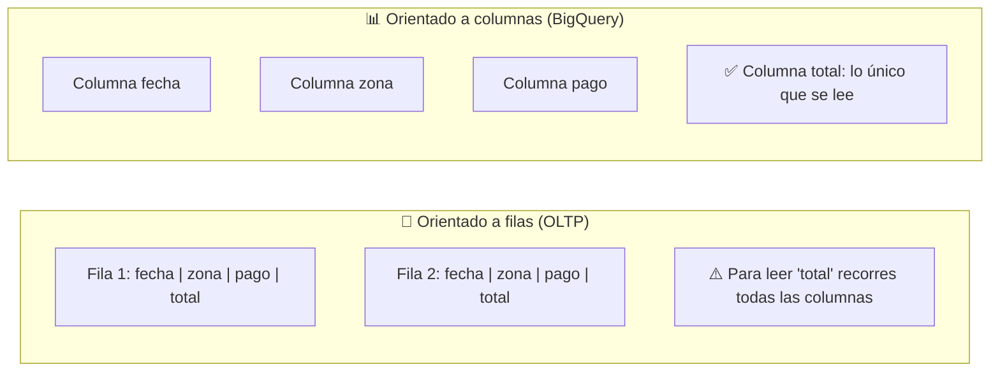
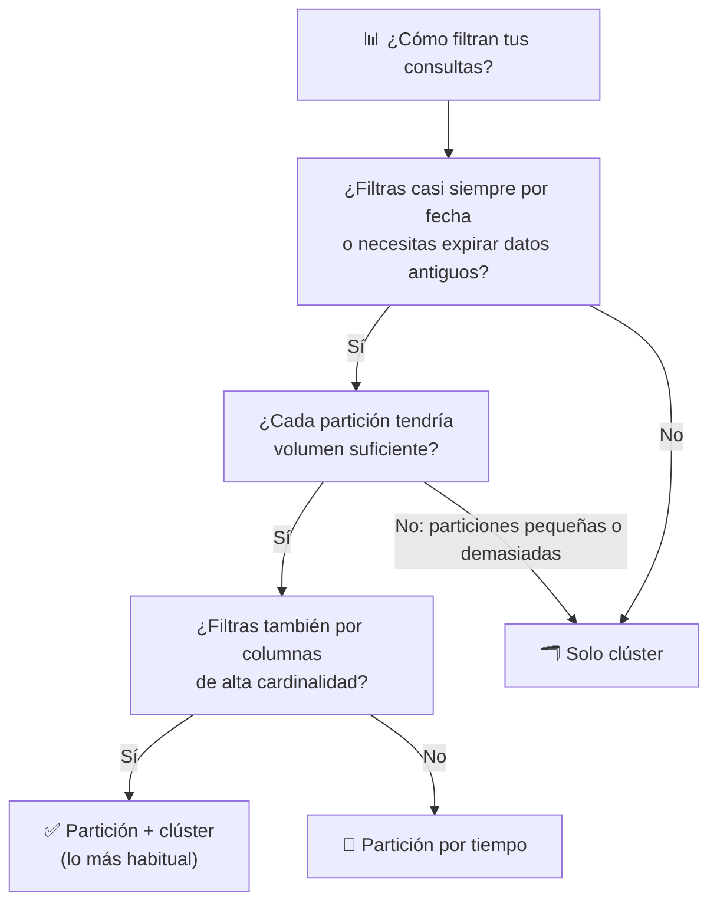
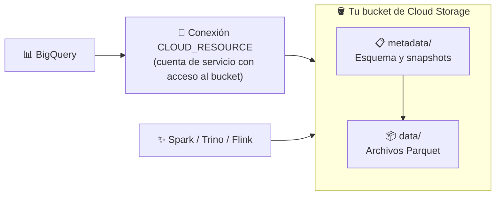
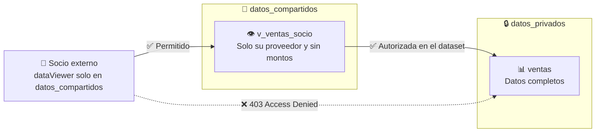

# Playbook 09: Almacenamiento Analítico y Data Warehousing Moderno con BigQuery

## 1. Introducción: De Bases de Datos Transaccionales a Data Warehousing

En el Módulo 07 usamos **Cloud SQL** para registrar pedidos uno a uno. Ese trabajo se llama **OLTP** (*Online Transaction Processing*): muchas operaciones pequeñas que leen o escriben pocas filas. Pero si Gerencia pregunta *"¿cuánto vendimos por zona y por mes en los últimos tres años?"*, la consulta debe recorrer millones de filas y solo unas pocas columnas. Ese trabajo se llama **OLAP** (*Online Analytical Processing*) y necesita un motor distinto: un **Data Warehouse**.

| Característica | OLTP (Cloud SQL, Spanner) | OLAP (BigQuery) |
| :--- | :--- | :--- |
| **Consulta típica** | Pocas filas por clave (`WHERE id = 42`) | Millones de filas agregadas (`SUM`, `GROUP BY`) |
| **Escrituras** | Muchas y pequeñas, con transacciones frecuentes | Cargas por lotes o streaming, más DML ocasional |
| **Almacenamiento físico** | Orientado a filas | Orientado a columnas |
| **Aceleración principal** | Índices B-Tree | Escaneo paralelo masivo, particiones y clústeres |
| **Capacidad** | Aprovisionas instancia y disco | Serverless: no administras servidores |
| **Latencia objetivo** | Milisegundos | Segundos o minutos sobre terabytes |

**BigQuery** es el Data Warehouse serverless de Google Cloud: escribes SQL (dialecto **GoogleSQL**) y Google se encarga de asignar el cómputo y el almacenamiento.

> [!IMPORTANT]
> BigQuery **no sustituye a Cloud SQL**. No lo uses como backend de una aplicación que hace miles de lecturas y escrituras puntuales por segundo. Lo normal es que ambos convivan: la aplicación escribe en Cloud SQL y los datos se replican hacia BigQuery para analizarlos.

---

## 2. Arquitectura Desacoplada: Cómputo y Almacenamiento Separados

En una base de datos tradicional, CPU y disco viven en la misma máquina: si necesitas más disco, a menudo pagas también más CPU. La idea central de BigQuery es **separarlos** y unirlos con una red muy rápida. Así cada uno escala por su cuenta: puedes guardar petabytes sin consultarlos, o lanzar miles de workers durante unos segundos sobre una tabla pequeña.

| Componente | Función | Por qué importa |
| :--- | :--- | :--- |
| **Dremel** | Motor de ejecución. Convierte tu SQL en un **árbol de ejecución**: las hojas (**slots**) leen de Colossus y calculan; las ramas (**mixers**) agregan. | Reparte el trabajo entre miles de slots asignados dinámicamente. |
| **Colossus** | Sistema de archivos distribuido de Google. Gestiona replicación, recuperación y distribución. | El almacenamiento crece sin que administres discos. |
| **Jupiter** | Red de los datacenters de Google, con capacidad a escala de **petabits por segundo**. | Permite leer datos remotos casi como si fueran locales: por eso separar cómputo y disco funciona. |
| **Borg** | Gestor de clústeres, predecesor de Kubernetes. Asigna recursos a Dremel y esquiva fallos de hardware. | Si cae un servidor durante tu consulta, normalmente no lo notas. |

### 2.1. ¿Qué es un Slot?
Un **slot** es la unidad virtual de cómputo (CPU y memoria) que BigQuery usa para ejecutar parte de una consulta. Una consulta se divide en **etapas**, y BigQuery ajusta los slots que usa según la etapa y la capacidad disponible. El tiempo total se reporta como `total_slot_ms`: una consulta de 10 segundos con 100 slots consume unos 1,000,000 slot-ms.

---

## 3. Almacenamiento Columnar y Capacitor

Una tabla con 20 columnas no se guarda fila por fila: **cada columna se guarda por separado**. Si tu consulta usa 2 columnas, BigQuery no lee las otras 18.

**Capacitor** es el formato columnar propio de BigQuery, sucesor de **ColumnIO** (formato del que se inspiraron Parquet y ORC). Aplica codificaciones como **diccionario**, **run-length** y **delta**, e incluso reordena filas para comprimir mejor. Las columnas con muchos valores repetidos, como `payment_type`, se comprimen muy bien.

> [!WARNING]
> **Esto cambia cómo escribes SQL.** Con el modelo on-demand pagas por los bytes de **las columnas que referencias**. Por eso `SELECT *` es el error más caro, y **`LIMIT` no lo arregla**: BigQuery lee las columnas completas y recorta el resultado al final.

### 3.1. Costos de Almacenamiento

Referencia en `us-central1`, sobre la tarifa por GiB-hora de la [página oficial de precios](https://cloud.google.com/bigquery/pricing), convertida a unas 730 horas por mes:

| Tipo | Qué mide | Activo (~/GiB/mes) | Largo plazo (~/GiB/mes) |
| :--- | :--- | :--- | :--- |
| **Lógico** (predeterminado) | Tamaño sin comprimir | ~$0.023 | ~$0.016 |
| **Físico** | Tamaño comprimido en disco | ~$0.040 | ~$0.020 |

- **Capa gratuita**: los primeros **10 GiB** al mes.
- **Largo plazo**: una tabla o partición sin modificar durante **90 días consecutivos** baja de tarifa automáticamente, sin perder rendimiento ni durabilidad. Cada partición cuenta por separado.
- **Lógico vs. físico**: se elige por dataset, no afecta al rendimiento y tras un cambio debes esperar **14 días** para volver a cambiarlo. El físico conviene cuando la compresión es alta; a cambio, el **time travel** y el **fail-safe** se cobran aparte.

---

## 4. Modelos de Cómputo: On-Demand vs. Editions (Slots)

El almacenamiento se factura aparte. Para el cómputo eliges entre dos modelos:

| Aspecto | On-Demand | Editions (Capacidad) |
| :--- | :--- | :--- |
| **Qué pagas** | Bytes procesados | Slots por hora |
| **Precio de referencia** | **$6.25 / TiB** (primer TiB al mes gratis) | Desde **$0.04 / slot-hora** |
| **Previsibilidad** | Depende de cada consulta | Acotada por el máximo de tu reservación |
| **Capacidad** | Hasta **2,000 slots** por proyecto, compartidos y sin garantía | Autoscaling, y baseline dedicada en Enterprise |
| **Riesgo típico** | Un `SELECT *` sobre una tabla enorme sale caro | Pagar por capacidad escalada sin aprovecharla |
| **Ideal para** | Cargas pequeñas, variables o esporádicas | Cargas altas y constantes, o gasto que debe ser previsible |

### 4.1. Las Tres Ediciones

| Aspecto | Standard | Enterprise | Enterprise Plus |
| :--- | :--- | :--- | :--- |
| **Pay-as-you-go (US)** | $0.04 / slot-hora | $0.06 / slot-hora | $0.10 / slot-hora |
| **Compromiso BigQuery CUD 1 / 3 años** | $0.036 / $0.032 | $0.054 / $0.048 | $0.09 / $0.08 |
| **Slots por reservación** | Hasta 1,600 | Según cuota | Según cuota |
| **Baseline** | No (solo autoscaling) | Sí | Sí |
| **Crear vistas materializadas** | **No** (solo consultar las existentes) | Sí | Sí |
| **BigQuery ML y BI Engine** | No | Sí | Sí |
| **Seguridad a nivel de columna/fila y CMEK** | No | Sí | Sí |
| **SLO** | ≥ 99.9% | ≥ 99.99% | ≥ 99.99% |
| **Recuperación ante desastres administrada** | No | No | Sí |

### 4.2. Cómo se Factura el Autoscaling
- Escala en múltiplos de **50 slots**.
- Se cobra por los slots **escalados**, no por los usados, y también si el job falla.
- La facturación es por segundo con **mínimo de 1 minuto**. La opción **fluid scaling** elimina ese mínimo.
- La capacidad escalada se mantiene al menos **60 segundos** tras un pico.

> [!CAUTION]
> `total_slot_ms` mide **uso**, no facturación. Google advierte que no se debe cuadrar la factura con `INFORMATION_SCHEMA.JOBS`. Sirve para comparar órdenes de magnitud: en el mundo real el costo por slots suele ser **mayor** que el calculado con `total_slot_ms`, por los escalones de 50 slots y el mínimo de 1 minuto.

### 4.3. ¿Cuál Elegir?
1. **Empieza con on-demand** y ponle tope con `maximum_bytes_billed` y cuotas diarias. La cuota predeterminada de un proyecto es de **200 TiB al día**.
2. **Mide** durante unas semanas: bytes procesados y slots con `INFORMATION_SCHEMA.JOBS`.
3. **Pasa a Editions** cuando el gasto on-demand sea alto y constante o necesites capacidad garantizada. Compara con el *Slot Estimator* de la consola.
4. **Puedes mezclar**: cada proyecto se asigna o no a una reservación, así que un proyecto de ETL puede ir con slots y otro de exploración con on-demand.

---

## 5. Particionamiento y Clusterización

Son las dos palancas principales para no escanear datos innecesarios.

**Particionar** divide la tabla en segmentos físicos por una columna. Una consulta que filtra por esa columna descarta segmentos enteros (*partition pruning*).

| Tipo | Columna | Granularidad | Ejemplo |
| :--- | :--- | :--- | :--- |
| **Por columna de tiempo** | `DATE`, `TIMESTAMP`, `DATETIME` | Hora, día, mes o año (hora no aplica a `DATE`) | `PARTITION BY TIMESTAMP_TRUNC(pickup_datetime, MONTH)` |
| **Por tiempo de ingesta** | Pseudocolumna `_PARTITIONTIME` | Hora, día, mes o año | Logs sin fecha propia confiable |
| **Por rango entero** | `INTEGER` | Rango fijo | `RANGE_BUCKET(id_cliente, GENERATE_ARRAY(0, 100000, 1000))` |

Una tabla admite hasta **10,000 particiones**. Dos opciones muy útiles:
- `require_partition_filter = TRUE`: rechaza las consultas que no filtren por la partición.
- `partition_expiration_days`: borra automáticamente las particiones antiguas.

**Clusterizar** ordena los datos dentro de cada partición (o de la tabla) según **hasta 4 columnas**. BigQuery guarda el rango de valores de cada bloque y omite los que no pueden coincidir con tu filtro (*block pruning*).

- **El orden importa**: `CLUSTER BY zona, pago` ayuda si filtras por `zona` o por `zona` y `pago`, pero no si filtras solo por `pago`.
- **Reclusterización automática**: BigQuery mantiene el orden en segundo plano al llegar datos nuevos, sin costo de consulta.
- **Tabla existente**: clusterizar una tabla ya creada solo afecta a los datos nuevos.

| Aspecto | Particionamiento | Clusterización |
| :--- | :--- | :--- |
| **Costo estimable antes de ejecutar** | **Sí** | **No**: solo se conoce tras ejecutar |
| **Cardinalidad** | Baja (hasta 10,000 particiones) | Alta (IDs, zonas, clientes) |
| **Gestión** | Expiración y escritura por partición | No aplica |
| **Número de columnas** | 1 | Hasta 4 |

> [!TIP]
> **No particiones de más.** Google recomienda clusterizar en lugar de particionar cuando las particiones serían pequeñas (aproximadamente **menos de 10 GB**) o demasiadas. En el laboratorio usaremos partición **mensual** por esa razón: 365 particiones de 20 MB dejarían poco margen al clúster.

---

## 6. Mejores Prácticas de Consultas SQL

| Práctica | Evita | Prefiere |
| :--- | :--- | :--- |
| **Selecciona solo lo necesario** | `SELECT *` | `SELECT a, b` o `SELECT * EXCEPT (c)` |
| **Filtra por la partición** | Filtros que no permitan descartar particiones | `WHERE pickup_datetime >= '2022-03-01'` |
| **No confíes en `LIMIT`** | `SELECT * ... LIMIT 10` para "explorar barato" | La pestaña *Vista previa* de la consola, gratuita |
| **Estima antes** | Lanzar consultas a ciegas | `bq query --dry_run` |
| **Pon un tope** | Consultas sin límite | `--maximum_bytes_billed` |
| **Ordena los JOIN** | Tablas pequeñas primero | La tabla más grande primero, luego de mayor a menor |
| **Agrega antes de unir** | `JOIN` de hechos completos | Pre-agregar con `GROUP BY` |
| **Evita los self-joins** | Autouniones | Funciones de ventana o `PIVOT` |
| **Reutiliza con cuidado** | CTE evaluadas varias veces | Tablas temporales o variables |
| **Tipos eficientes** | Filtros sobre `STRING` | `BOOL`, `INT64`, `FLOAT64`, `DATE`; claves `INT64` en los JOIN |

**Caché de resultados**: repetir una consulta idéntica sobre datos sin cambios devuelve el resultado guardado sin costo. Por eso una consulta medida dos veces puede marcar 0 bytes; para comparar de verdad se usa `--nouse_cache`.

> [!NOTE]
> Una estimación de **dry run** es un límite superior en tablas clusterizadas. Sobre **tablas externas** puede reportar 0 bytes aunque la consulta real sí procese datos, así que no la uses como presupuesto.

---

## 7. Integración Analítica: Lakehouse, Iceberg y Vistas

### 7.1. Tablas Externas y Google Cloud Lakehouse
Una **tabla externa** se consulta desde BigQuery, pero sus datos siguen fuera de él (normalmente en Cloud Storage). Evita duplicar datos, a costa de menor rendimiento y menos funciones.

| Tipo | Quién accede al archivo | Permisos del usuario |
| :--- | :--- | :--- |
| **Externa estándar** | El propio usuario | Sobre la tabla **y** sobre el archivo |
| **Externa con conexión** (BigLake) | La cuenta de servicio de una **conexión** | Solo sobre la tabla: el acceso se delega |

> [!NOTE]
> **Cambio de nombre**: en abril de 2026 **BigLake** pasó a llamarse **Google Cloud Lakehouse**, y BigLake metastore pasó a ser **Lakehouse runtime catalog**. Los nombres de API y CLI no cambiaron, por lo que seguirás viendo `biglake` en rutas y comandos.

Una **conexión** (`CLOUD_RESOURCE`) es un recurso de BigQuery con su propia cuenta de servicio. Esa cuenta recibe los permisos sobre el bucket, de modo que el analista no necesita acceso directo a los archivos.

### 7.2. Apache Iceberg
**Apache Iceberg** es un formato abierto de tablas: añade a los archivos Parquet una capa de **metadatos** con esquema, snapshots y lista de archivos. Así, varios motores (BigQuery, Spark, Trino, Flink) pueden trabajar sobre **una sola copia** de los datos, sin quedar atados a un proveedor.

| Aspecto | Iceberg administrada | Iceberg externa |
| :--- | :--- | :--- |
| **Quién escribe** | BigQuery | Otro motor; BigQuery **solo lee** |
| **DDL** | `CREATE TABLE ... WITH CONNECTION ... OPTIONS (table_format = 'ICEBERG')` | `CREATE EXTERNAL TABLE ... OPTIONS (format = 'ICEBERG')` |
| **DML** | Sí | No |
| **Mantenimiento** | Automático (compactación, recolección de basura) | A cargo del motor escritor |
| **Metadatos** | BigQuery los gestiona; `EXPORT TABLE METADATA` publica un snapshot para otros motores | Debes actualizar a mano el archivo de metadatos apuntado |
| **Almacenamiento** | Se paga a Cloud Storage | Se paga a Cloud Storage |

Tres reglas de las tablas administradas:
- `storage_uri` debe ser un **prefijo vacío y exclusivo** de esa tabla: la recolección de basura puede borrar lo que encuentre ahí.
- **No toques los archivos desde fuera de BigQuery**: puede provocar fallos o pérdida de datos sin recuperación autónoma.
- Google recomienda un **bucket de una sola región** en la misma región del dataset.

> [!IMPORTANT]
> Google indica que las **tablas externas Iceberg** "ya no se recomiendan para la mayoría de los casos" y propone **Lakehouse runtime catalog** para datos gestionados por catálogos remotos. Las usamos en el laboratorio porque muestran con claridad qué significa leer un snapshot sin motor adicional.

### 7.3. Vistas Autorizadas
Una vista normal exige permisos sobre las tablas de origen. Una **vista autorizada** invierte esto: se concede acceso **a la vista** sobre el dataset fuente, y los usuarios solo necesitan permisos sobre la vista.

Requisitos para el usuario:
1. `roles/bigquery.dataViewer` sobre el dataset **de la vista**.
2. `roles/bigquery.jobUser` sobre el proyecto donde se ejecuta la consulta.

La vista debe estar en un **dataset distinto** del dataset fuente y en la misma ubicación. Un dataset admite hasta **2,500 recursos autorizados**. Para muchas vistas, Google recomienda **datasets autorizados**, que autorizan de una vez todas las vistas de un dataset.

### 7.4. Vistas Materializadas
Una **vista normal** vuelve a ejecutar su consulta cada vez. Una **vista materializada** guarda el resultado y lo mantiene al día.

| Aspecto | Vista normal | Vista materializada |
| :--- | :--- | :--- |
| **Guarda datos** | No | Sí (paga almacenamiento) |
| **Costo por consulta** | Toda la consulta subyacente | Solo el resultado precalculado y los cambios recientes |
| **SQL** | Casi sin restricciones | Limitado en las incrementales |
| **Actualización** | No aplica | Automática en segundo plano |

- **Incremental**: combina lo precalculado con los cambios recientes de la tabla base, así que devuelve datos frescos.
- **Smart tuning**: BigQuery **reescribe automáticamente** las consultas sobre la tabla base para usar la vista cuando puede. Tus reportes se aceleran sin cambiar el SQL.
- **`max_staleness`**: admite datos de hasta cierta antigüedad, entre **30 minutos y 3 días**, a cambio de menor costo.
- **Agregaciones admitidas**: `SUM`, `COUNT`, `AVG`, `MIN`, `MAX`, `COUNTIF`, `APPROX_COUNT_DISTINCT`, `ANY_VALUE`, entre otras.
- **Particionamiento**: solo si la tabla base está particionada y con la misma columna y granularidad.
- **JOINs**: en las incrementales, sin `RIGHT`/`FULL OUTER JOIN` ni self-joins; pon primero la tabla que más cambia.
- **Límite**: hasta **100** vistas materializadas por tabla base en un mismo proyecto.

### 7.5. Restricciones que se Cruzan

Estas combinaciones **no funcionan**, y conviene conocerlas antes de diseñar:

| Si usas... | No puedes... | Alternativa |
| :--- | :--- | :--- |
| **Tabla Iceberg administrada** | Crear sobre ella vistas materializadas ni vistas autorizadas | Usar una tabla nativa para la capa servida |
| **Tabla Iceberg administrada** | Renombrar, copiar, clonar ni usar `TRUNCATE` | `CREATE OR REPLACE TABLE` o `DELETE ... WHERE TRUE` |
| **Tabla Iceberg administrada** | Usar `BIGNUMERIC`, `JSON`, `GEOGRAPHY`, `INTERVAL` ni `RANGE` | Tipos compatibles o una tabla nativa |
| **Reservación Standard** | Crear vistas materializadas ni seguridad por fila/columna | Enterprise, o crearlas bajo on-demand |
| **Vista materializada** | Anidarla, consultar tablas comodín ni editar su SQL | Recrearla |
| **Dataset en US** | Hacer JOIN con un dataset en otra ubicación | Copiar los datos a la misma ubicación |

---

## 8. Referencias Oficiales

- **Documentación General de BigQuery**: [https://docs.cloud.google.com/bigquery/docs](https://docs.cloud.google.com/bigquery/docs)
- **BigQuery Under the Hood (Dremel, Colossus, Jupiter, Borg)**: [https://cloud.google.com/blog/products/bigquery/bigquery-under-the-hood](https://cloud.google.com/blog/products/bigquery/bigquery-under-the-hood)
- **Almacenamiento en BigQuery**: [https://docs.cloud.google.com/bigquery/docs/storage_overview](https://docs.cloud.google.com/bigquery/docs/storage_overview)
- **Precios de BigQuery**: [https://cloud.google.com/bigquery/pricing](https://cloud.google.com/bigquery/pricing)
- **Ediciones de BigQuery**: [https://docs.cloud.google.com/bigquery/docs/editions-intro](https://docs.cloud.google.com/bigquery/docs/editions-intro)
- **Autoscaling de Slots**: [https://docs.cloud.google.com/bigquery/docs/slots-autoscaling-intro](https://docs.cloud.google.com/bigquery/docs/slots-autoscaling-intro)
- **Tablas Particionadas**: [https://docs.cloud.google.com/bigquery/docs/partitioned-tables](https://docs.cloud.google.com/bigquery/docs/partitioned-tables)
- **Tablas Clusterizadas**: [https://docs.cloud.google.com/bigquery/docs/clustered-tables](https://docs.cloud.google.com/bigquery/docs/clustered-tables)
- **Buenas Prácticas de Rendimiento**: [https://docs.cloud.google.com/bigquery/docs/best-practices-performance-compute](https://docs.cloud.google.com/bigquery/docs/best-practices-performance-compute)
- **Tablas Iceberg Administradas**: [https://docs.cloud.google.com/bigquery/docs/biglake-iceberg-tables-in-bigquery](https://docs.cloud.google.com/bigquery/docs/biglake-iceberg-tables-in-bigquery)
- **Tablas Externas Iceberg**: [https://docs.cloud.google.com/bigquery/docs/iceberg-external-tables](https://docs.cloud.google.com/bigquery/docs/iceberg-external-tables)
- **Vistas Autorizadas**: [https://docs.cloud.google.com/bigquery/docs/authorized-views](https://docs.cloud.google.com/bigquery/docs/authorized-views)
- **Vistas Materializadas**: [https://docs.cloud.google.com/bigquery/docs/materialized-views-intro](https://docs.cloud.google.com/bigquery/docs/materialized-views-intro)
- **Cuotas y Límites**: [https://docs.cloud.google.com/bigquery/quotas](https://docs.cloud.google.com/bigquery/quotas)
