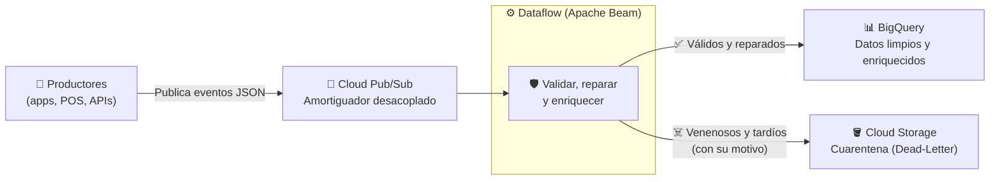
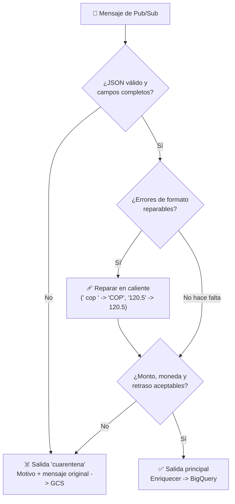

# Playbook 10: Ingesta en Tiempo Real — Cloud Pub/Sub, Dataflow (Apache Beam) y el Patrón Dead-Letter

## 1. Introducción: Del Lote al Flujo Continuo

En el Módulo 09 consultamos datos que **ya estaban** en BigQuery. Pero un sistema de pagos, una flota de sensores IoT o una tienda en línea generan eventos **cada milisegundo**, y el negocio quiere verlos en segundos, no en el reporte de mañana. Esa es la **ingesta en streaming**.

El reto real no es mover datos rápido, sino que **el sistema sobreviva a los datos malos**. En producción siempre llegan mensajes corruptos, campos faltantes, formatos inesperados o eventos que llegan horas tarde. Un pipeline ingenuo hace una de dos cosas, ambas graves:
- **Colapsa**: un solo mensaje "venenoso" (*poison pill*) lanza una excepción, el worker reintenta para siempre y todo el flujo se detiene.
- **Contamina**: acepta la basura y llena el Data Warehouse de montos negativos y monedas inexistentes.

La arquitectura de este módulo evita ambas cosas:



---

## 2. Cloud Pub/Sub: El Amortiguador

**Pub/Sub** es el servicio de mensajería asíncrona global de Google Cloud. Los **publicadores** envían mensajes a un **topic** sin saber quién los leerá. Los **suscriptores** leen de una **suscripción** conectada a ese topic, a su propio ritmo.

### 2.1. ¿Por Qué Desacoplar?
Si un productor llamara directamente a la base de datos, cualquier pico de tráfico o caída del consumidor se convertiría en errores para el usuario final. Con Pub/Sub:
- **Absorbe ráfagas**: si llegan 10,000 pagos en un segundo, Pub/Sub los guarda y el consumidor los procesa cuando pueda.
- **Sobrevive a caídas**: si el consumidor se detiene, los mensajes esperan en la suscripción (retención predeterminada de **7 días**) y se procesan al volver.
- **Permite varios consumidores**: cada suscripción recibe su propia copia de cada mensaje. Puedes añadir un sistema antifraude sin tocar a los productores.

### 2.2. Conceptos Clave

| Concepto | Qué es | Detalle importante |
| :--- | :--- | :--- |
| **Topic** | Canal donde se publica | Puede retener mensajes para *replay* si lo configuras |
| **Suscripción** | Cola de lectura asociada a un topic | Expira tras **31 días** sin actividad (configurable) |
| **Ack (*acknowledge*)** | El suscriptor confirma que procesó el mensaje | Si no confirma antes del **ack deadline**, Pub/Sub lo reenvía |
| **Entrega** | Por defecto **al menos una vez** (*at-least-once*) | Puede haber duplicados y desorden: los consumidores deben ser **idempotentes** |
| **Orden** | Desactivado por defecto | Con *ordering keys* se garantiza el orden por clave dentro de una región |
| **Seek / replay** | Volver a un instante pasado o a un snapshot | Permite reprocesar tras corregir un bug |

### 2.3. Tipos de Suscripción

| Tipo | Quién inicia la entrega | Ideal para |
| :--- | :--- | :--- |
| **Pull** | El suscriptor pide mensajes | Dataflow, workers propios, alto volumen |
| **Push** | Pub/Sub llama a un endpoint HTTPS | Cloud Run y servicios web |
| **Exportación a BigQuery** | Pub/Sub escribe directo en una tabla | Ingesta **sin código** cuando los datos ya vienen limpios |
| **Exportación a Cloud Storage** | Pub/Sub escribe archivos en un bucket | Archivar el flujo crudo |

> [!TIP]
> **¿Necesito Dataflow?** Si los mensajes ya vienen con el esquema correcto y no hay que limpiar ni enriquecer nada, una **suscripción de exportación a BigQuery** es más simple y barata. Dataflow se justifica cuando hay que **validar, transformar, enriquecer, agregar o bifurcar** los datos, como en este módulo.

### 2.4. Dead-Letter Topics de Pub/Sub vs. Dead-Letter en Dataflow
Pub/Sub tiene su propio mecanismo: tras N intentos de entrega fallidos (entre **5 y 100**), mueve el mensaje a un **dead-letter topic**. Funciona con suscriptores que **no confirman** los mensajes problemáticos.

**Dataflow no funciona así**: confirma los mensajes en cuanto los guarda de forma duradera, antes de procesarlos. Por eso un mensaje venenoso nunca "falla la entrega" desde el punto de vista de Pub/Sub. La cuarentena debe construirse **dentro del pipeline**, con salidas laterales (sección 3.3).

---

## 3. Apache Beam y Cloud Dataflow

**Apache Beam** es un modelo de programación de código abierto para describir pipelines de datos, **por lotes o en streaming, con el mismo código** (Java, Python, Go o YAML). **Cloud Dataflow** es el servicio administrado de Google que **ejecuta** esos pipelines: aprovisiona workers, los escala y se recupera de fallos.

| Pieza | Qué es |
| :--- | :--- |
| **Pipeline** | El grafo completo de procesamiento |
| **PCollection** | Un conjunto de datos distribuido, finito (lote) o infinito (streaming) |
| **PTransform** | Una operación: `Map`, `Filter`, `ParDo`, `GroupByKey`, `WindowInto` |
| **`ParDo` / `DoFn`** | Tu código por elemento: puede emitir 0, 1 o muchos resultados |
| **Runner** | Dónde se ejecuta: `DirectRunner` (tu máquina) o `DataflowRunner` (la nube) |
| **I/O connectors** | Lectura y escritura: `ReadFromPubSub`, `WriteToBigQuery`, `fileio.WriteToFiles` |

### 3.1. El Mismo Código en Local y en la Nube
Puedes probar la lógica en tu máquina en segundos con `TestPipeline` y datos en memoria. Después, el mismo archivo se lanza a Dataflow cambiando solo `--runner=DataflowRunner`. Esto es crucial porque **arrancar un job de Dataflow tarda varios minutos**: depurar en la nube es lento y cuesta dinero.

Ten en cuenta una limitación actual de Python: el `DirectRunner` en streaming no ejecuta transformaciones multilenguaje (como el conector de BigQuery con Storage Write API), y el runner local **Prism** aún no lee de Pub/Sub. Por eso, en local se prueba la **lógica** (los `DoFn`) y la integración completa se valida en Dataflow.

### 3.2. Event Time, Processing Time y Watermarks

| Tiempo | Definición | Ejemplo |
| :--- | :--- | :--- |
| **Event time** | Cuándo ocurrió el evento en el mundo real | El cliente pagó a las 10:00:00 |
| **Processing time** | Cuándo lo procesa el pipeline | El pipeline lo vio a las 10:00:02, o a las 14:00 si el teléfono estaba sin señal |

En streaming los eventos llegan **desordenados y con retraso**. Beam lo maneja con:
- **Ventanas (*windows*)**: agrupan eventos por event time, por ejemplo cada 60 segundos (`FixedWindows(60)`).
- **Watermark**: la estimación del sistema de "hasta qué event time ya llegó todo". Cuando supera el fin de una ventana, la ventana se emite.
- **Datos tardíos y *allowed lateness***: un evento que llega después del watermark es **tardío**. Puedes aceptarlo durante un margen (`allowed_lateness`) o descartarlo.
- **Triggers**: deciden cuándo emitir resultados (al pasar el watermark, cada N elementos, cada N segundos).

En el laboratorio aplicamos una **regla de negocio** más simple y explícita: un pago que llega con **más de 60 minutos** de retraso no se carga, sino que va a cuarentena con el motivo `EVENTO_TARDIO` para que alguien lo revise. Es una decisión de negocio (¿se acepta un cobro de hace 5 horas?) y no un detalle técnico.

### 3.3. El Patrón Dead-Letter con Salidas Laterales
Un `DoFn` puede emitir a **varias salidas etiquetadas**. Esa es la base del escudo:

```python
resultado = mensajes | beam.ParDo(ValidarYEnriquecer()).with_outputs("cuarentena", main="validos")
resultado.validos     # -> BigQuery
resultado.cuarentena  # -> Cloud Storage
```



Reglas de un buen dead-letter:
1. **Nunca lances una excepción por un dato malo.** En streaming, Dataflow **reintenta indefinidamente** los bundles que fallan: un solo mensaje venenoso puede atascar el pipeline.
2. **Guarda el mensaje original y el motivo.** Sin ellos no podrás corregir y reprocesar.
3. **Distingue lo reparable de lo irrecuperable.** Normalizar `" cop "` a `"COP"` es **autocuración**: el dato se salva sin intervención humana.
4. **Vigila el volumen de la cuarentena.** Si sube del 1% al 30%, probablemente un productor desplegó un bug: es una alerta, no un detalle.

### 3.4. Escribir Archivos en Streaming
En un pipeline que nunca termina no existe "el final" para cerrar un archivo. Por eso la salida a Cloud Storage se **ventanea** (por ejemplo, un archivo por minuto) con `fileio.WriteToFiles`. Los archivos aparecen cuando el watermark cierra cada ventana, normalmente **1 o 2 minutos después**.

---

## 4. Escritura en BigQuery desde Dataflow

| Método | Semántica | Latencia | Recomendación |
| :--- | :--- | :--- | :--- |
| **`STORAGE_WRITE_API`** | **Exactly-once** | Segundos (`triggering_frequency`) | **Predeterminado recomendado** en streaming |
| **`STORAGE_API_AT_LEAST_ONCE`** | At-least-once (posibles duplicados) | Menor y más barato | Con el modo at-least-once de Dataflow y deduplicación posterior |
| **`FILE_LOADS`** | Exactly-once | Minutos (por lotes) | Batch |
| **`STREAMING_INSERTS`** | At-least-once | Segundos | **No recomendado** para proyectos nuevos |

- En Python, `STORAGE_WRITE_API` es una **transformación multilenguaje** (*cross-language*): Beam arranca un servicio de expansión en Java al construir el pipeline. Por eso necesitas Java disponible (Cloud Shell ya lo trae), y el primer lanzamiento tarda algo más.
- Las filas que BigQuery rechace (por ejemplo, por un tipo incompatible) se pueden capturar con `failed_rows_with_errors` y enviarlas también a cuarentena: es una **segunda capa del escudo**.

---

## 5. Operación de Dataflow en Streaming

### 5.1. Modos de Streaming

| Modo | Garantía | Cuándo usarlo |
| :--- | :--- | :--- |
| **Exactly-once** (predeterminado) | Ni pérdidas ni duplicados en el pipeline | Agregaciones, pagos, fraude, inventario |
| **At-least-once** (`--dataflow_service_options=streaming_mode_at_least_once`) | Sin pérdidas, con duplicados posibles (normalmente < 1%) | Pipelines solo de transformación, menor costo y latencia |

### 5.2. Streaming Engine y Autoescalado
- **Streaming Engine** mueve el estado y el *shuffle* de los workers al backend de Dataflow. Los workers son más livianos y el autoescalado reacciona mejor.
- El **autoescalado horizontal** añade o quita workers según el *backlog* y el uso de CPU, dentro del rango que fijes (`--max_num_workers`). Pon siempre un máximo: es tu tope de gasto.

### 5.3. Detener un Job: Drain vs. Cancel

| Acción | Qué hace | Riesgo |
| :--- | :--- | :--- |
| **Drain** (`gcloud dataflow jobs drain`) | Deja de leer, **termina lo que está en vuelo** y se detiene | Puede tardar varios minutos; sigue cobrando mientras drena |
| **Cancel** (`gcloud dataflow jobs cancel`) | Se detiene de inmediato | Puede **perder datos en vuelo** |

Con Pub/Sub, cancelar es menos grave de lo que parece: los mensajes que el pipeline no llegó a confirmar siguen en la suscripción. Aun así, **drain es la opción correcta** al actualizar o apagar un pipeline productivo.

### 5.4. Qué Observar en la Consola de Dataflow
- **Grafo del job**: cada transformación con su rendimiento (elementos por segundo).
- **Data freshness / watermark**: qué tan atrasado va el pipeline respecto al tiempo real.
- **Backlog de Pub/Sub**: mensajes pendientes en la suscripción. Si crece sin parar, faltan workers.
- **Workers**: cuántos hay y cómo cambian con el autoescalado.

---

## 6. Costos (FinOps)

| Servicio | Cómo cobra (referencia) | Capa gratuita |
| :--- | :--- | :--- |
| **Pub/Sub** | Por volumen de mensajes publicados y entregados, con **mínimo de 1 KB por mensaje** | Primeros **10 GiB/mes** |
| **Dataflow (streaming)** | Por vCPU-hora y GB-hora de los workers mientras el job vive, más Streaming Engine | No |
| **BigQuery (Storage Write API)** | Por GB ingerido, con una parte gratuita mensual | Sí, generosa para laboratorios |
| **Cloud Storage** | Por GB almacenado | Primeros 5 GB/mes |

> [!CAUTION]
> **Un job de Dataflow en streaming nunca termina solo.** Cobra cada hora mientras exista, aunque no reciba mensajes. Es el recurso que más fácilmente se olvida encendido.

---

## 7. Referencias Oficiales

- **Documentación de Pub/Sub**: [https://docs.cloud.google.com/pubsub/docs/overview](https://docs.cloud.google.com/pubsub/docs/overview)
- **Tipos de Suscripción de Pub/Sub**: [https://docs.cloud.google.com/pubsub/docs/subscription-overview](https://docs.cloud.google.com/pubsub/docs/subscription-overview)
- **Dead-Letter Topics de Pub/Sub**: [https://docs.cloud.google.com/pubsub/docs/handling-failures](https://docs.cloud.google.com/pubsub/docs/handling-failures)
- **Documentación de Dataflow**: [https://docs.cloud.google.com/dataflow/docs/overview](https://docs.cloud.google.com/dataflow/docs/overview)
- **Pipelines de Streaming en Dataflow**: [https://docs.cloud.google.com/dataflow/docs/concepts/streaming-pipelines](https://docs.cloud.google.com/dataflow/docs/concepts/streaming-pipelines)
- **Modos de Streaming (Exactly-once vs At-least-once)**: [https://docs.cloud.google.com/dataflow/docs/guides/streaming-modes](https://docs.cloud.google.com/dataflow/docs/guides/streaming-modes)
- **Detener un Pipeline (Drain vs Cancel)**: [https://docs.cloud.google.com/dataflow/docs/guides/stopping-a-pipeline](https://docs.cloud.google.com/dataflow/docs/guides/stopping-a-pipeline)
- **Seguridad y Permisos de Dataflow**: [https://docs.cloud.google.com/dataflow/docs/concepts/security-and-permissions](https://docs.cloud.google.com/dataflow/docs/concepts/security-and-permissions)
- **Escribir en BigQuery desde Dataflow**: [https://docs.cloud.google.com/dataflow/docs/guides/write-to-bigquery](https://docs.cloud.google.com/dataflow/docs/guides/write-to-bigquery)
- **Conector BigQuery de Apache Beam**: [https://beam.apache.org/documentation/io/built-in/google-bigquery/](https://beam.apache.org/documentation/io/built-in/google-bigquery/)
- **Guía de Programación de Apache Beam**: [https://beam.apache.org/documentation/programming-guide/](https://beam.apache.org/documentation/programming-guide/)
- **Precios de Dataflow**: [https://cloud.google.com/dataflow/pricing](https://cloud.google.com/dataflow/pricing)
- **Precios de Pub/Sub**: [https://cloud.google.com/pubsub/pricing](https://cloud.google.com/pubsub/pricing)
