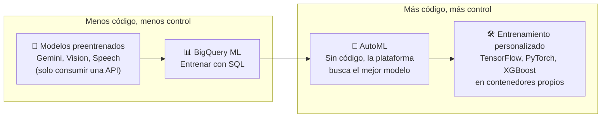
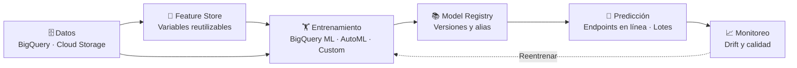
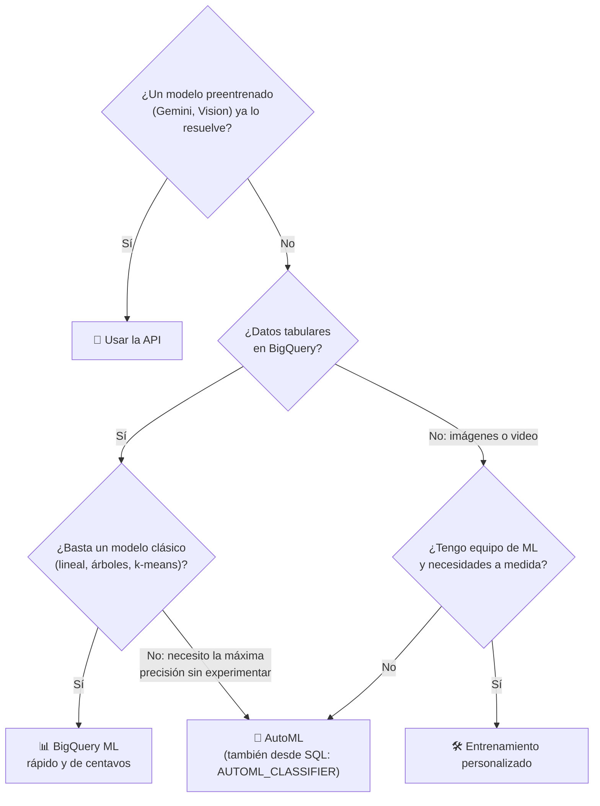
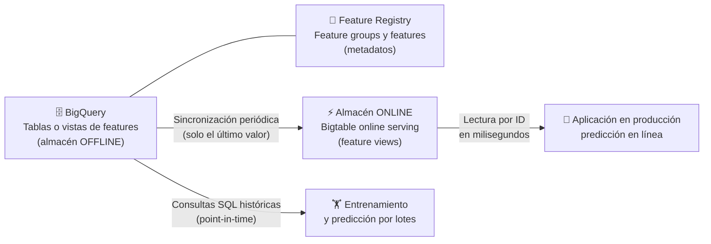

# Playbook 11: Machine Learning Integrado — BigQuery ML, AutoML y Feature Store en Vertex AI

## 1. Introducción: Llevar el Modelo a los Datos

En los Módulos 09 y 10 construimos un Data Warehouse en BigQuery y lo alimentamos en tiempo real. El paso natural es **predecir**: qué cliente se irá, qué pago es fraude, cuánto venderemos el mes próximo.

El enfoque tradicional saca los datos del warehouse, los copia a un entorno de Python, entrena allí y vuelve a subir las predicciones. Cada copia agrega **latencia, costo, riesgo de seguridad** y una versión de los datos que deja de estar actualizada. Google Cloud propone lo contrario: **llevar el modelo a donde viven los datos**, y elegir el nivel de control según el problema.

| Opción | Quién la usa | Dónde están los datos | Esfuerzo | Costo típico |
| :--- | :--- | :--- | :--- | :--- |
| **Modelos preentrenados** | Cualquier desarrollador | En la petición a la API | Minutos | Por llamada o por token |
| **BigQuery ML** | Analistas e ingenieros de datos | En BigQuery | Horas | Por bytes procesados (centavos) |
| **AutoML** | Equipos sin científicos de datos | BigQuery, Cloud Storage o CSV | Horas, sin código | Por nodo-hora de entrenamiento (decenas de USD) |
| **Entrenamiento personalizado** | Científicos e ingenieros de ML | Donde el código los lea | Días o semanas | Por hora de máquina y aceleradores |

Este módulo cubre los dos del medio: **BigQuery ML** y **AutoML**, más el **Feature Store**, que resuelve un problema que aparece apenas un modelo llega a producción.

---

## 2. El Ecosistema Unificado de Vertex AI

**Vertex AI** es la plataforma de ML de Google Cloud que reúne en un solo lugar, con una sola API (`aiplatform.googleapis.com`), todo el ciclo de vida de un modelo. Antes de 2021 cada pieza era un producto separado (AI Platform, AutoML Tables, AutoML Vision…); Vertex AI las unificó.

> [!NOTE]
> **Cambio de nombre (abril de 2026):** en Google Cloud Next '26, Vertex AI pasó a llamarse **Gemini Enterprise Agent Platform**. En la consola y en la documentación nueva verás **"Agent Platform"**, pero la API, los comandos `gcloud ai` y muchos componentes (por ejemplo, "Vertex AI Model Registry") conservan el nombre anterior. En este curso usamos ambos nombres como sinónimos.

| Componente | Para qué sirve |
| :--- | :--- |
| **Datasets** | Registrar los datos de entrenamiento (tablas, imágenes, video) con su esquema y etiquetas |
| **Training** | Entrenar con AutoML o con código propio (*custom training*) en máquinas administradas |
| **Model Registry** | Catálogo central de modelos con **versiones**, **alias** (`default`, `produccion`) y linaje |
| **Endpoints** | Servir un modelo como API REST de baja latencia (cobra por hora mientras está desplegado) |
| **Batch Prediction** | Predecir sobre millones de filas de una vez, sin endpoint permanente |
| **Feature Store** | Gestionar variables predictivas compartidas entre entrenamiento e inferencia |
| **Pipelines** | Orquestar el flujo completo (preparar → entrenar → evaluar → registrar) de forma reproducible |
| **Experiments y Model Monitoring** | Comparar ejecuciones y detectar cuando los datos reales se alejan de los de entrenamiento (*drift*) |
| **Workbench / Colab Enterprise** | Notebooks administrados para explorar y prototipar |
| **Model Garden** | Catálogo de modelos fundacionales (Gemini y modelos abiertos) listos para usar o ajustar |

### 2.1. Model Registry: El Punto de Encuentro
El **Model Registry** es lo que hace "unificado" al ecosistema: un modelo entrenado con SQL en BigQuery, uno de AutoML y uno de PyTorch quedan **en el mismo catálogo**, con la misma gestión de versiones y el mismo camino a producción.

- **Versiones**: cada reentrenamiento con el mismo ID de modelo crea una versión nueva (1, 2, 3…); las anteriores se conservan para comparar o volver atrás.
- **Alias**: nombres móviles que apuntan a una versión. `default` es la que se usa si no se pide una en concreto. Promover un modelo a producción es **mover un alias**, no cambiar el código de quien lo consume.
- **Integración con BigQuery ML**: basta con `MODEL_REGISTRY = 'VERTEX_AI'` en el `CREATE MODEL`. Desde el Registry el modelo se puede desplegar en un endpoint sin reentrenarlo.

> [!WARNING]
> Un modelo de BigQuery ML registrado **se borra desde BigQuery ML**: al borrar el modelo con `bq rm -m` o `DROP MODEL`, su versión desaparece del Registry. Si en cambio se borra **el dataset completo**, la versión puede quedar **huérfana** en el Registry y Vertex AI rechaza borrarla (*"BQML model can not be deleted from Vertex, delete it from BQML"*). Borra siempre los modelos antes que el dataset.

---

## 3. BigQuery ML: Machine Learning con SQL

**BigQuery ML (BQML)** permite crear, evaluar y usar modelos con sentencias SQL estándar. Sus ventajas:
- **Los datos no se mueven**: se entrena donde ya están, con la seguridad y la gobernanza de BigQuery (IAM, vistas autorizadas, auditoría).
- **El equipo ya sabe SQL**: un analista puede entrenar un modelo sin aprender Python ni administrar servidores.
- **Escala sola**: el entrenamiento usa los mismos *slots* que las consultas (Módulo 09).

### 3.1. Tipos de Modelos

| Problema | Pregunta de negocio | Tipos de modelo (`model_type`) |
| :--- | :--- | :--- |
| **Regresión** | ¿Cuánto? (precio, demanda, tiempo de entrega) | `LINEAR_REG`, `BOOSTED_TREE_REGRESSOR`, `RANDOM_FOREST_REGRESSOR`, `DNN_REGRESSOR`, `AUTOML_REGRESSOR` |
| **Clasificación** | ¿Cuál categoría? (fraude sí/no, abandono, segmento) | `LOGISTIC_REG`, `BOOSTED_TREE_CLASSIFIER`, `RANDOM_FOREST_CLASSIFIER`, `DNN_CLASSIFIER`, `AUTOML_CLASSIFIER` |
| **Clustering** | ¿Qué grupos naturales existen? (segmentación de clientes) | `KMEANS` |
| **Series de tiempo** | ¿Qué pasará en las próximas semanas? | `ARIMA_PLUS`, `ARIMA_PLUS_XREG` y el modelo preentrenado TimesFM |
| **Recomendación** | ¿Qué producto le interesa a este usuario? | `MATRIX_FACTORIZATION` |
| **Reducción y anomalías** | ¿Qué es raro? ¿Cómo resumir 100 columnas? | `PCA`, `AUTOENCODER` |
| **Modelos remotos** | Generar texto, resumir, clasificar con LLM | Gemini y otros modelos de Vertex AI vía `REMOTE WITH CONNECTION` |

En los problemas **supervisados** (regresión y clasificación) el modelo aprende de ejemplos con la respuesta conocida (la **etiqueta**, `input_label_cols`). En los **no supervisados** (clustering, anomalías) no hay respuesta: el modelo encuentra estructura por sí mismo.

### 3.2. Modelos Internos vs. Externos
- **Internos** (lineales, logísticos, k-means, PCA, ARIMA): se entrenan **dentro de BigQuery**. Son rápidos y se cobran por bytes procesados.
- **Externos** (árboles potenciados, bosques aleatorios, DNN, AutoML): BigQuery ML los entrena **en Vertex AI** por ti. Se cobran los bytes de BigQuery **más** el cómputo de entrenamiento en Vertex AI, por lo que son notablemente más caros y lentos.

### 3.3. El Ciclo de Vida en SQL

| Etapa | Función | Qué devuelve |
| :--- | :--- | :--- |
| Entrenar | `CREATE MODEL ... OPTIONS(...) AS SELECT ...` | El modelo, como un objeto más del dataset |
| Evaluar | `ML.EVALUATE` | Métricas sobre datos de evaluación o de prueba |
| Diagnosticar | `ML.CONFUSION_MATRIX`, `ML.ROC_CURVE`, `ML.TRAINING_INFO` | Errores por clase, curva ROC, pérdida por iteración |
| Inspeccionar | `ML.WEIGHTS`, `ML.CENTROIDS`, `ML.FEATURE_INFO` | Coeficientes, centros de grupos, estadísticas de las variables |
| Predecir | `ML.PREDICT` | La tabla de entrada con columnas `predicted_*` |
| Explicar | `ML.EXPLAIN_PREDICT`, `ML.GLOBAL_EXPLAIN` | Contribución de cada variable a una predicción o al modelo completo |
| Exportar o registrar | `EXPORT MODEL`, `MODEL_REGISTRY = 'VERTEX_AI'` | El modelo en Cloud Storage o en el Model Registry |

### 3.4. Preparar los Datos: División y Preprocesamiento
- **División entrenamiento/prueba**: un modelo se evalúa con datos que **no vio**. BigQuery ML separa una parte automáticamente (`AUTO_SPLIT`), pero para comparar versiones de forma justa conviene una división propia y **reproducible**, por ejemplo con `FARM_FINGERPRINT` sobre cada fila, y entrenar con `data_split_method = 'NO_SPLIT'`.
- **Preprocesamiento automático**: BigQuery ML convierte sola las columnas de texto en variables numéricas (*one-hot encoding*), estandariza los números e imputa los nulos.
- **`TRANSFORM`**: cuando necesitas transformaciones propias (agrupar edades en rangos, escalar, combinar columnas), escríbelas en la cláusula `TRANSFORM`. Quedan **guardadas dentro del modelo** y se aplican igual en `ML.PREDICT`: quien consume el modelo le pasa los datos crudos. Es una protección directa contra el *training-serving skew* (sección 5).

### 3.5. Elegir la Métrica Correcta

| Tipo | Métrica | Cómo leerla |
| :--- | :--- | :--- |
| **Regresión** | **MAE** (error absoluto medio) | Error promedio en las unidades del problema ("±230 g") |
| | **R²** | Proporción de la variación explicada (1.0 = perfecto, 0 = no mejor que el promedio) |
| **Clasificación** | **Precisión** | De lo que el modelo marcó como positivo, cuánto lo era |
| | **Recall** | De todos los positivos reales, cuántos encontró |
| | **AUC** | Capacidad de ordenar por probabilidad (0.5 = azar, 1.0 = perfecto), independiente del umbral |
| **Clustering** | **Índice Davies-Bouldin** | Qué tan compactos y separados son los grupos (menor es mejor) |

> [!TIP]
> **Cuidado con la exactitud (*accuracy*) en clases desbalanceadas.** Si solo el 2% de los pagos es fraude, un modelo que siempre responda "no es fraude" tiene 98% de exactitud y es inútil. Mira precisión, recall y AUC, y ajusta el **umbral** de decisión (`STRUCT(0.3 AS threshold)`) según qué error le cuesta más al negocio.

### 3.6. Costos de BigQuery ML (On-Demand, Multirregión US)

| Operación | Precio de referencia |
| :--- | :--- |
| Entrenar modelos **internos** (lineal, logístico, k-means, PCA, ARIMA) | **$312.50 por TiB** procesado |
| Entrenar modelos **externos** (árboles, DNN, AutoML) | $6.25 por TiB **+ el costo del entrenamiento en Vertex AI** |
| Evaluar, inspeccionar y predecir | $6.25 por TiB (comparte el **1 TiB gratis** mensual de consultas) |

Como en cualquier consulta, se factura un **mínimo de 10 MB** por consulta. Entrenar es 50 veces más caro por byte que consultar: **muestrea y selecciona solo las columnas útiles** antes de entrenar sobre tablas grandes. Con Editions (Módulo 09), el entrenamiento consume slots de la reservación en lugar de bytes.

---

## 4. AutoML: Entrenamiento sin Código

**AutoML** automatiza el trabajo de un científico de datos: analiza las columnas, elige transformaciones, prueba muchas arquitecturas e hiperparámetros, combina los mejores candidatos (*ensembles*) y entrega un modelo evaluado, todo desde un asistente en la consola.

### 4.1. Modalidades

| Tipo de dato | Objetivos | Estado |
| :--- | :--- | :--- |
| **Tabular** | Clasificación, regresión y pronóstico (*forecasting*) | Disponible |
| **Imagen** | Clasificación (una o varias etiquetas) y detección de objetos | Disponible |
| **Video** | Clasificación, reconocimiento de acciones y seguimiento de objetos | Disponible |
| **Texto** | Clasificación, extracción de entidades y sentimiento | **Deprecado**: desde el 15 de septiembre de 2024 ya no se pueden entrenar modelos nuevos; los existentes se pudieron usar hasta el 15 de junio de 2025 |

> [!NOTE]
> **¿Qué reemplazó a AutoML para texto?** Los modelos fundacionales: **Gemini** resuelve clasificación, extracción y sentimiento con un *prompt* (sin entrenar) o con **ajuste supervisado** (*supervised fine-tuning*) cuando se necesita más precisión. Google publica una guía de migración de AutoML Text a Gemini.

### 4.2. Cómo se Cobra: El Presupuesto en Nodo-Horas
AutoML no cobra por bytes sino por **nodo-hora de entrenamiento**. Al configurar el entrenamiento defines un **presupuesto máximo** de horas; AutoML puede detenerse antes si deja de mejorar (*early stopping*).

| AutoML | Entrenamiento (precio de referencia) |
| :--- | :--- |
| Tabular (clasificación y regresión) | **$21.252 por nodo-hora** |
| Imagen (clasificación y detección de objetos) | $3.465 por nodo-hora |

Google sugiere, para datos tabulares, **de 1 a 3 horas para menos de 100,000 filas** y hasta 24 horas para más de 10 millones. A eso se suma la **predicción**: un endpoint desplegado cobra por hora mientras exista, aunque no reciba peticiones.

### 4.3. ¿BigQuery ML, AutoML o Código Propio?

Una estrategia común es **empezar con BigQuery ML** para tener una línea base en minutos y por centavos, y solo invertir en AutoML o en código propio si la mejora justifica el costo.

---

## 5. Feature Store: Variables Predictivas Centralizadas

### 5.1. El Problema que Resuelve
Un **feature** (variable predictiva) es un dato calculado que alimenta al modelo: "número de compras del cliente en los últimos 30 días", "monto promedio de sus pagos", "días desde su último inicio de sesión". Cuando una empresa tiene varios modelos, aparecen tres problemas:

1. **Duplicación**: el equipo de fraude y el de marketing calculan "compras de los últimos 30 días" cada uno a su manera, con resultados distintos.
2. ***Training-serving skew***: el modelo se entrenó con el feature calculado en SQL sobre el warehouse, pero en producción la aplicación lo calcula en Java con otra lógica. El modelo recibe datos distintos a los que aprendió y **se degrada en silencio**.
3. **Fuga de datos (*data leakage*)**: para entrenar con el historial hay que usar el valor del feature **tal como era en ese momento**, no el de hoy. Si para predecir un abandono de marzo se usa la actividad de abril, el modelo "ve el futuro" y sus métricas de entrenamiento son mentira.

Un **Feature Store** es un repositorio central donde los features se **definen una vez**, se documentan, se reutilizan y se sirven **con la misma definición** tanto para entrenar como para predecir.

### 5.2. Arquitectura en Google Cloud
El Feature Store actual de Vertex AI (**Agent Platform Feature Store**) **no copia** los datos a un almacenamiento propio: usa **BigQuery como almacén offline** y sincroniza a un **almacén online** solo lo que necesita latencia baja.

| Concepto | Qué es |
| :--- | :--- |
| **Feature group** | Registro asociado a una tabla o vista de BigQuery, con la columna de **ID de entidad** (cliente, tarjeta, producto) y, si hay historial, la columna de **tiempo** |
| **Feature** | Una columna concreta del feature group, documentada y reutilizable |
| **Online store** | Instancia de baja latencia; hoy el tipo recomendado es **Bigtable online serving**, pensado para grandes volúmenes |
| **Feature view** | Colección de features que se materializa desde BigQuery en el online store y se **refresca periódicamente** |

> [!NOTE]
> El tipo **Optimized online serving** (latencia ultrabaja y embeddings) está **deprecado**: desde el 17 de mayo de 2026 solo recibe parches críticos y el **17 de febrero de 2027** dejará de estar disponible. Google recomienda migrar a Bigtable online serving o a **Vector Search** para embeddings.

### 5.3. Offline vs. Online, con Ejemplos

| | **Offline (BigQuery)** | **Online (Bigtable)** |
| :--- | :--- | :--- |
| **Para qué** | Entrenar modelos y predecir por lotes | Predecir en tiempo real dentro de una aplicación |
| **Qué guarda** | **Todo el historial** de valores con su marca de tiempo | Solo el **último valor** de cada entidad |
| **Cómo se lee** | SQL sobre millones de filas | Por ID de entidad, una o pocas filas |
| **Latencia** | Segundos a minutos | Milisegundos |
| **Costo** | Almacenamiento y consultas de BigQuery | **Nodos siempre encendidos**, se cobran por hora aunque no haya tráfico |

**Ejemplo 1 — Offline: entrenar un modelo de abandono de clientes.**
El equipo quiere predecir qué clientes cancelarán su suscripción. Para cada cancelación ocurrida el 15 de marzo necesita los features **como estaban el 14 de marzo**: compras de los últimos 30 días, tickets de soporte abiertos, días desde el último inicio de sesión. Con el historial en BigQuery, una consulta de tipo ***point-in-time*** une cada evento con el último valor de cada feature **anterior** a su fecha. El resultado es una tabla de entrenamiento sin fuga de datos, que puede alimentar un `CREATE MODEL` de BigQuery ML o un entrenamiento de AutoML. Por las noches, el mismo almacén offline alimenta la **predicción por lotes** de todos los clientes.

**Ejemplo 2 — Online: detectar fraude en el momento del pago.**
Retomando el Módulo 10: cuando llega un pago, la API de pagos tiene **menos de 100 ms** para aprobarlo o bloquearlo. No puede lanzar una consulta de BigQuery. En su lugar, lee del almacén online, por el ID de la tarjeta, features como "número de pagos en la última hora", "monto promedio de los últimos 30 días" y "país habitual", y se los pasa al modelo junto con los datos del pago actual. Esos features se calculan en BigQuery (o en un pipeline de Dataflow) y se sincronizan al online store: **la misma definición** sirve para entrenar y para predecir, y desaparece el *training-serving skew*.

**Ejemplo 3 — Ambos: recomendaciones en una tienda en línea.**
El modelo de recomendación se **entrena** con meses de historial de navegación (offline). Cuando un usuario abre la aplicación, el servicio lee **en milisegundos** sus categorías favoritas y sus últimas vistas (online) para elegir qué mostrarle.

### 5.4. ¿Cuándo Vale la Pena un Feature Store?

| Situación | ¿Feature Store? |
| :--- | :--- |
| Un solo modelo, predicciones por lotes, todo en BigQuery | **No**: basta con tablas o vistas bien documentadas y `TRANSFORM` en BigQuery ML |
| Varios equipos y modelos que reutilizan los mismos features | **Sí**: el **registro** evita duplicaciones y diferencias de definición |
| Predicción en línea con latencia de milisegundos | **Sí**: el **almacén online** es la pieza clave |
| Presupuesto muy ajustado y tráfico esporádico | Evaluar con cuidado: los nodos online cobran por hora aunque no se usen |

> [!TIP]
> Antes de un Feature Store, aplica la misma idea en pequeño: define los features **una sola vez** en vistas de BigQuery y pon las transformaciones dentro del modelo con **`TRANSFORM`**. Es lo que haremos en el laboratorio.

---

## 6. Costos (FinOps)

| Recurso | Cómo se cobra | Palanca de ahorro |
| :--- | :--- | :--- |
| **BigQuery ML: modelos internos** | $312.50 por TiB procesado al entrenar | Muestrear, seleccionar columnas, entrenar sobre tablas particionadas filtradas |
| **BigQuery ML: modelos externos** | Bytes de BigQuery + entrenamiento en Vertex AI | Empezar con un modelo interno como línea base |
| **AutoML tabular** | $21.252 por nodo-hora de entrenamiento | Presupuesto mínimo razonable y *early stopping*; probar primero con BigQuery ML |
| **Endpoints de predicción** | Por hora de nodo desplegado, haya o no tráfico | Usar **predicción por lotes** o `ML.PREDICT` cuando no se necesita tiempo real; replegar (*undeploy*) los endpoints sin uso |
| **Feature Store online** | Por hora de nodo del online store | Sincronizar solo los features que se sirven en línea; el resto queda offline en BigQuery |
| **Model Registry** | La página de precios no lista un cargo por registrar; el costo aparece al **desplegar** o predecir | Borrar versiones que ya no se usan |

> [!WARNING]
> El error de costos más frecuente en ML no es el entrenamiento, que termina solo, sino los recursos **que se quedan encendidos**: endpoints desplegados y nodos del Feature Store online cobran **cada hora** aunque nadie los use.

---

## 7. Referencias Oficiales

- **Introducción a Vertex AI (Agent Platform)**: [https://docs.cloud.google.com/vertex-ai/docs/start/introduction-unified-platform](https://docs.cloud.google.com/vertex-ai/docs/start/introduction-unified-platform)
- **Introducción a BigQuery ML**: [https://docs.cloud.google.com/bigquery/docs/bqml-introduction](https://docs.cloud.google.com/bigquery/docs/bqml-introduction)
- **Sentencia `CREATE MODEL`**: [https://docs.cloud.google.com/bigquery/docs/reference/standard-sql/bigqueryml-syntax-create](https://docs.cloud.google.com/bigquery/docs/reference/standard-sql/bigqueryml-syntax-create)
- **Cláusula `TRANSFORM`**: [https://docs.cloud.google.com/bigquery/docs/bigqueryml-transform](https://docs.cloud.google.com/bigquery/docs/bigqueryml-transform)
- **Explicabilidad en BigQuery ML**: [https://docs.cloud.google.com/bigquery/docs/xai-overview](https://docs.cloud.google.com/bigquery/docs/xai-overview)
- **Gestionar Modelos de BigQuery ML en el Model Registry**: [https://docs.cloud.google.com/bigquery/docs/managing-models-vertex](https://docs.cloud.google.com/bigquery/docs/managing-models-vertex)
- **Entrenar un Modelo AutoML Tabular**: [https://docs.cloud.google.com/vertex-ai/docs/tabular-data/classification-regression/train-model](https://docs.cloud.google.com/vertex-ai/docs/tabular-data/classification-regression/train-model)
- **Deprecaciones de Vertex AI (AutoML Text)**: [https://docs.cloud.google.com/vertex-ai/docs/deprecations](https://docs.cloud.google.com/vertex-ai/docs/deprecations)
- **Migrar de AutoML Text a Gemini**: [https://docs.cloud.google.com/vertex-ai/docs/start/automl-gemini-comparison](https://docs.cloud.google.com/vertex-ai/docs/start/automl-gemini-comparison)
- **Feature Store: Visión General**: [https://docs.cloud.google.com/vertex-ai/docs/featurestore/latest/overview](https://docs.cloud.google.com/vertex-ai/docs/featurestore/latest/overview)
- **Precios de BigQuery ML**: [https://cloud.google.com/bigquery/pricing#bqml](https://cloud.google.com/bigquery/pricing#bqml)
- **Precios de Vertex AI (Agent Platform)**: [https://cloud.google.com/vertex-ai/pricing](https://cloud.google.com/vertex-ai/pricing)
